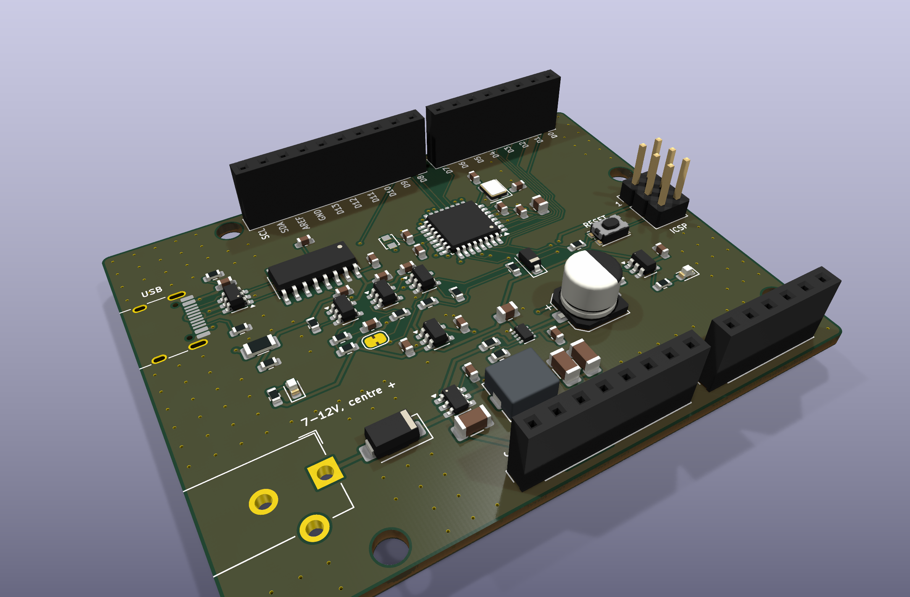
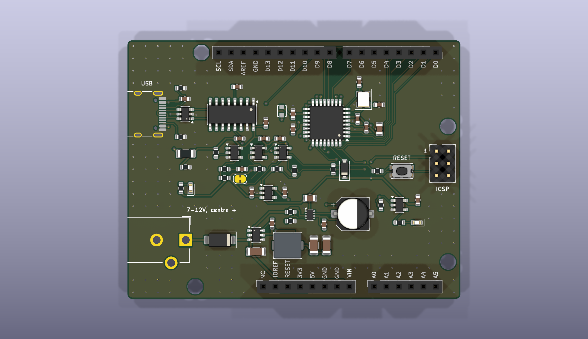
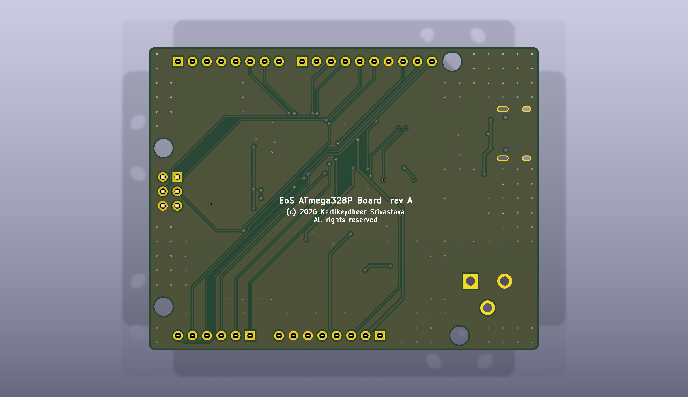

# EoS ATmega328P Board

An ATmega328P development board that fits Uno R3 shields, 68.58 × 53.34 mm, two layers.
Designed by Kartikeydheer Srivastava. All rights reserved: not open source, and not under this repository's MIT licence.
Anyone may view it, clone this repository and run its tests; anything more needs
Kartikeydheer Srivastava's written permission (kartikeydheer@gmail.com). EmbeddedOS (EoS) Research Foundation has a limited, revocable
permission. See [LICENSE.txt](LICENSE.txt) and [the licence summary](../README.md#licence).

A board for the same job as the Arduino UNO R3; an original design, not a copy: no design
file of Arduino's was used (no schematic, layout, Eagle or board file). The only Arduino
document read is the UNO R3 product reference manual, for its published mounting-hole
dimensions. "Arduino" and "UNO" are Arduino's names, used here only to say what the board fits; the EoS
ATmega328P Board is not an Arduino product.



| | |
|---|---|
|  |  |

The ATmega328P-AU runs at 16 MHz from 5 V. Power comes from USB-C or from a 7–12 V barrel
jack; a power mux picks the jack's 5 V whenever it is there and USB otherwise, and blocks
reverse current, so neither source feeds the other. A CH340C bridges USB to the UART and
resets the MCU from DTR, so sketches upload over USB the usual way.

## What is on it

| Block | What and why | Source |
|---|---|---|
| MCU | ATmega328P-AU, TQFP-32, 16 MHz from the 5 V rail (the speed grade runs linearly from 10 MHz at 2.7 V to 20 MHz at 4.5 V, so 16 MHz needs at least 3.78 V). 100 nF at each VCC/GND pair (pins 4/3, 6/5) and 10 µF bulk beside it. AVCC through 10 µH (Murata LQH2MCN100K02L, 225 mA, 1.2 Ω ±30 %, enough because AVCC also powers PC0–PC3) with 100 nF. 100 nF on AREF. ADC6 and ADC7 are not connected. | Microchip DS40002061B sections 1.1.7, 24.6.2 and Figure 24-9, 29.3; AN2519 sections 2.1, 2.2; Murata JELF243A-0053 |
| Crystal | ECS-160-12-33Q-JES-TR, 16 MHz, CL = 12 pF, ESR 80 Ω max, shunt capacitance C0 7 pF max, drive level 100 µW max; "JES" = ±20 ppm tolerance, ±50 ppm stability, −40 to +125 °C. ECS: "Crystal is symmetrical, pads 1 & 3 are interchangeable", so pad 1 takes XTAL1 and pad 3 XTAL2, and neither line crosses the other. AN2519 Equation 2: Ce = 2 CL − (Ci + Cs) = 24 pF − 6 pF = 18 pF, taking Ci + Cs = 6 pF per pin (AN2519 puts the stray at 2–5 pF; the pin adds a few). 18 pF (Yageo CC0603JRNPO9BN180, C0G) is inside the 12–22 pF the datasheet gives for 8–16 MHz crystals. If Ci + Cs is really 3–9 pF, the crystal sees 10.5–13.5 pF. | ECS ECX-33Q (Rev. 2023); AN2519 section 5.2; DS40002061B Tables 9-3 and 9-5 |
| Clock fuses | Burn them over ICSP before anything else: a new ATmega328P runs from its 8 MHz RC oscillator divided by 8 and ignores the crystal. Low fuse 0xFF: CKSEL3..0 = 1111 and SUT1..0 = 11 (low-power crystal oscillator, 8–16 MHz, 16K CK + 65 ms start-up), CKDIV8 unprogrammed. Never the full-swing oscillator (CKSEL 0111–0110): a rail-to-rail XTAL2 would push about 2π f (C0 + CL) × 1.77 V rms = 3.4 mA through the crystal, roughly 0.9 mW against its 100 µW. | DS40002061B sections 9.2.1, 9.3, 9.4, Tables 9-1, 9-3, 9-4, 28-9; ECS ECX-33Q |
| Reset | 10 kΩ pull-up (AN2519: 4.7 kΩ or more, 10 kΩ or more for debugWIRE), 1N4148W from RESET to 5 V (AN2519 recommends it when high-voltage programming is not used), reset button through 330 Ω (AN2519 Figure 3-2). No capacitor to GND: AN2519 calls it optional, and it stops debugWIRE. Auto-reset: DTR#, buffered, through 220 Ω, 100 nF and a solder jumper, JP1 (bridged as delivered); see the next rows. **For debugWIRE, cut JP1**: the datasheet says "Capacitors connected to the RESET pin must be disconnected" and "All external reset sources must be disconnected"; re-bridge it for auto-reset uploads. | AN2519 sections 3, 3.1; DS40002061B section 25.3; Diodes DS30086 |
| USB-UART | WCH CH340C, chosen over the CP2102N because it runs from 5 V with 5 V logic, so TXD, RXD and DTR# meet the ATmega328P at its own level, and it has a built-in clock (no crystal). It is bus-powered from VBUS after the polyfuse, so it runs only while a host supplies VBUS and its D+ pull-up is not powered without it. Its 5 V range is 4.0–5.3 V; USB 2.0 VBUS is 4.40–5.25 V, leaving at least 4.33 V after the fuse. 100 nF on VCC; 100 nF on V3, which is not tied to VCC at 5 V; UD+/UD− straight to the connector, as WCH asks; R232 to GND; unused MODEM inputs open. Any CH340C lot will do (next row). **USB current**: WCH's 4.7 kΩ pull-down on DTR#, which makes the CH340C ask the host for a larger supply current, is not fitted, because it would hold DTR# low at every plug-in and unplug and reset the MCU. So the CH340C asks for its default current; WCH does not state it for the CH340C (the CH340B's configuration table defaults to 31H, 98 mA). By USB 2.0 rules a board with power-hungry shields should then run from the jack; whether any host enforces it has not been tried. | WCH CH340 datasheet V3D sections 2–6; USB 2.0 section 7.3.2 |
| CH340C to MCU | The CH340C runs from VBUS and the MCU from the 5 V rail, which the jack can power alone. WCH allows no pin above VCC + 0.5 V and says a separately powered CH340 needs an anti-injection circuit unless it is a lot-4 CH340C, and lots cannot be ordered. So every line between the two goes through an Ioff-rated buffer powered from VBUS: SN74LVC1G17 Schmitt buffers U8 (D1 → RXD) and U9 (TXD → D0), and an SN74LVC1G07 open-drain buffer U10 (DTR# → auto-reset). Unpowered, each passes at most 10 µA (Ioff) on an input or output held at up to 5.5 V, so nothing on the 5 V side reaches the CH340C; a 10 kΩ bleeder on VBUS turns those leakages (U8's input, U9's and U10's outputs, at most 30 µA) into at most 0.3 V, under the 0.8 V vSafe0V a USB-C source checks before it applies VBUS. Levels: the LVC1G17 inputs accept 0–5.5 V at any VCC, VT+ ≤ 3.33 V and VT− ≥ 0.89 V, which both the MCU's and the CH340C's outputs (VOH ≥ VCC − 0.6 V = 3.73 V, VOL ≤ 0.5 V) clear; the outputs give VOH ≥ VCC − 0.1 V and VOL ≤ 0.1 V, so RXD reads low against its ≤ 300 µA pull-up and D0 reads high (VIH 0.6 VCC = 3.06 V at 5.1 V). U10's input (VIH 0.7 VCC, VIL 0.3 VCC) sees the CH340C's VOH ≥ 0.86 VCC and VOL ≤ 0.5 V. D0: 1 kΩ from U9 (a shield driving D0 fights at most 5 mA) and 10 kΩ to 5 V, which holds D0 high while U9 is unpowered (WCH suggests 2–22 kΩ); with U9 low, D0 = 0.56 V. D1: 100 kΩ to 5 V holds U8's input high while the MCU's TXD is tri-stated. | WCH CH340 V3D sections 6.1, 6.2, 7.7; TI SCES351Y sections 5.3, 5.5, 8.3; TI SCES296AG sections 5.3, 5.5, 7.1, 8.3; DS40002061B Table 30-1 |
| Auto-reset | U10 (open drain, on VUSB) → 220 Ω → 100 nF → JP1 → RESET. U10's output is pulled up to the MCU's own 5 V by 10 kΩ, and its input to VUSB by 100 kΩ, so it never floats while the CH340C resets. When DTR# falls, U10 sinks about 1.2 mA and RESET drops to VOL + (Vrail − VOL) × 220 Ω / (Rpu + 220 Ω), with Rpu = 10 kΩ in parallel with the MCU's own 30–60 kΩ pull-up. Worst case (rail 5.1 V from the jack, Rpu 7.5 kΩ, VOL 0.4 V, which TI guarantees at 16 mA): RESET falls to 0.53 V, under the 1.02 V (0.2 VCC) a reset needs, and stays below it for about 80 µs (C11 10 % low) against the 2.5 µs required; typically 0.2 V for 0.16 ms. The swing starts from the MCU's rail, not from VBUS, so a low VBUS costs no margin. **Unplugging USB while the jack powers the board does not reset the MCU**: as VUSB collapses, U10's input follows it (through the 100 kΩ and the CH340C's own DTR#), so its output stays off, and its input follows its own falling supply and, with VCC at 0 V, its Ioff circuit "disables the outputs" (SCES296AG 7.1); the 10 kΩ holds the capacitor's driven end at 5 V. 220 Ω holds the current through U10 to 23 mA when an ISP programmer drives RESET (U10's IOL is 32 mA); a reset-button press, or a programmer pulling RESET low, pushes that end below ground into U10's output clamp, at most 9 mA for about 55 µs (button) or 23 mA for about 22 µs (programmer), under its 50 mA clamp rating. | DS40002061B Tables 29-11, 30-1; TI SCES296AG sections 5.1, 5.3, 5.5, 7.1 |
| USB-C | 5 V sink: 5.1 kΩ on CC1 and CC2. USBLC6-2SC6 ESD protection on D+, D− and VBUS, with 100 nF on VBUS at the device, as ST's layout figure shows. A USBLC6-style part, with diodes from D+/D− to its VBUS pin, is safe here (unlike next to a CP2102N) because the CH340C senses no VBUS: it has no VBUS pin and is itself powered from VBUS, so its D+ pull-up dies with the host's VBUS and cannot hold VBUS up after an unplug. U1 is turned for ST's flow-through layout: each line runs in on one pin and out of the opposite one (D− 4 → 3, D+ 6 → 1). Littelfuse 1206L050YR polyfuse: 0.50 A hold, 1.00 A trip, 6 V, 0.15 Ω minimum, 0.70 Ω after tripping. | USB Type-C specification (Rd); ST DS4260 Rev 7 section 2.3, Figures 6 and 17; WCH CH340 V3D section 4; Littelfuse 1206L series |
| Barrel jack | Same Sky PJ-102AH (2.0 mm pin, connector rated 5 A). The board takes 7–12 V, centre positive. Below 7 V the buck drops out: a 5 V adapter leaves it near 4.6 V, inside the mux's 3.96–4.64 V switch-over band. Above 12 V nothing on the board clamps a hot-plug surge (the AP63205's absolute maximum is 35 V). A B240A Schottky (40 V, 2 A, VF 0.50 V at 2 A) blocks reverse polarity; after it the supply is VIN, which also reaches the VIN header pin. VIN is rated 1 A: D1 carries 2 A, but its 0.4 mm tracks carry about 1.2 A for a 10 °C rise (IPC-2221). | Same Sky PJ-102AH; Diodes DS13004; Diodes DS41326 absolute maximum ratings |
| 5 V from the jack | AP63205 synchronous buck (3.8–32 V in, 5.0 V, 2 A) with the values in its Table 3: 4.7 µH, 10 µF in, 2 × 22 µF out, 100 nF bootstrap; EN tied to VIN. Its high-side current limit is 2.5–3.1 A, so the inductor must not saturate below 3.1 A: Bourns SRP5030T-4R7M, 4.7 µH ±20 %, Isat 6.0 A, Irms 4.6 A, 53 mΩ max. The 0.3 mm 5 V tracks limit this path to about 1 A. A buck rather than a linear regulator: from 12 V, a linear 5 V regulator would burn 3.5 W at 0.5 A. | Diodes DS41326 Table 3, Electrical Characteristics (IPEAK_LIMIT); Bourns SRP5030T |
| Power selection | TI TPS2116 power mux in priority mode: MODE tied to VIN1 (the buck's 5 V), PR1 fed from VIN1 through 33 kΩ / 10 kΩ, so PR1 = 1.16 V at 5.0 V against VREF = 0.92–1.08 V. The jack's 5 V is used whenever it is above 4.3 V (3.96–4.64 V); otherwise USB. Reverse-current blocking means the jack never feeds USB and USB never feeds the buck, and 5 V fed into the 5V header pin reaches neither. 1 µF on VIN2; on the output, 10 µF ceramic at U3's VOUT pins plus 100 µF bulk (Panasonic EEE-FK1C101P) 5.3 mm of track from VOUT, as TI recommends where reverse blocking can occur ("a high output capacitance (about 100µF)" against spikes from the output inductance). | TI SLVSFG1A sections 7.3.1, 7.3.4, 7.6.1.1, 9 |
| 3.3 V | Diodes AP2112K-3.3 LDO (600 mA), 1 µF in and out, EN tied to its input, feeding the 3V3 header pin. At 184 °C/W, 250 mA from 5.0 V (0.43 W) keeps the junction at 125 °C only up to about 47 °C ambient (42 °C from 5.1 V); above that, draw less. **The 3V3 pin is an output: never feed it from a shield.** DS39724 gives the AP2112K no reverse-current protection, so 3.3 V fed in while the board is off would back-feed the 5 V rail through the LDO (Inferred). | Diodes DS39724 |
| LEDs | Power LED (green, Kingbright APTD1608LCGCK) on 5 V. "L" LED (yellow, APTD1608LSYCK) on D13, driven by a TI SN74LVC1G17 Schmitt buffer: D13 sees 4.5 pF, so it still works as SPI SCK. 100 kΩ holds the buffer input low while D13 is an input (TI: inputs must be held at VCC or GND); with D13's internal pull-up on, the pin still reads 3.3 V, above VIH. Both LEDs are specified at 2 mA: (5 V − 1.9 V) / 1.5 kΩ = 2.1 mA. | Kingbright DSAO7432, DSAO7434; TI SCES351Y sections 5.3, 8.3 |
| Shield headers | Uno R3 positions and pinout: digital D0–D7 (8-pin) and D8–D13, GND, AREF, SDA, SCL (10-pin, with the 160 mil step between D7 and D8); power NC, IOREF, RESET, 3V3, 5V, GND, GND, VIN; analog A0–A5. SDA and SCL are A4 and A5. IOREF is 5 V. | Positions: see Mechanical below |
| ICSP | 2 × 3 AVR ISP header (MISO, 5 V, SCK, MOSI, RESET, GND) at the Uno R3 ICSP position. | AN2519 section 4.1 |

| ATmega328P pin | Header pin |
|---|---|
| PD0–PD7 | D0–D7 (D0 from CH340C TXD through U9 and 1 kΩ, with a 10 kΩ pull-up; D1 to CH340C RXD through U8) |
| PB0–PB5 | D8–D13 (PB3/PB4/PB5 = MOSI/MISO/SCK, also on ICSP) |
| PC0–PC5 | A0–A5 (PC4/PC5 = SDA/SCL, also on the 10-pin header) |
| PC6 | RESET (power header, ICSP, button, DTR) |

### Mechanical

The outline is the Uno R3's 2700 × 2100 mil bounding box, 68.58 × 53.34 mm, as a rounded
rectangle: the Uno R3's chamfered right-hand corners are not copied, so a case moulded to that
exact outline may not fit, though shields do. Where each number comes from:

| Feature | Position (mil from the lower-left corner) | Source |
|---|---|---|
| Outline | 2700 × 2100 | Matthew Beckler, "Arduino Uno R3" dimension drawing v1.05 (Wayne and Layne, public domain) |
| Mounting holes, 3.2 mm | (600, 2000), (550, 100), (2600, 1400), (2600, 300) | Beckler drawing; Arduino UNO R3 product reference manual (A000066) section 5.4 gives the same mm figures and the 3.20 mm diameter, except the x of the lower-left hole, which it does not dimension |
| Digital headers | 10-pin from 740 and 8-pin from 1800, at y = 2000 | Beckler drawing, checked against KiCad 10's Module:Arduino_UNO_R3_WithMountingHoles footprint |
| Power and analog headers | 8-pin from 1100 and 6-pin from 2000, at y = 100 | as above |
| ICSP | pin 1 at (2505, 1200) | Beckler drawing |

The holes are unplated: they sit 2.54 mm from the edge, where a plated ring would reach it.
On any board with the R3 pinout the 10-pin socket ends 0.69 mm from the top-left hole's edge,
so a screw head on top there hits the socket; that hole (H1) is placed from the back, where
its standoff goes.

**The barrel jack is a shield-compatibility exception.** The drawings put the Uno R3's jack at
−75 to 450 mil across and 125 to 475 mil up, which is 41.3–50.2 mm from the top edge here.
Every horizontal 5.5 mm jack in KiCad's library is 14–16 mm long, against the Uno R3's 13.3 mm.
At the Uno R3's height the PJ-102AH's body would cover hole H2, or would have to overhang the edge
by about 5 mm. Instead it sits as low as H2's screw head allows: body 36.2–47.7 mm from the top
edge, about 4 mm higher, over the same x. It overhangs the left edge by about 2 mm, as the
Uno R3's does. Check a shield that has parts on its underside over x < 14 mm, 36–41 mm from the
top edge. The USB-C receptacle sits on the left edge with its shell standing proud of the board,
as HRO's recommended layout for the TYPE-C-31-M-12 shows, its origin at the generator's
`USB_C_EDGE` (5.79 mm from its locating pegs to the edge).

### Layout

The autorouter gives a different result on every run, so the lines that matter are laid first,
as priority routes, all on the top layer. Measured on the placed board (by script; the full build
lays the same routes before routing the rest):

| Lines | Path | Length | Vias |
|---|---|---|---|
| XTAL1 | MCU pin 7 → crystal pad 1 → C17 | 5.00 + 1.59 mm | 0 |
| XTAL2 | MCU pin 8 → crystal pad 3 → C18 | 4.17 + 1.70 mm | 0 |
| MCU decoupling | pin 6 → C12, pin 5 → C12's GND; pin 4 → C13, pin 3 → C13's GND | 1.90, 1.85; 4.44, 4.27 mm | 0 |
| USB D− | B7 → U1 pin 4 → pin 3 → CH340C UD− | 3.35 + 2.25 + 7.33 mm | 0 |
| USB D+ | B6 → U1 pin 6 → pin 1 → CH340C UD+ | 3.35 + 2.25 + 9.38 mm | 0 |
| USB ties | A6 → B6 behind the pad row; A7 → B7 | 2.66 mm; 1.96 mm | 0 |
| CH340C decoupling | VCC → C9; V3 → C10 | 2.55; 2.90 mm | 0 |
| D4 … D0 | MCU → digital header, round the right of the crystal | 25.55 to 35.14 mm | 0 |
| 5 V at the MCU | C14 (10 µF bulk) → C13 (100 nF at VCC) | 2.83 mm | 0 |
| 5 V bulk | TPS2116 VOUT → C6 (100 µF) | 5.30 mm | 0 |

- **Crystal.** Each load capacitor sits beside its own crystal pad, each line runs pin → crystal
  pad → capacitor, and top-layer keep-outs around the crystal and its capacitors keep other
  tracks out, so the top pour surrounds them (AN2519 section 5.6). On the placed board nothing
  but XTAL1, XTAL2 and 0.7 mm of a 5 V decoupling track lies on the top layer within the
  crystal block. D0–D4, which the autorouter used to run diagonally under the crystal on the
  bottom layer, are now laid on top round its right-hand side. The generator's keep-outs are
  top-layer only, so whether another line (the ICSP lines D11–D13 must cross D0–D4 somewhere,
  on the bottom layer) passes under the crystal can be checked only on the routed board.
- **USB.** The receptacle repeats each data contact in the order B7 (D−), A6 (D+), A7 (D−),
  B6 (D+), so the two ties cross each other. A6 joins B6 behind the pad row; A7 joins B7 with a
  loop about 0.3 mm in front of A6's pad end: 1.6 mm of D− track inside the receptacle's body
  outline, its nearest copper 6.1 mm from the board edge, the pattern of EoS TM4C123 Board. No
  D+ track lies inside the outline. Taking that tie behind the
  pads too needs a via pair, and at 0.5 mm pitch the other tie leaves no room for one.
- **No top-layer track under the MCU**, and none between the buck inductor's pads.

The front silkscreen names every shield-header pin, the jack's 7–12 V centre-positive input,
the ICSP header and its pin 1, the reset button and the USB port.

## Not on this board

- **No ATmega16U2 USB bridge.** The Uno R3 uses a second microcontroller running its own
  firmware as the USB bridge. A CH340C does the same job without firmware to maintain; it
  cannot act as a USB HID device the way a reprogrammed 16U2 can.
- **No TX and RX LEDs.** The CH340C has no LED outputs, and buffering the UART lines for two
  LEDs was left out.
- **No USB-B connector.** USB-C instead.
- **No 6-pin ICSP header for the USB bridge.** The CH340C is not programmable.
- **No linear 5 V regulator.** A buck instead (see above).
- **No series resistors on the ICSP lines.** AN2519 section 4.1.1 suggests 330 Ω when other
  devices share the SPI lines; here the shield headers share D11–D13 directly, as shields
  expect. Remove a shield that drives SPI before programming over ICSP.

## Build results

The numbers below are from `build-report.json` and `drc.json` in this folder.

| Check | Result |
|---|---|
| Schematic ERC | 0 violations |
| DRC errors | 0 |
| Unconnected items | 0 |
| Schematic ↔ board parity | 0 differences |
| DRC warnings | 4: silkscreen within the board-edge clearance, the outline of J1 (USB-C) and J2 (7-12V), which sit at the board edge |

## Fabrication

2 layers, 1.6 mm thick, ground poured on both sides. Design rules (from the design file and
the generator's defaults; the routed board is not measured here):

- **Tracks:** 0.15 mm signals, 0.2 mm USB D+/D−, 0.3 mm on the 5 V nets, 3.3 V and AVCC
  (AVCC also powers PC0–PC3's drivers; the TPS2116's 0.5 mm-pitch pads limit the class), 0.4 mm
  on VBUS, the jack input, VIN and the buck switch node. Where the router necks a track down
  to enter a fine-pitch pad, the build widens it to 0.127 mm, the design's minimum.
- **Clearance:** 0.15 mm.
- **Vias:** 0.6 mm with a 0.3 mm drill.
- **Smallest drill:** 0.3 mm (vias). The USB-C shell slots are 0.6 mm wide; header pins
  1.0 mm; barrel jack 1.6 mm; mounting holes 3.2 mm, unplated.

## What has not been done

- **No board has been made or tested.** Only KiCad's checks have been run on the design.
- **No firmware or bootloader is included or tested.** A serial bootloader such as Optiboot
  should work through the CH340C and DTR auto-reset, but none has been run on this board.
- **The crystal load is an estimate.** The ATmega328P datasheet does not give the XTAL pin
  capacitance; Ci + Cs = 6 pF is assumed, as above.
- **Two parts' figures come from distributor listings, not the maker's PDF.** The Panasonic
  EEE-FK1C101P (100 µF) and the in-production status of the Murata LQH2MCN100K02L; Murata's
  own specification (JELF243A-0053) gives the electrical figures.
- **The isolation buffers' leakage path is assumed.** TI gives Ioff (at most 10 µA per pin
  with VCC at 0 V) but not where that current goes; the 10 kΩ VBUS bleeder assumes the worst
  case, all of it into VBUS.
- **CH340C temperature range.** WCH rates the CH340C for −20 to 70 °C.
- **Auto-reset and unplug not measured.** The RESET pulse and the absence of a reset when USB
  is unplugged under jack power are calculated from the datasheets. Scope RESET on a built
  board while opening the serial port and while unplugging USB, at 0 °C and 50 °C.
- **Oscillator margin unknown.** The crystal's critical transconductance is
  4 ESR (2π f)² (C0 + CL)² = 1.2 mA/V; Microchip gives no figure for the oscillator, and the
  low-power oscillator's swing, so the crystal's drive level, is not stated either. Run a
  negative-resistance start-up test (a resistor of a few times the ESR in series with the
  crystal) and measure the drive level on the first boards.
- **Upload speed.** At 16 MHz and 115.2 kbaud (U2X) the AVR runs 2.1 % fast (DS40002061B Table
  20-7). With the CH340C's internal clock (±1.2 % from −5 to 55 °C, ±1.8 % from −25 to 75 °C;
  WCH V3D section 6.4) the worst-case mismatch is 3.3 % or 3.9 %, inside Table 20-3's maximum
  total error (+3.90 / −4.00 % for 8 data bits) but above its recommended ±1.5 %. A bootloader
  built for this board should use 57.6 kbaud (−0.8 %) or 76.8 kbaud (+0.2 %). The CH340C's own
  rounding at each rate is not published.
- **Ground vias near the MCU and the buck capacitors** are left to the generator's stitching
  (the design file cannot place vias); check them on the routed board.
- **MPNs.** The 18 pF load capacitors (Yageo CC0603JRNPO9BN180) and the ICSP header (Samtec
  TSW-103-07-G-D, unshrouded, so a shield taking SPI there still mates) are named. The other
  resistors and ceramic capacitors are not: the X5R parts (C1, C3, C4, C14, C20) should be
  chosen against their DC-bias curves, which has not been done.

## Rebuild

```
python3 tools/eos_boards/build.py eos_atmega328p_board
```

The design file is [tools/eos_boards/boards/eos_atmega328p_board.py](../../../tools/eos_boards/boards/eos_atmega328p_board.py).
