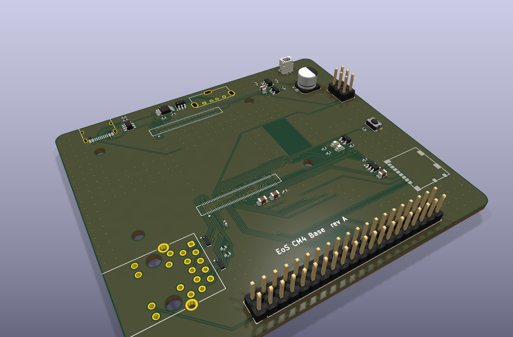
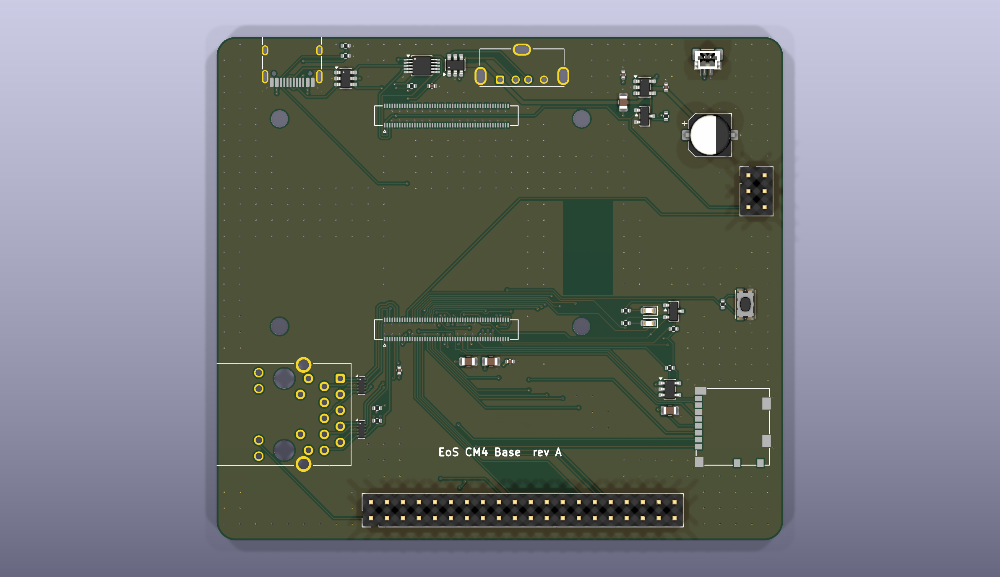
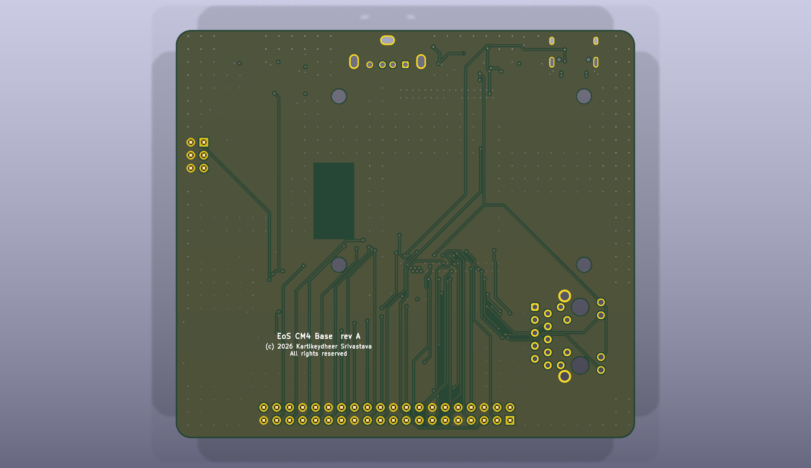

# EoS CM4 Base

A carrier board for the Raspberry Pi Compute Module 4, 90 × 80 mm, four layers. Designed by
Kartikeydheer Srivastava. All rights reserved: not open source, and not under this repository's MIT licence.
Anyone may view it, clone this repository and run its tests; anything more needs
Kartikeydheer Srivastava's written permission (kartikeydheer@gmail.com). EmbeddedOS (EoS) Research Foundation has a limited, revocable
permission. See [LICENSE.txt](LICENSE.txt) and [the licence summary](../README.md#licence).

A board for the same job as Raspberry Pi's CM4 IO Board; an original design, not a copy: no file
of the CM4 IO Board was used. It is EoS CM5 Base's layout, changed where the CM4 differs. The
connector and hole positions are facts taken from the CM5 footprint that Raspberry Pi publishes
for carrier designs (the CM5 IO Board datasheet says it may be used in your own designs). They
are cross-checked against the dimensions in the CM4 datasheet's Figure 4.



| | |
|---|---|
|  |  |

## The module fits, to the nanometre

The CM4 plugs in through two 100-pin Hirose DF40C-100DS-0.4V connectors, giving 1.5 mm
stacking (CM4 datasheet, section 3.1).

**Where the connectors and holes go.** Figure 4 of the CM4 datasheet and Figure 4 of the CM5
datasheet show the same module:
- the same 55 × 40 mm outline;
- M2.5 holes inset 3.5 mm;
- connectors 3 mm from the long edges;
- the same wireless cut-out.

The CM5 datasheet (section 1.2) also says CM5 fits existing CM4 carrier boards. So the connector
pads and holes sit where `tools/eos_boards/reference/cm5_carrier.json` puts them. That file holds
facts from the CM5 footprint that Raspberry Pi publishes for carriers. A test also places the
holes and connector centres from Figure 4's own dimensions and checks they land in the same
spots.

**Which net each pin carries** comes from the CM4 datasheet's pinout (section 4). It is recorded
in `tools/eos_boards/reference/cm4_pins.json` by `extract_cm4.py`, with the datasheet's SHA-256.

`tests/unit/test_eos_boards.py` checks, at KiCad's 1 nm resolution:
- all 200 pads and the four holes;
- every ground, 5 V, 3.3 V and GPIO pin's net;
- that HDMI, camera, display, PCIe, 1.8 V and reserved pins stay unconnected.

## What is on it

| Block | How |
|---|---|
| Power in | **USB-C, 5 V / 3 A.** VBUS feeds the module's six +5V pins (4.75–5.25 V). The CM4 draws about 1.4 A when running (datasheet section 5.3), plus the USB-A port (0.5 A), the 3.3 V loads and the fan, so use a 5 V / 3 A supply; a computer's USB port may not power the board. The CM4 does not negotiate USB-C power, so CC1 and CC2 each have 5.1 kΩ to ground (a USB-C sink). They also go to AnalogIP1 and AnalogIP0, which the datasheet says are "typically connected to CC pin of Type C power connector". The header's 5 V pins share this rail with no diode, so a HAT must not feed 5 V while the board is off. |
| USB 2.0 | **One port, two connectors.** The CM4 has one USB 2.0 port. A jumper (J9 5–6) chooses where it goes: open, a TI TS3USB30E switch routes it to the USB-C connector (device: rpiboot flashing, gadget mode); fitted, to the USB-A connector (host). TI's truth table: S low, D = D1; S high, D = D2. The same line is USB_OTG_ID: "Internally pulled up. When grounded the CM4 becomes a USB host but the correct OS driver also needs to be used" (pin 101). **The OS sets the role.** USB is off until `otg_mode=1` in `config.txt` enables it (section 2.4), and the ID pin is read only in OTG mode, so set the jumper to match. Fit it for host use. Leave it open for rpiboot, which always needs it open, and for gadget use (for example `dtoverlay=dwc2,dr_mode=peripheral`). **The USB-A port** sits on the top edge beside the module's USB pins, so the host path is short; the generator does not match lengths. Its 5 V comes through a TPS2051C (0.5 A, enable active high), whose enable a 2N7002 drives. It is on only in host mode and only while the CM4's 3.3 V is up: tied straight to USB_OTG_ID, an active-low switch would turn on whenever that rail is down. There are 0.1 µF and 10 µF at the input and 0.1 µF ceramic and 150 µF at the output, after TI's application circuit (USB asks 120 µF per port). Both connectors have USBLC6-2SC6 ESD protection. |
| Gigabit Ethernet | As EoS CM5 Base: a TRXCOM TRJG0926HENL MagJack, pairs 0–3 to TRD0–3, centre tap through 100 nF, activity and speed LEDs (Ethernet_nLED3, nLED2) through 470 Ω, and two flow-through TPD4EUSB30 for ESD. The CM4 uses the same pins. |
| microSD (CM4 Lite) | As EoS CM5 Base: direct to SD_CLK, SD_CMD and SD_DAT0–3. The card's 3.3 V comes through an RT9742GGJ5 switch enabled by SD_PWR_ON. |
| 40-pin GPIO | The standard Raspberry Pi header. GPIO_VREF is tied to CM4_3.3V, as the datasheet requires for 3.3 V GPIO. |
| Controls and LEDs | **Reset:** RUN_PG can be "driven low (via a 220Ω resistor) to reset the CM4 CPU", so a reset button goes through 220 Ω. **Power LED:** PI_LED_nPWR "needs to be buffered", so a BSS84 P-MOSFET drives it. **Activity LED:** Pi_nLED_Activity sinks its LED directly (20 mA max). **Jumpers:** nRPIBOOT (USB boot), EEPROM write protect, USB host mode. **Fan:** a plain 5 V fan connector. |
| Antenna | **No copper on any layer under the module's PCB antenna.** The CM4 datasheet (section 3.1) says there must be no metal there, ground planes included, and a ground-plane cut-out of at least 6.5 × 11 mm, ideally 8 × 15 mm. The board keeps the larger area clear on every layer, where Figure 4 puts the antenna. A test checks it. |

## Not on this board

HDMI, PCIe, and the camera and display (MIPI CSI and DSI) interfaces are left off on purpose.
Each needs impedance-controlled, length-matched differential pairs. This generator routes nets
one at a time and cannot match or verify such pairs.

The CM4 has no RTC battery input and no fan-controller pins, so this board has no coin cell and
no fan speed control. Raspberry Pi's CM4 IO Board adds those with chips on I2C; this board does
not.

## Build results

The numbers below are from `build-report.json` and `drc.json` in this folder.

| Check | Result |
|---|---|
| Schematic ERC | 0 violations |
| DRC errors | 0 |
| Unconnected items | 0 |
| Schematic ↔ board parity | 0 differences |
| DRC warnings | 4: silkscreen of the USB-C connector (J3) and the RJ45 MagJack (J5) past the board edge, where edge connectors belong |

## Fabrication

4 layers (signal / GND plane / 5 V plane / signal), 1.6 mm thick.

- **Vias:** 0.45 mm with a 0.2 mm drill, as on EoS CM5 Base.
- **Tracks:** 0.15 mm by default and 0.2 mm on the USB and Ethernet lines, narrowing to the 0.09 mm
  four-layer minimum where the router enters a fine-pitch pad; 0.5 mm on 5 V where it is routed
  rather than on the plane.
- **Under the module:** nothing on the top side, because 1.5 mm stacking leaves no room. There is
  no copper at all under the antenna.

Some lines are routed first, in a set order, before the autorouter:
- the Ethernet pairs, each through its ESD part to the MagJack;
- the USB pair from the module to the switch (USB_N to D−, then USB_P to D+);
- the switch's ground pin 9 joined to its ground pin 5, and its supply pin 10 to C9;
- USBH_VBUS from the host ESD part's VBUS pin (U3.5) to the USB-A port's VBUS pin. This pin
  sits between the pair's pads, so it is routed before the pair, through the channel between
  U3's pad rows;
- the host pair from the switch through its ESD part to the USB-A port, D− and then D+. D− runs
  partly on the bottom layer, so that the VBUS route and D+ can stay on top;
- three microSD lines (DAT1, DAT0, CLK).

U3's ground pad gets its plane via before any of these lines, so that the host pair cannot close
it in.

The power switch and the 150 µF capacitor sit more than 10 mm from the module's antenna.

## What has not been done

- **No board has been made or tested.**
- **No signal-integrity simulation.** The CM4 datasheet asks for 90 Ω differential pairs with P
  and N matched to 0.15 mm, and TI asks for equal-length USB lines. This generator routes each
  line on its own and matches no lengths, so the pairs are short but not matched, and their
  impedance has not been calculated or simulated.
- **The switch's effect on the USB eye** has not been measured. TI publishes a 480 Mb/s eye
  diagram through the TS3USB30E.

## Rebuild

```
python3 tools/eos_boards/build.py eos_cm4_base
```

The design file is [tools/eos_boards/boards/eos_cm4_base.py](../../../tools/eos_boards/boards/eos_cm4_base.py).
