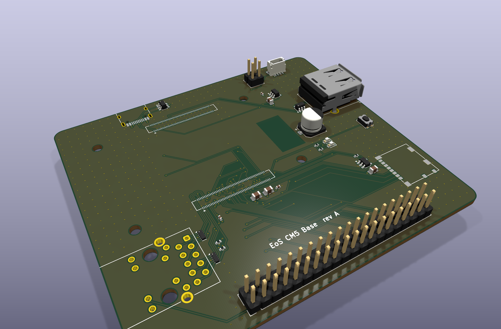
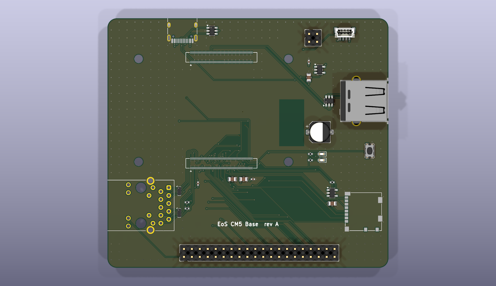
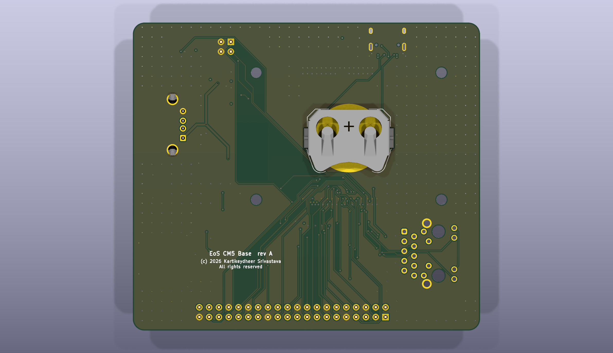

# EoS CM5 Base

A carrier board for the Raspberry Pi Compute Module 5, 90 × 80 mm, four layers. Designed by
Kartikeydheer Srivastava. All rights reserved: not open source, and not under this repository's MIT licence.
Anyone may view it, clone this repository and run its tests; anything more needs
Kartikeydheer Srivastava's written permission (kartikeydheer@gmail.com). EmbeddedOS (EoS) Research Foundation has a limited, revocable
permission. See [LICENSE.txt](LICENSE.txt) and [the licence summary](../README.md#licence).



| | |
|---|---|
|  |  |

## The module fits, to the nanometre

The CM5 plugs in through two 100-pin connectors: Amphenol 10164227-1001A1RLF, the 1.5 mm
stacking part the CM5 datasheet names. They sit on KiCad's Hirose DF40C-100DS footprint, which
has the same land pattern.

The positions come from the CM5 footprint in Raspberry Pi's CM5 IO Board files; only the facts
were taken, no file was copied. They are stored in `tools/eos_boards/reference/cm5_carrier.json`
with the SHA-256 of their source. `tests/unit/test_eos_boards.py` checks three things against
them, at KiCad's 1 nm resolution:

- all 200 connector pads, pin for pin;
- the module's four M2.5 holes;
- every ground, 5 V, 3.3 V and GPIO pin's net against the CM5 datasheet's pin table.

## What is on it

Every pin's net follows the CM5 datasheet (table 4). Where the datasheet leaves a choice, the
circuit follows Raspberry Pi's own CM5 IO Board.

| Block | How |
|---|---|
| Power in + USB 2.0 device | One USB-C connector. VBUS feeds the module's six 5 V pins. CC1/CC2 go straight to the module, which negotiates 5 A at 5 V itself, so there are no CC resistors. USB_P/USB_N carry rpiboot flashing and USB gadget mode, with USBLC6-2SC6 ESD protection. |
| USB 2.0 host | USB-A on the USB 2.0 pair of the module's first USB 3.0 port. 5 V through a TPS2051C (0.5 A, enable high) switched by VBUS_EN. 0.1 µF + 10 µF in and 150 µF out: TI's figures, since USB needs at least 120 µF. |
| Gigabit Ethernet | TRXCOM TRJG0926HENL MagJack, wired as on CM5IO: pairs 0-3 to TRD0-3; common centre tap through 100 nF to ground; line-side taps open (CM5IO uses them only for PoE). Green LED for activity, yellow for speed, each through 470 Ω. Two TPD4EUSB30 for ESD, laid out flow-through as TI intends: each line enters one pad and leaves from the pad opposite (pins 1/10, 2/9, 4/7, 5/6, as on CM5IO). The jack sits beside the module's Ethernet pins. |
| microSD (CM5 Lite) | Direct to SD_CLK, SD_CMD and SD_DAT0-3. The card's 3.3 V comes through an RT9742GGJ5 switch enabled by SD_PWR_ON (10 kΩ pull-up), with 10 µF after it, as on CM5IO. |
| 40-pin GPIO | The standard Raspberry Pi header. GPIO_VREF is tied to CM5_3.3V for 3.3 V GPIO, as the datasheet requires. |
| Also | Fan connector (5 V, PWM, GND, tacho), RTC coin cell on VBAT, power button, jumpers for nRPIBOOT and EEPROM write protect, power and activity LEDs (1 kΩ from 3.3 V, as on CM5IO). |
| Antenna | No copper on any layer under the module's PCB antenna. The CM5 datasheet (section 4.1.2) says "Don't place any metal, including ground planes, directly beneath the antenna" and asks for a ground-plane cut-out of at least 6.5 × 11 mm, ideally 8 × 15 mm. The board keeps the larger 8 × 15 mm clear on every layer, where the datasheet's Figure 4 puts the antenna (the module's pin-99 edge, 18.5 mm up from the pin-200 edge). A test checks that no track, via or pour enters it. |

## Not on this board

HDMI, PCIe, USB 3.0 SuperSpeed, and the camera and display (MIPI) interfaces are left off on
purpose. Each needs impedance-controlled, length-matched differential pairs. This generator
routes nets one at a time and cannot match or verify such pairs, so claiming them would be
untrue. The Ethernet pairs and the two USB 2.0 pairs are kept short instead.

## Build results

The numbers below are from `build-report.json` and `drc.json` in this folder.

| Check | Result |
|---|---|
| Schematic ERC | 0 violations |
| DRC errors | 0 |
| Unconnected items | 0 |
| Schematic ↔ board parity | 0 differences |
| DRC warnings | 6: silkscreen of the USB-C, USB-A and RJ45 connectors past the board edge, where edge connectors belong |

## Fabrication

4 layers (signal / GND plane / 5 V plane / signal), 1.6 mm thick.

- **Vias:** 0.45 mm with a 0.2 mm drill, the size Raspberry Pi's CM5 IO Board uses around this
  connector.
- **Tracks:** 0.15 mm, narrowing at fine-pitch pins; 0.5 mm on 5 V.
- **Coin-cell holder:** on the bottom side, under the module. Everything else is on top.
- **Under the module:** nothing on the top side, because 1.5 mm stacking leaves no room. There is
  no copper at all under the antenna.

The connector's ground pads drop their vias into the channel between its two pad rows, as on
CM5IO, so the signals keep the outward side. Some lines are routed first, in a set order, before
the autorouter:
- the Ethernet pairs, each through its ESD part to the MagJack;
- the USB host pair through its ESD part (U3), each line entering one pad and leaving from the
  other. Each line's two pads are joined straight across first;
- USBH_VBUS from U3's VBUS pin (U3.5, a reference input with no load current) to the USB-A
  port's VBUS pin. The joined pads wall that pin in, so it drops through a via placed in the gap
  between U3's pad rows and reaches the port on the bottom layer;
- the host pair's runs: D+ from U3 to the port over the top of U3, then D− and D+ from the module
  to U3, then D− from U3 to the port. Both lines stay on the top layer with no vias;
- three microSD lines (DAT1, DAT0, CLK), then GPIO2 to the 40-pin header.

U3's ground pad gets its plane via before any of these lines. Without that, the host pair closed
it in and left it as an unconnected scrap of ground pour.

- Gerbers and drill files: [fab/gerbers](fab/gerbers)
- Bill of materials: [fab/eos-cm5-base-bom.csv](fab/eos-cm5-base-bom.csv)
- Pick-and-place: [fab/eos-cm5-base-placement.csv](fab/eos-cm5-base-placement.csv)
- STEP model: [fab/eos-cm5-base.step](fab/eos-cm5-base.step)
- Schematic: [eos-cm5-base-schematic.pdf](eos-cm5-base-schematic.pdf)
- KiCad project: [hardware](hardware)

## What has not been done

- **No board has been made or tested.**
- **No signal-integrity simulation.** The Ethernet and USB 2.0 pairs are short, but their
  impedance has not been calculated or simulated.
- **Some footprints carry no 3D model.** The MagJack footprint is this project's own, drawn from
  the pad positions on Raspberry Pi's CM5IO, and has no 3D model.

## Rebuild

```
python3 tools/eos_boards/build.py eos_cm5_base
```

The design file is [tools/eos_boards/boards/eos_cm5_base.py](../../../tools/eos_boards/boards/eos_cm5_base.py).
