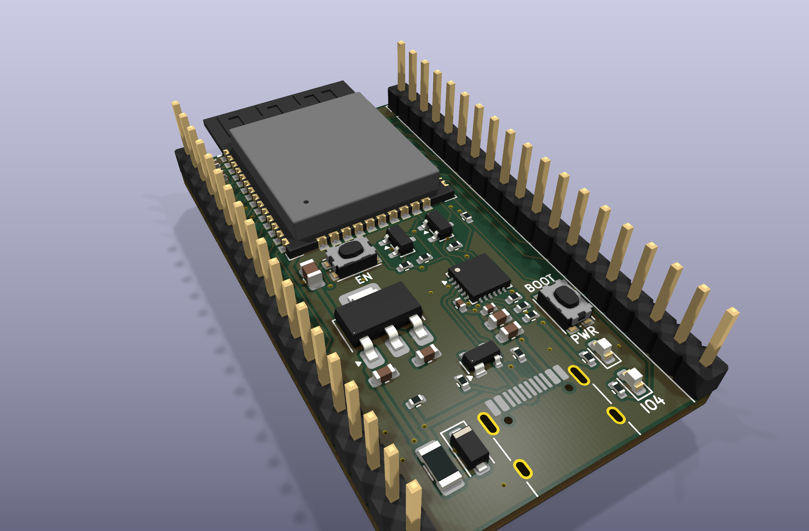
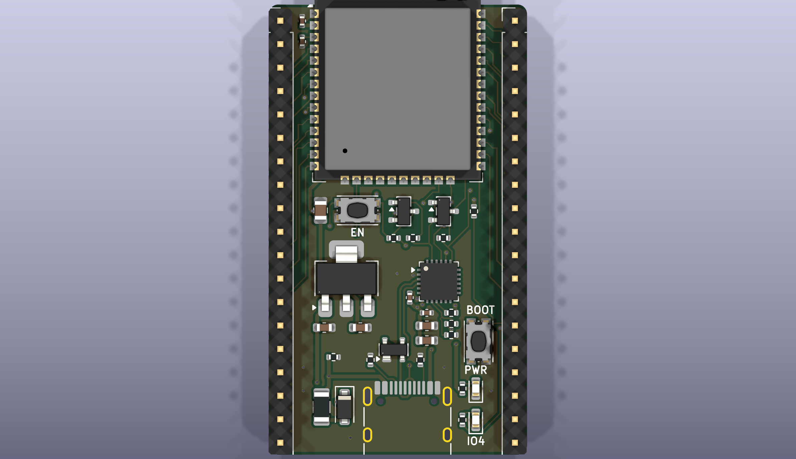
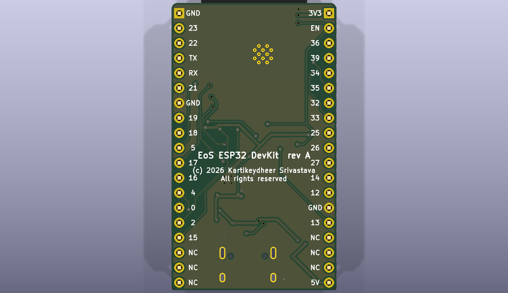

# EoS ESP32 DevKit

A breadboard development board for the Espressif ESP32-WROOM-32E module, 27.94 × 48.76 mm, two layers.
Designed by Kartikeydheer Srivastava. All rights reserved: not open source, and not under this repository's MIT licence.
Anyone may view it, clone this repository and run its tests; anything more needs
Kartikeydheer Srivastava's written permission (kartikeydheer@gmail.com). EmbeddedOS (EoS) Research Foundation has a limited, revocable
permission. See [LICENSE.txt](LICENSE.txt) and [the licence summary](../README.md#licence).

A board for the same job as Espressif's ESP32-DevKitC V4; an original design, not a copy: no file of the vendor's was used.
The only things taken from Espressif's DevKitC V4 documents are facts it publishes for users: the header
pinout (the user guide's J2 and J3 tables) and the header grid and board width (its dimension drawing).
Its schematic, layout and board files were not opened.



| | |
|---|---|
|  |  |

USB-C in, a CP2102N USB-UART bridge with esptool's automatic reset into the bootloader, a 1 A
3.3 V regulator, EN and BOOT buttons, a power LED and a user LED, and every usable GPIO of the
module on two 1×19 headers.

## What is on it

| Block | What it is, and where each value comes from |
|---|---|
| Module | ESP32-WROOM-32E-N4 (4 MB flash, no PSRAM, so IO16 is free). 22 µF + 100 nF on 3V3 and the EN delay R = 10 kΩ, C = 1 µF: Espressif ESP32-WROOM-32E datasheet v2.1, section 9. The 100 nF and the 1 µF sit in the gap beside the module's 3V3 and EN pins. The module already has a 499 Ω resistor on U0TXD (datasheet Figure 7), as Espressif's hardware design guidelines ask, so none is added. |
| Antenna | The module's whole 6.19 mm antenna area (datasheet Figure 13) overhangs the top edge, 0.31 mm clear of it, so the antenna keep-out lies off the board. This is what the datasheet's section 11.2 refers to: Espressif's hardware design guidelines, "Positioning a Module on a Base Board", put the PCB antenna outside the base board. |
| 3.3 V supply | AP7361C-33 LDO, 1.0 A (Diodes Inc. DS37274 Rev. 5-2). The module needs at least 0.5 A at 3.0–3.6 V (datasheet Table 14) and draws 379 mA at its Wi-Fi TX peak, 239 mA on average (Table 16). Dropout is 140 mV at most at 300 mA. 4.7 µF on input and output, as the regulator's typical application shows. At a 253 mA average load from 4.1–4.8 V (USB's 4.75–5.25 V less the fuse and Schottky drops) it dissipates 0.20–0.39 W, 22–43 °C above ambient at the datasheet's 110 °C/W. |
| USB-C | 5 V sink: 5.1 kΩ Rd on CC1 and CC2 (TI SLVSFJ9, section 10.3.14.2), USB 2.0 data only. SP0503BAHTG ESD protection on D+, D− and VBUS: three diodes to ground, as the CP2102N data sheet shows (Figure 2.5). A USBLC6-style part, whose data-line diodes run to its VBUS pin, would let the CP2102N's D+ pull-up hold VBUS near 2 V after a host unplugs, when the board runs from its 5V pin. 500 mA polyfuse (Littelfuse 1206L050: 0.50 A hold, 1.00 A trip). Then a Nexperia PMEG6010CEH Schottky (60 V, 1 A; VF ≤ 530 mV at 500 mA) to the 5 V rail, so 5 V fed into the 5V pin cannot reach the USB host. It was chosen for its low reverse leakage. From a 4.75 V port at a 400 mA peak the regulator still gets at least 3.94 V. A 5.1 kΩ bleed resistor from VBUS to ground (R12) takes the Schottky's leakage when the board runs from the 5V pin with no host (see VBUS bleed below). |
| USB-UART | CP2102N-A02-GQFN24 (Silicon Labs data sheet Rev. 1.5). The QFN-24 has all eight UART and modem lines (DTR and RTS are the ones needed) in 4 × 4 mm. The QFN-28 is 5 × 5 mm, and its extra pins (battery-charger detection, GPIO.4–6) have no use here. It runs from the 3.3 V rail with its own regulator unused (Figure 2.3), so it is powered whenever the ESP32 is, and the ESP32's TX line never back-powers it. 4.7 µF + 100 nF on VREGIN/VDD and on VIO; 1 kΩ RSTb pull-up (section 2.1). VBUS sense through the 22.1 kΩ / 47.5 kΩ divider (Figures 2.5, 2.6), which section 2.3 requires: 5 V reads as 3.41 V, above the 2.7 V threshold. |
| Auto-program | The two-transistor circuit the esptool documentation describes ("Boot Mode Selection", "Automatic Bootloader"): RTS drives EN, DTR drives IO0, and asserting both together resets nothing. Two MMBT3904 (onsemi), each with its base through 10 kΩ from one line and its emitter on the other. The 10 kΩ gives at least 0.115 mA of base current (CP2102N Table 3.7 levels, MMBT3904 VBE(sat) ≤ 0.85 V) against a 0.33 mA load, so the transistor saturates. Discharging the EN capacitor it passes at most 78 mA into the CP2102N pin, under its 100 mA limit (Table 3.10). The 1 µF on EN is the "1 µF–10 µF" esptool asks for. |
| Buttons | EN (reset) and BOOT (IO0 to ground). IO0 has a 10 kΩ pull-up and no capacitor: Espressif's guidelines ("Strapping Pins") recommend a pull-up on GPIO0 and warn against large capacitors on it. |
| LEDs | Power (red, Kingbright APTD1608LSURCK, VF 1.75 V at 2 mA) through 750 Ω from 3.3 V. User LED (green, APTD1608LCGCK, VF 1.9 V at 2 mA) through 680 Ω on IO4, about 2 mA each. IO4 is not a strapping, JTAG, flash or UART0 pin, and its ADC2 channel cannot be used while Wi-Fi is on. It is pulled down at reset, so the LED starts off. |
| Headers | Two 1×19 rows, 2.54 mm pitch, 25.40 mm apart, on the grid of Espressif's ESP32-DevKitC V4 dimension drawing, in the order of its user guide's J2 and J3 tables. Pin labels are on the back. |

### VBUS bleed

When the board is fed from the 5V pin with no host plugged in, the Schottky is reverse-biased
by about 5 V and leaks into VBUS. Without R12, the CP2102N's 69.6 kΩ VBUS divider would be the
only load on that current, so VBUS could rise until the CP2102N saw a bus that is not there.

The CP2102N is guaranteed to read its VBUS pin as low at or below VIL = 0.6 V. It detects a
bus above VIH = VIO − 0.6 V = 2.7 V (data sheet Rev. 1.5, Table 3.7 and section 2.3). The
divider puts 47.5/69.6 of VBUS on the pin, so VBUS may rise to 0.88 V. R12 in parallel with the
divider is 4.75 kΩ, so up to 185 µA of leakage is harmless.

The PMEG6010CEH leaks 0.8 µA typically at 5 V and 25 °C (Nexperia data sheet v.4, Table 7). Its
maximum, 50 µA at 25 °C, is given at 60 V, and Fig. 2 shows the current falling with the
voltage, so at 5 V it is lower still. That is under a third of the bound. Fig. 2's typical
curves give about 65 µA at 5 V and 85 °C and about 600 µA at 125 °C, so a typical part reaches
185 µA only at roughly 100 °C. The data sheet gives no maximum above 25 °C. Scaling Fig. 2 by
the 25 °C maximum-to-typical ratio (50/11) suggests the bound holds to about 75 °C; that is an
estimate, not a data sheet figure.

With a host attached, R12 draws 1.0 mA (5 mW). It is the same 5.1 kΩ part as the CC resistors.
The PMEG6010CEH's forward drop is higher than a low-voltage Schottky's (460 mV typical, 530 mV
maximum at 500 mA), which the supply budget above allows for.

### Headers

Pin 1 is at the antenna end. Pin numbers and names follow the ESP32-DevKitC V4 user guide.

| Pin | J2 (left) | J3 (right) |
|---|---|---|
| 1 | 3V3 | GND |
| 2 | EN | IO23 |
| 3 | IO36 (SENSOR_VP, input only) | IO22 |
| 4 | IO39 (SENSOR_VN, input only) | TX (IO1, U0TXD) |
| 5 | IO34 (input only) | RX (IO3, U0RXD) |
| 6 | IO35 (input only) | IO21 |
| 7 | IO32 | GND |
| 8 | IO33 | IO19 |
| 9 | IO25 | IO18 |
| 10 | IO26 | IO5 (strapping) |
| 11 | IO27 | IO17 |
| 12 | IO14 | IO16 |
| 13 | IO12 (strapping: keep low at reset) | IO4 (user LED) |
| 14 | GND | IO0 (BOOT) |
| 15 | IO13 | IO2 (strapping: low or open to flash) |
| 16 | not connected | IO15 (strapping) |
| 17 | not connected | not connected |
| 18 | not connected | not connected |
| 19 | 5V | not connected |

The six unconnected positions are where the DevKitC V4 tables put D0–D3, CMD and CLK, which
are GPIO6–GPIO11. On the ESP32-WROOM-32E those lines run to the module's own SPI flash and are
not led out: the datasheet lists module pins 17–22 as NC (Table 3, note 2). They stay
unconnected here, so nothing can be wired to the flash bus.

Power: USB-C, the 5V pin and the 3V3 pin can each power the board. Espressif's DevKitC V4 guide
says to use one and only one supply on its board. This board allows one combination more:
USB-C and the 5V pin may be connected together. The Schottky between VBUS and the 5 V rail
stops the 5V-pin supply feeding back into the USB host. The board then runs from the 5V pin
unless that is lower than VBUS less the Schottky's drop. The 3V3 pin is wired straight to the
regulator's output, so use it as an input only when nothing is connected to USB-C or the 5V
pin.

The module overhangs the top edge by about 6.5 mm (its antenna end is 6.50 mm past the edge).
A panel of these boards needs a clear zone at least that deep above the top edge, with no
frame or neighbouring board in it.

The board is 0.50 mm longer than the DevKitC V4's 48.26 mm. The pin rows start 1.75 mm below
the top edge instead of 1.25 mm, because the header courtyards must clear the module
footprint's antenna keep-out courtyard. The grid itself (row spacing, pitch, side margins,
bottom margin) is unchanged, so the board fits the same breadboard rows and carrier sockets.

## Not on this board

- **Other modules.** Espressif sells the DevKitC V4 with several modules (WROOM-32UE, WROVER-E
  and others). This board is for the ESP32-WROOM-32E only, without PSRAM.
- **GPIO6–GPIO11 on the headers.** The WROOM-32E does not lead them out (see above).
- **Female headers.** The DevKitC V4 is also sold with female headers. This design uses male
  pin headers.
- **The DevKitC V4's exact length.** It is 0.50 mm longer, for the reason given above.
- **Mounting holes.** There is no room between the header rows for them. The board is meant
  for a breadboard or a socket.
- **An on-board debug probe.** The DevKitC V4 has none, and neither does this board. The
  module's JTAG pins (IO12 MTDI, IO13 MTCK, IO14 MTMS, IO15 MTDO) are on the headers for an
  external JTAG adapter.

## Build results

The numbers below are from `build-report.json` and `drc.json` in this folder.

| Check | Result |
|---|---|
| Schematic ERC | 0 violations |
| DRC errors | 0 |
| Unconnected items | 0 |
| Schematic ↔ board parity | 0 differences |
| DRC warnings | 8: silkscreen past the board edge: the header rows and the USB-C connector sit at the edge, and the module's outline runs over its antenna overhang |

## Fabrication

2 layers, 1.6 mm thick, ground poured on both sides. Design rules:

- **Tracks:** 0.15 mm, narrowing to the 0.1 mm minimum at fine-pitch pads; 0.4 mm on the
  supplies (VBUS, the fuse-to-Schottky link, 5 V and 3.3 V); 0.2 mm on USB D+/D−. The
  exception is 3.3 V at the CP2102N: pins 5 to 7 leave the package at 0.15 mm, because a 0.4 mm
  track cannot pass between 0.5 mm-pitch pins.
- **Clearance:** 0.15 mm.
- **Vias:** 0.6 mm with a 0.3 mm drill, except one. VBUS reaches the R8/R9 divider through a
  0.5 mm via with a 0.25 mm drill, placed at the centre of R8's and R9's four pads, 0.175 mm
  from each.
- **Smallest drill:** 0.2 mm, in the module footprint's thermal vias under its ground pad.
  The other holes are the 1.0 mm header holes, the USB-C shell's 0.6 mm-wide slots and its
  0.65 mm locating holes.
- **Header pads** sit 0.39 mm (left row) and 0.45 mm (right row) from the board edge. That is
  where the DevKitC V4 grid puts them.

The lines around the CP2102N are routed first, in a set order, before the autorouter. That
order keeps every via off the pads:
- USB D− from the CP2102N to the ESD part, then D+;
- the ground and 3.3 V links between C6, C7, C8 and C9;
- the 0.15 mm 3.3 V lines from pins 5 to 7;
- reset to R7;
- VBUS from the USB-C connector to R8, through the pinned via;
- VBUS sense from pin 8 to R8;
- R7's 3.3 V pad to C7, last.

## What has not been done

- **No board has been made or tested.** The board is routed and its checks come from the full
  build: schematic electrical rules, design rules, connectivity and schematic-to-board parity.
  Those checks are all that has been done.
- **Nothing has been measured.** That includes the antenna with this base board, the
  regulator's temperature, the Schottky's leakage with R12, and the auto-reset timing with
  esptool.

## Rebuild

```
python3 tools/eos_boards/build.py eos_esp32_devkit
```

The design file is [tools/eos_boards/boards/eos_esp32_devkit.py](../../../tools/eos_boards/boards/eos_esp32_devkit.py).
