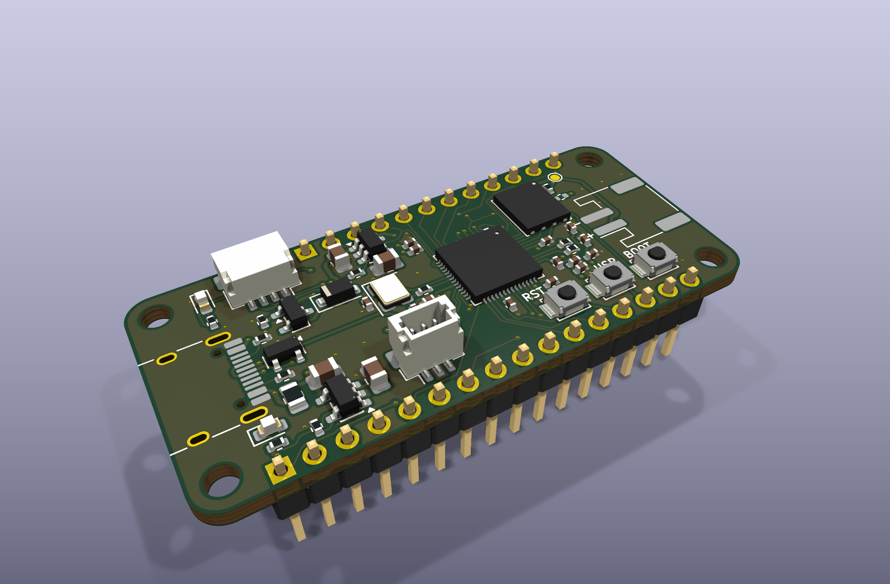
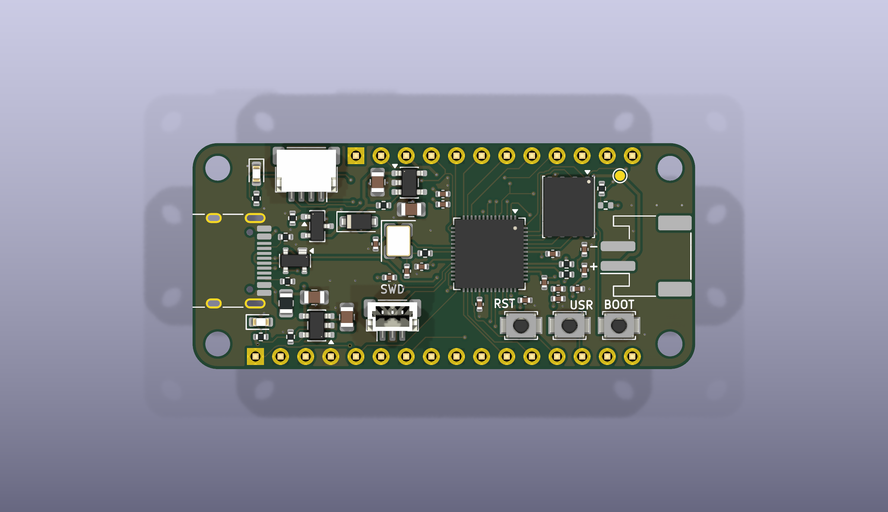
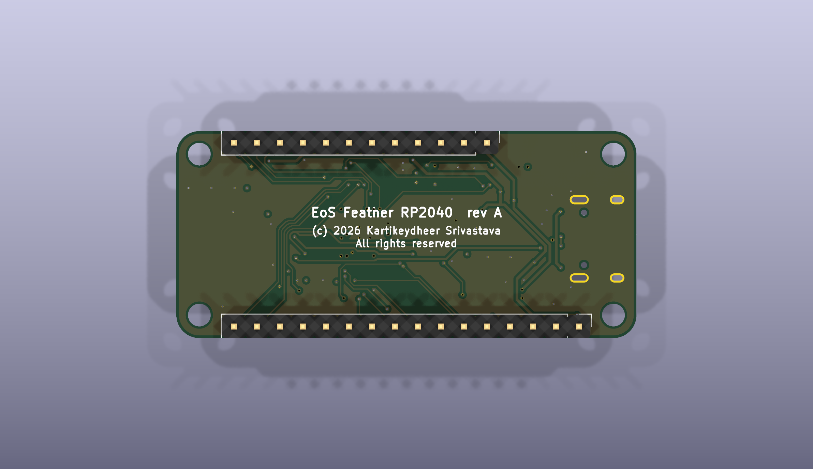

# EoS Feather RP2040

An original RP2040 board in the Feather form factor, 50.8 × 22.86 mm, four layers.
Designed by Kartikeydheer Srivastava.
All rights reserved: not open source, and not under this repository's MIT licence.
Anyone may view it, clone this repository and run its tests; anything more needs
Kartikeydheer Srivastava's written permission (kartikeydheer@gmail.com). EmbeddedOS (EoS) Research Foundation has a limited, revocable
permission. See [LICENSE.txt](LICENSE.txt) and [the licence summary](../README.md#licence).

A board for the same job as Adafruit's Feather RP2040 (product 4884); an original design, not a
copy: no design file of the vendor's was used (no schematic, layout, CAD, Gerber or BOM). The
outline, hole and header positions come from Adafruit's
[Feather Specification](https://learn.adafruit.com/adafruit-feather/feather-specification) (its
text and dimension drawing), and the signal on each header pin, the user button's GPIO and the
battery polarity from Adafruit's published
[Feather RP2040 pinout](https://learn.adafruit.com/adafruit-feather-rp2040-pico/pinouts) and
its pinout diagram. "Feather" is used only to say what the board fits; it is not an Adafruit
product.



| | |
|---|---|
|  |  |

FeatherWings, and CircuitPython or Arduino code written for the Feather RP2040's pinout, find the
same signals on the same pins. The flash is 16 MB, not 8 MB: firmware built for the Feather
RP2040 runs from its first 8 MB.

## What is on it

| Block | Parts, values and source |
|---|---|
| Outline, holes, headers | 0.9 × 2.0 in with 0.1 in holes at each corner, their centres 0.1 in from each edge. A 16-pin strip along the bottom edge centred 1.0 in from the left edge, a 12-pin strip along the top edge 1.2 in from the left, 0.8 in apart; pin order from the USB end. Source: Adafruit [Feather Specification](https://learn.adafruit.com/adafruit-feather/feather-specification) (text and dimension drawing), as EoS Motion Wing uses it. Holes: KiCad's 2.5 mm unplated hole, the nearest stock size to 0.1 in; corner radius 2.54 mm, concentric with the holes (the spec gives none). Male headers on the back (Würth 61301611121, 61301211121): pins point down, for a breadboard or a Feather socket. |
| MCU | Raspberry Pi RP2040, QFN-56 7 × 7 mm; its single ground is the centre pad (RP2040 datasheet Table 1), which has a 2 × 2 array of vias into the ground plane. 100 nF at each IOVDD and DVDD pin and at USB_VDD and ADC_AVDD (datasheet 2.9.1–2.9.5); 1 µF at VREG_VIN and at VREG_VOUT, which feeds the DVDD pins (datasheet 2.10.1; [Hardware design with RP2040](https://datasheets.raspberrypi.com/rp2040/hardware-design-with-rp2040.pdf) 2.1.3); TESTEN to ground (Table 1). [RP2040 datasheet](https://datasheets.raspberrypi.com/rp2040/rp2040-datasheet.pdf), build 2025-02-20. |
| Crystal | Abracon ABM8-272-T3, 12 MHz, CL 10 pF, ESR 50 Ω, the crystal Raspberry Pi recommends; 15 pF C0G load capacitors and 1 kΩ in series with XOUT, tuned for IOVDD = 3.3 V (Hardware design with RP2040, 2.3 and Table 1). |
| Flash | Winbond W25Q128JVPIQ, 16 MB QSPI, WSON-8 6 × 5 mm: the guide's W25Q128JV (2.2) in its smaller package. 100 nF (C22) beside it, joined to VCC only through the 3.3 V plane (see [Layout](#layout)). Its exposed pad is left unconnected, with no via under it, as the [W25Q128JV data sheet](https://www.winbond.com/resource-files/w25q128jv%20revf%2003272018%20plus.pdf) Rev. F (section 10.3) asks. |
| BOOTSEL | 1 kΩ from QSPI_SS to the BOOT button, so QSPI_SS can over-drive the button when the chip boots; the 10 kΩ QSPI_SS pull-up (R7) is drawn but not fitted, as the guide does for this flash (2.2). |
| USB | HRO TYPE-C-31-M-12 as a 5 V sink: 5.1 kΩ Rd on CC1 and CC2 ([USB Type-C specification](https://www.usb.org/usb-type-cr-cable-and-connector-specification)). Littelfuse SP0503BAHTG on D+, D− and VBUS: diodes to ground only ([SP05xxBA data sheet](https://www.littelfuse.com/~/media/electronics/datasheets/tvs_diode_arrays/littelfuse_tvs_diode_array_sp05_datasheet.pdf.pdf)). 27 Ω in series with USB_DP and USB_DM, at the chip (RP2040 datasheet Table 1; guide 2.4.1). Littelfuse 0805L050WR polyfuse, 0.50 A hold, 1.00 A trip, 6 V, R1max 0.85 Ω (0805L data sheet, revised 10/29/21). |
| LiPo charger | Microchip MCP73831T-2ACI/OT, 4.20 V. R10 = 4.7 kΩ sets 1000 V / 4.7 kΩ = 213 mA (equation 5-1), inside the Feather spec's 100–500 mA. 10 µF on VDD and on VBAT, where the data sheet asks for at least 4.7 µF (sections 3.1, 3.2, 6.1.1.4). Yellow CHG LED from VBUS through 1 kΩ into STAT: lit while charging. [MCP73831 data sheet](https://ww1.microchip.com/downloads/aemDocuments/documents/APID/ProductDocuments/DataSheets/MCP73831-Family-Data-Sheet-DS20001984H.pdf) DS20001984H. |
| Battery and power path | JST PH 2-pin (S2B-PH-SM4-TB), the connector the Feather spec requires, polarity as Adafruit's cells (see [Battery polarity](#battery-polarity)). Load sharing as Microchip [AN1149](https://ww1.microchip.com/downloads/en/AppNotes/01149c.pdf) (DS01149C) Figures 5–7: an AOS AO3401A P-MOSFET from the battery to the system rail, its gate on USB power with a pull-down, and a Nexperia PMEG6010CEH Schottky from USB to the system rail. With USB present the MOSFET is off and USB runs the board while the charger charges the battery; without USB the pull-down turns it on. AO3401A Rev 3.1: RDS(on) ≤ 85 mΩ at VGS = −2.5 V. PMEG6010CEH v.4: VF ≤ 530 mV at 500 mA. The pull-down is 10 kΩ, not AN1149's 100 kΩ: see [Gate pull-down](#gate-pull-down). The battery line passes a 1 mm test pad, TP1, in the top-right corner. |
| 3.3 V | Diodes AP2112K-3.3TRG1, 600 mA, the regulator the Feather spec names; dropout ≤ 400 mV at 600 mA; stable with 1.0 µF ceramic capacitors (X5R/X7R); 10 µF X5R fitted at input and output. The Feather EN pin pulls its EN low; 100 kΩ to the system rail holds it high otherwise (EN high above 1.5 V; 3 MΩ internal pull-down). [AP2112 data sheet](https://www.diodes.com/assets/Datasheets/AP2112.pdf) DS39724 Rev. 2-2. |
| Buttons | RESET (RUN, which has an internal pull-up: RP2040 datasheet Table 619), BOOT and USER, Omron B3U-1000P (A162-E1-07), along the bottom right: RST, USR, BOOT from left to right. USER is on GPIO4, where Adafruit's pinout puts the Feather RP2040's user-readable button; turn on GPIO4's internal pull-up in firmware (the pins reset with pull-downs, datasheet Table 615). |
| LEDs | Red user LED on D13 (GPIO13), Kingbright APTD1608LSURCK through 1 kΩ: 1.55 mA at VF 1.75 V (DSAO7433), under the pin's 4 mA default drive. Yellow CHG LED, APTD1608LSYCK (DSAO7434). The spec asks for the user LED above the USB connector and suggests the CHG LED below it; both are there. |
| SWD | Raspberry Pi 3-pin debug connector, JST SH BM03B-SRSS-TB: 1 SWCLK, 2 GND, 3 SWDIO ([RP-003139-SP-4](https://datasheets.raspberrypi.com/debug/debug-connector-specification.pdf)), marked SWD. It takes a Raspberry Pi Debug Probe's cable. The specification recommends 100 Ω in series at the target's pins "unless the platform is very low cost and/or space constrained"; there is no room for them beside the RP2040's pins 20–26 (XIN, XOUT, DVDD, SWCLK, SWDIO and RUN at 0.4 mm pitch, with R5 and C20 in front of them), so they are left out. |
| STEMMA QT / Qwiic | JST SH SM04B-SRSS-TB on SDA/SCL (GPIO2/GPIO3, I2C1), 1 GND, 2 3.3 V, 3 SDA, 4 SCL ([STEMMA QT technical specs](https://learn.adafruit.com/introducing-adafruit-stemma-qt/technical-specs), the Qwiic convention). No pull-ups on the board: the spec puts them on the I2C devices and on the wings. |

### Feather pins

| Pin | Header | Signal | | Pin | Header | Signal |
|---|---|---|---|---|---|---|
| RST | 16-pin, 1 | RUN | | BAT | 12-pin, 1 | battery + |
| 3V | 16-pin, 2 | 3.3 V | | EN | 12-pin, 2 | regulator enable |
| 3V | 16-pin, 3 | 3.3 V (AREF in the spec; see below) | | USB | 12-pin, 3 | USB 5 V, after the polyfuse |
| GND | 16-pin, 4 | ground | | D13 | 12-pin, 4 | GPIO13, red LED |
| A0–A3 | 16-pin, 5–8 | GPIO26–GPIO29 (ADC0–ADC3) | | D12, D11, D10, D9 | 12-pin, 5–8 | GPIO12, GPIO11, GPIO10, GPIO9 |
| D24, D25 | 16-pin, 9–10 | GPIO24, GPIO25 | | D6, D5 | 12-pin, 9–10 | GPIO8, GPIO7 |
| SCK, MO, MI | 16-pin, 11–13 | GPIO18, GPIO19, GPIO20 (SPI0) | | SCL, SDA | 12-pin, 11–12 | GPIO3, GPIO2 (I2C1), and the STEMMA QT |
| RX, TX | 16-pin, 14–15 | GPIO1, GPIO0 (UART0) | | | | |
| D4 | 16-pin, 16 | GPIO6 | | | | |

GPIO4 is the USER button. GPIO5, GPIO14–17 and GPIO21–23 are not connected. The spec's AREF
position (16-pin, 3) carries 3.3 V, as on Adafruit's pinout: the RP2040 has no separate ADC
reference pin, and the spec says to leave AREF unconnected on such a chip, so a wing that drives
an analog reference into that pin would meet this board's 3.3 V rail.

### Gate pull-down

On battery, D1 is reverse-biased by the system rail and its leakage flows into Q1's gate node,
whose only path to ground is the pull-down. The gate rises by the leakage times the pull-down.
With AN1149's 100 kΩ and a very-low-VF Schottky (onsemi's MBR120VL is allowed 0.6 mA at 25 °C),
the gate could reach the system rail and turn Q1 off. PMEG6010CEH (v.4) leaks 0.8 µA typical at
5 V and at most 50 µA at 60 V (25 °C); its Fig. 2 shows about 65 µA at 5 V and 85 °C (typical;
the data sheet gives no maximum above 25 °C). Through 10 kΩ that lifts the gate at most 0.5 V at
25 °C and about 0.65 V at 85 °C, so VGS stays below −2.3 V down to a 3.0 V cell, past the
AO3401A's −1.3 V maximum threshold. With USB present the pull-down takes 0.5 mA.

### Battery polarity

Adafruit's pinout diagram marks the battery connector: − toward the USB end and + away from it,
on a connector that faces the 12-pin edge. Looking into that connector from outside the board,
top side up, + is on the left. This board's connector faces the right-hand edge and keeps that
convention: looking into it, + (J4 pin 1) is on the left, toward the 16-pin edge. The marks
+ and − are on the silkscreen beside it. Cells from other makers may be wired the other way
round; check a cell with a meter before plugging it in.

## Not on this board

- **NeoPixel.** The Feather RP2040 has an RGB NeoPixel on GPIO16; this board has none, and
  GPIO16 is not connected.
- **The 2 × 5 1.27 mm SWD footprint and the bottom SWD pads.** The Raspberry Pi 3-pin connector
  replaces them.
- **The battery connector's position.** The Feather spec says the JST PH "must" be 0.425 in
  from the left edge, on the 12-pin edge beside the USB connector. With KiCad's stock footprints,
  the courtyards of the HRO TYPE-C-31-M-12 (10.6 mm wide, extended by its rear shell tabs) and of
  the S2B-PH-SM4-TB (10.2 mm deep) overlap at that spot, so the connector is at the right-hand end,
  facing out of it. A USB-C receptacle with a shorter rear, or a mid-mount one, might allow the
  spec position. This is a deviation from a "must" of the spec, awaiting the owner's decision. A
  case or a cable routing that expects the battery lead at the USB end will not fit.
- **USB at the exact centre of the left edge.** The receptacle is centred at y 11.90 mm, 0.47 mm
  below the edge's centre (11.43 mm), where the Feather spec puts USB; an enclosure's plug window
  centred on the edge has 0.47 mm less margin on one side.
- **Header pin labels.** Neither silkscreen labels the header pins; the
  [Feather pins](#feather-pins) table is the key.
- **Battery voltage monitor.** None, as on the Feather RP2040 (Adafruit's power page: no ADC is
  connected to a battery monitor).

## Layout

Measured from the routed board file, `hardware/eos-feather-rp2040.kicad_pcb`.

- **Crystal.** XIN runs 8.4 mm from pin 20 to the crystal and C23; XOUT 2.6 mm from pin 21 to
  R5, then 2.2 mm from R5 to the crystal and C24. All three are on the top layer with no via. On
  the bottom layer under the crystal, C23, C24, R5 and these lines the only track or via of another
  net is one ground via; the bottom ground pour covers the area. Next to the clock tracks, the
  nearest other tracks are those of the chip's neighbouring pins (3.3 V and ground), 0.24 mm away
  at the pad row, and the +1V1 line to C20, 0.55 mm away.
- **USB D+ near the crystal.** On its way from the ESD part to its via under the chip, D+ runs on
  the top layer through the crystal group: 0.17 mm from the crystal's ground pad (Y1.2), 0.18 mm
  from C24's ground pad (C24.2), 0.59 mm from C24's XTAL_OUT pad (C24.1) and 0.88 mm from the
  XTAL_OUT track, edge to edge. It crosses no clock line, and the ground plane (In1) under it there
  is solid. Rev B moves it out of the group (see [Rev B follow-ups](#rev-b-follow-ups)).
- **USB.** From the receptacle through the ESD part to R3 and R4: D+ 36.3 mm with 4 vias (two of
  them join the receptacle's A6 and B6 contacts), D− 35.1 mm with 2 vias, 0.2 mm wide. They are
  not a coupled pair: D+ runs 21.4 mm on the top layer and 14.9 mm on the bottom, D− 7.4 mm on the
  top and 27.7 mm on the bottom. Under the chip both are on the bottom layer, 0.5 to 1.4 mm apart
  centre to centre. From R3 and R4 to pins 47 and 46: 3.9 and 4.1 mm on the top layer.
- **QSPI.** SCLK 4.4 mm, SD0 2.9 mm, SD1 11.5 mm, SD2 9.0 mm, SD3 5.8 mm, all on the top layer
  with no via. SS runs 11.9 mm on the top layer from pin 56 to the flash's CS pad. From there a
  branch goes on to the BOOTSEL resistors right of the flash: 8.21 mm to R6 and 9.45 mm to R7
  (7.61 mm on the top layer, 1.84 mm on the bottom, 2 vias), where Hardware design with RP2040
  (2.2) asks for both resistors close to the flash. Rev B routes it directly.
- **Core supply (+1V1).** Each pin has a top-layer track to its capacitor: VREG_VOUT (pin 45) to
  C11 2.5 mm, DVDD pin 50 to C21 2.3 mm, DVDD pin 23 to C20 3.2 mm. One 0.2 mm line joins them:
  from C11 round the end of the USB D+ line beside R3, then on the bottom layer under the chip to
  C20, with a via down to it from pin 50's track; 32.6 mm of +1V1 track in all, 3 vias.
- **3.3 V decoupling, supply side.** Track length along the centrelines, pad centre to via
  centre. Each 3.3 V pin of the RP2040 has its own via inside the pad ring: 0.86 mm from pins 1,
  10, 22, 33, 42 and 48, 1.46 mm from pins 43 and 49, 2.06 mm from pin 44 (VREG_VIN); pin 43's
  track also passes over pin 42's via. C15 sits 1.2 mm from pin 33 on a direct top-layer track and
  uses pin 33's via. C12, C13, C14 and C16 have a via each (0.73 to 0.74 mm). C10 and C18 share
  one (C18 0.73 mm; C10 1.73 mm, through C18's pad). C17, C19 and C22 share another (C19 0.73 mm,
  C17 2.64 mm, C22 5.36 mm through C17's pad). Capacitor pad to pin pad: C16 1.4 mm (pin 42), C10
  3.3 mm (VREG_VIN, pin 44), C13 4.5 mm (pin 10), C18 5.0 mm (USB_VDD, pin 48), C19 5.1 mm
  (ADC_AVDD, pin 43), C17 6.5 mm (pin 49), C14 7.5 mm (pin 22), C12 8.2 mm (pin 1).
- **Decoupling, ground side.** Copper path from the pad's edge to the nearest ground via: C21's
  ground pad (DVDD pin 50) has the longest of any decoupling capacitor, 3.38 mm of top copper, to
  a via that C17 (1.93 mm) and C22 (0.33 mm) also use.
- **Flash decoupling.** C22, the flash's 100 nF, has no track to the flash's VCC pin (U2.8): it
  is turned with its ground pad between U2.8 and its 3.3 V pad. It reaches U2.8 only through the
  3.3 V plane: from C22's 3.3 V pad, 4.55 mm of copper (5.36 mm along the track centrelines) to
  the via it shares with C17 and C19, and that via is 6.73 mm from U2.8's own via. Hardware
  design with RP2040 (Figure 11) puts the 100 nF at the flash's VCC. Rev B turns C22 and routes
  it to U2.8, and moves C12, C14 and C17 nearer their pins.
- **Lines to the bottom right.** GPIO0 (TX), GPIO1 (RX), GPIO6 (D4) and GPIO4 (user button)
  leave the chip's top edge and change to the bottom layer above it. They run under the flash to
  the 16-pin strip and the button: 22.2, 22.3, 26.7 and 20.1 mm, with one or two vias each.
- **Battery line.** VBAT, 0.3 mm wide (0.225 mm where it enters the charger's pin), runs from
  J4 past TP1 and along the top edge, under the 12-pin strip, to the BAT pin and on to the
  charger: 63.3 mm with 3 vias.
- **Ground.** Ground is poured on both outer layers, with 39 ground vias. Every fragment of the
  outer-layer ground pours contains a ground via or a plated-through ground pin.

## Build results

The numbers below are from `build-report.json` and `drc.json` in this folder.

| Check | Result |
|---|---|
| Schematic ERC | 0 violations |
| DRC errors | 0 |
| Unconnected items | 0 |
| Schematic ↔ board parity | 0 differences |
| DRC warnings | 7: silkscreen within the board-edge clearance: the front outline of J1 (USB-C) at the left edge (2), and the back outlines of J2 (Feather 16-pin) and J3 (Feather 12-pin) at the bottom and top edges (2 and 3) |

## Fabrication

Four layers, 1.6 mm FR-4: signal, ground plane, 3.3 V plane, signal, with ground poured on both
outer layers. Measured from the board file:

- **Tracks:** 0.127 mm for signals; 0.2 mm for USB and +1V1, which enter the RP2040's
  0.4 mm-pitch pads; 0.2 and 0.3 mm for +3V3; 0.3 mm for VBUS, the battery and the system rail;
  ground tracks 0.127, 0.2 and 0.3 mm. Narrower where a track enters a fine-pitch pad: 0.095 mm
  on the USB-C receptacle's CC contacts, 0.225 mm on VBUS and VBAT at the receptacle and the
  charger, and one 0.15 mm segment on +3V3.
- **Clearance:** 0.127 mm; 0.15 mm around the USB, supply and power lines (their net classes).
- **Vias:** 0.45 mm with a 0.2 mm drill (109 vias).
- **Smallest drill:** 0.2 mm, in the vias.
- **Plated slots:** the USB-C receptacle's four shell holes are plated oval slots, 0.6 × 1.2 mm and
  0.6 × 1.7 mm (two of each): tell the fab the board has plated slots. Its two 0.65 mm peg holes
  are unplated.

The four vias in the RP2040's centre pad sit in its paste openings: order them filled and capped
(or plugged), so solder does not wick down them.

## What has not been done

- **No board has been made or tested.** These are design files that pass KiCad's electrical and
  design rule checks; no hardware has been built, powered, charged from or flashed.
- **No signal-integrity, thermal or charging test.** USB, QSPI and the crystal were not simulated
  or measured. The charger's thermal regulation and the AP2112K's temperature at full load were
  not measured.
- **Regulator heat.** The AP2112K's SOT-25 package is rated 184 °C/W (no heatsink). From USB the
  system rail is about 4.3–4.5 V, so 500 mA from the 3.3 V rail dissipates about 0.55 W, a rise of
  about 100 °C: the 500 mA is a peak, not a continuous load.
- **Charger heat.** The MCP73831 (230 °C/W, 4-layer JEDEC board) dissipates about 0.3 W at 213 mA
  from 5 V into a 3.6 V cell. The worst case is at the start of constant-current charging, where
  the cell is at the precondition threshold, 66.5 % of 4.20 V = 2.79 V (DS20001984H, VPTH/VREG):
  (5 − 2.79) V × 0.213 A = about 0.47 W, a rise of about 108 °C, so the charger's thermal
  regulation will cut the current there.
- **USB budget.** The polyfuse holds 0.50 A at 20 °C, and less when warm: 0.40 A at 40 °C, 0.37 A
  at 50 °C and 0.33 A at 60 °C (0805L data sheet, temperature rerating table, 0805L050). The
  charger takes up to 213 mA of it, so while a battery charges the board and its wings should stay
  under about 287 mA at 20 °C (0.50 A − 213 mA) and about 187 mA at 40 °C (0.40 A − 213 mA).
- **Capacitance at USB attach.** USB 2.0 (section 7.2.4.1) allows at most 10 µF across VBUS when
  a device is plugged in. This board has C30 (10 µF) on VBUS directly, behind the polyfuse, C32
  (10 µF) behind D1, and about 12 µF on the 3.3 V rail behind the AP2112K, with no inrush
  limiting. Not measured.
- **Bulk capacitors' DC bias.** C30–C33 are 10 µF 16 V X5R 0805 capacitors with no part number.
  The MCP73831 needs at least 4.7 µF on VDD and on VBAT (DS20001984H sections 3.1, 3.2 and
  6.1.1.4); a typical 16 V 0805 X5R part keeps about 40–60 % of its capacitance at 5 V (Assumed:
  no capacitor data sheet was checked), so that margin is open.
- **3D models.** KiCad 10.0.6 ships none for the HRO TYPE-C-31-M-12 (J1) or the JST
  S2B-PH-SM4-TB (J4), so the STEP file and the renders lack them.
- **Mechanical fit** with Feather cases and stacked FeatherWings has not been tried.

## Rev B follow-ups

- Move USB D+ out of the crystal group (see [Layout](#layout)).
- Turn C22 and route it to the flash's VCC pin; move C12, C14 and C17 nearer pins 1, 22 and 49;
  give C21's ground pad a via of its own.
- Centre the USB-C receptacle on the left edge.
- Route the BOOTSEL/R7 branch directly from the flash's CS pad, close to the flash.
- Name the USB Type-C specification as the source in R1's and R2's Description fields.
- Name a 10 µF part whose DC-bias curve is checked against the MCP73831's 4.7 µF minimum.
- Add header pin labels to the silkscreen.

Awaiting the owner's decision: the battery connector's position (see
[Not on this board](#not-on-this-board)).

## Rebuild

```
python3 tools/eos_boards/build.py eos_feather_rp2040
```

The autorouter (Freerouting) gives a different result on every run, so a rebuild may not pass
the checks first time: builds 9 to 12 of this board each left different connections open. The
files in this folder are from the build that passed.

The design file is [tools/eos_boards/boards/eos_feather_rp2040.py](../../../tools/eos_boards/boards/eos_feather_rp2040.py).
