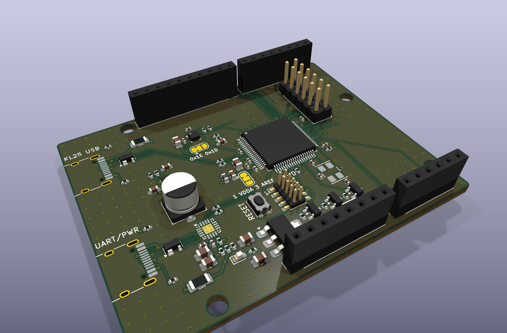
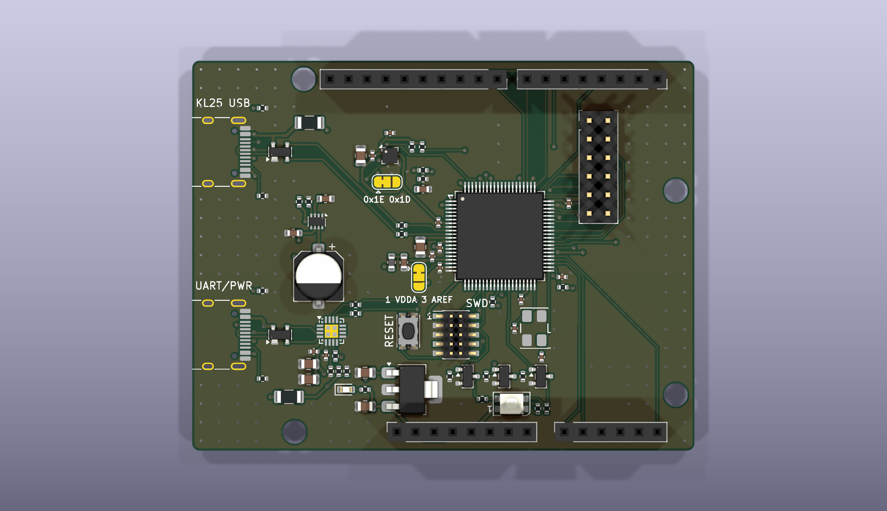
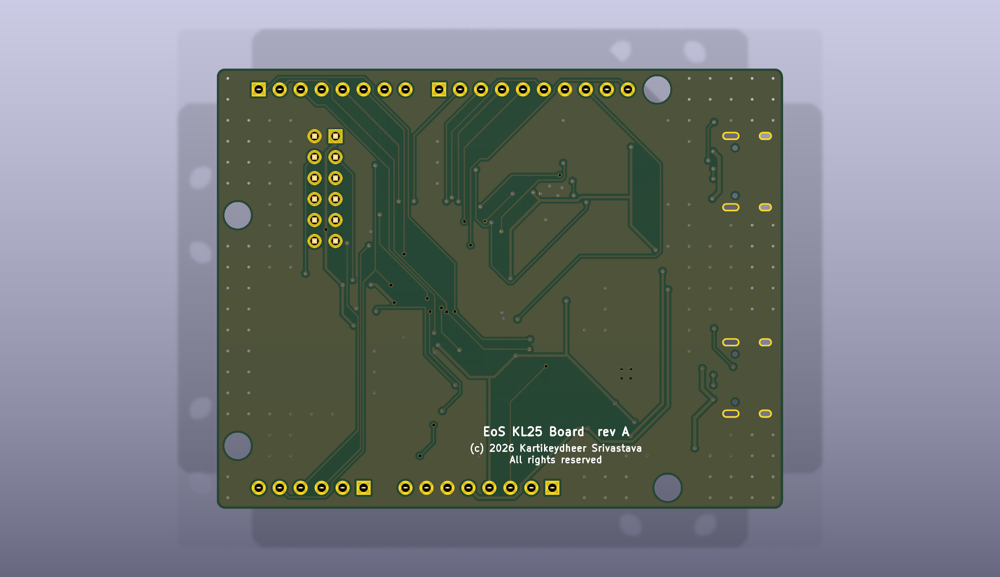

# EoS KL25 Board

An NXP Kinetis KL25 (MKL25Z128VLK4, LQFP-80) development board that fits Uno R3 shields, 68.58 × 53.34 mm, two layers.
Designed by Kartikeydheer Srivastava. All rights reserved: not open source, and not under this repository's MIT licence.
Anyone may view it, clone this repository and run its tests; anything more needs
Kartikeydheer Srivastava's written permission (kartikeydheer@gmail.com). EmbeddedOS (EoS) Research Foundation has a limited, revocable
permission. See [LICENSE.txt](LICENSE.txt) and [the licence summary](../README.md#licence).

A board for the same job as NXP's FRDM-KL25Z; an original design, not a copy: no file of the vendor's was used.
No design file of NXP's (schematic, layout, CAD, Gerbers, BOM) was opened; the header positions come from
Matthew Beckler's "Arduino Uno R3" dimension drawing v1.05 and the Arduino UNO R3 product reference manual
(A000066), section 5.4. The circuit comes from the chip makers' datasheets and NXP's KL25 data sheet,
reference manual and Kinetis L hardware guidance.



| | |
|---|---|
|  |  |

The KL25's own full-speed USB on one USB-C port, a CP2102N USB-UART bridge on UART0 on a
second, an 8 MHz crystal, an RGB LED, a LIS2HH12 accelerometer, a reset button, and an Arm
Cortex 10-pin SWD header in place of OpenSDA. The I/O runs at 3.3 V: IOREF is 3.3 V, and the
KL25's pins are not 5 V tolerant (data sheet Table 4: VIO at most VDD + 0.3 V).

**Use only 3.3 V shields, or shields that follow IOREF: 5 V on any I/O pin can damage the KL25.
Never feed the 3V3 or IOREF pins from a shield:** they are the LDO's output, whose absolute
maximum is its input + 0.3 V (Diodes DS37274), so a shield sourcing 3.3 V with no USB attached
drives the LDO backwards.

## What is on it

Sources: **DS** = NXP KL25P80M48SF0 data sheet Rev 5; **RM** = NXP KL25P80M48SF0RM reference manual
Rev 3; **KLQRUG** = NXP Kinetis L Peripheral Module Quick Reference Rev 0, chapter 2 (hardware
considerations).

| Block | What it is, and where each value comes from |
|---|---|
| MCU supply | 3.3 V (DS Table 5: 1.71–3.6 V). 100 nF at each VDD/VSS pair (7/8, 38/39, 60/59), close to the pins (KLQRUG 2.1.3.2). The DS and RM give no VDD value; 100 nF is the value RM 28.6.2.3 gives for VDDA. The LDO's 4.7 µF is the bulk. |
| VDDA, VREFH | VDDA from 3.3 V through a Murata BLM18PG221SN1D bead (220 Ω at 100 MHz, 0.10 Ω max), so it gets 100 nF plus the extra 1 µF RM 28.6.2.3 asks for with inductive isolation. 100 nF low-ESR from VREFH to VREFL at the pins (RM 28.6.1.2). JP1 takes VREFH from VDDA as delivered, or from the AREF pin (RM 28.2.3: never above VDDA). |
| KL25 USB (J1) | USB-C, RM 3.9.1.2.1 (Figure 3-29): the MCU runs from VDD, and the USB regulator powers the transceiver from VBUS, so VREGIN is on J1's VBUS and VOUT33 has only its capacitor: 4.7 µF X7R (DS Table 30: 1.76–8.16 µF, 1–100 mΩ ESR). Without VBUS the transceiver, and its D+ pull-up, have no supply. VBUS detect on PTD6, a PORTD interrupt and LLWU pin, as RM 3.9.1 asks ("a GPIO signal that can wake the chip in all power modes"), through 15 kΩ / 22 kΩ: 5.5 V reads 3.27 V, 4.4 V reads 2.62 V, above VIH = 2.31 V (DS Table 5). 1 µF on PTD6 slows that to an 8.9 ms rise (15 kΩ ∥ 22 kΩ × 1 µF): when J1 is the only source, VDD comes up with the TPS2116's 1.7 ms soft start (SLVSFG1A 6.6), and the pin, which has no diode to VDD, must stay under VDD + 0.3 V (DS Table 4, Table 5 note 1); 2 ms after the plug-in it is at 0.6 V, VDD at 3.3 V. That holds at plug-in only: at unplug the 1 µF holds PTD6 up while VDD falls, and above about 50 mA of load PTD6 briefly exceeds VDD + 0.3 V (see "What has not been done"). 33 Ω in D+ and D− close to the MCU (KLQRUG 9.6.2). |
| Clock | 8 MHz, ECS-80-10-30B-CWN-TR (ECS ECX-53B: CL 10 pF, ESR ≤ 100 Ω, C0 ≤ 5 pF, ≤ 100 µW). DS Table 19: external load capacitors in high-frequency mode; RF internal in low-power mode and "must not be attached externally". The DS gives no oscillator transconductance, so the gain margin cannot be computed; a 10 pF crystal needs the least: gmcrit = 4 ESR (2π f)² (C0 + CL)² = 0.227 mA/V (ST AN2867 section 3.4), against 0.535 mA/V for the 18 pF part of the same family. 11 pF C0G on each pin: C = 2 × 10 pF − 9 pF of strays (AN3208 section 5; 7 pF pin capacitance from DS Table 12, about 2 pF of board from AN1706 3.1.1). Drive level (AN3208 Eqn. 1): 10 µW at the low-power mode's 0.6 V swing (DS Table 19, taken as a peak), but 310 µW at a full 3.3 V swing, so **firmware must use low-power mode (MCG_C2[HGO] = 0)**. 8 MHz / 4 = 2 MHz feeds the PLL (2–4 MHz) for USB's 48 MHz. |
| Reset, NMI | RESET_b: 10 kΩ pull-up and 100 nF close to the MCU (KLQRUG 2.1.3.4.1: "4.7 kΩ to 10 kΩ", "100 nF"), and a reset button. NMI_b (PTA4): 10 kΩ, no capacitance (same section). PTA4 is not on a header, so a shield cannot fire the NMI. |
| Debug | Arm Cortex 10-pin 1.27 mm SWD header (J7): PTA0 SWD_CLK, PTA3 SWD_DIO, RESET_b, VTref 3.3 V. The internal SWD pulls are on out of reset (RM 6.2), so none are fitted. |
| Power path | Each USB-C is a 5 V sink (5.1 kΩ Rd on CC1, CC2; USB Type-C specification), with Littelfuse SP0503BAHTG ESD protection on D+, D− and VBUS (SP05xxBA data sheet: 5.5 V standoff, ≤ 100 nA leakage at 5 V, 30 pF; three diodes to GND, none between the lines; the part CP2102N Figure 2.5 shows) and a Bourns MF-NSMF050/8X-2 PTC fuse (0.50 A hold, 1.00 A trip). A TI TPS2116 mux (SLVSFG1A) in priority mode takes J1 whenever its VBUS is above 3.40–4.00 V (PR1 = 10 k / 37 k against VREF 0.92–1.08 V), otherwise J2. Its reverse current blocking (section 7.3.4) keeps either port, or 5 V fed into the 5V pin, from reaching the other port or the bridge. 1 µF on each input (section 9), 100 µF on the output (section 7.3.4). The shield VIN pin is not connected: there is no 7–12 V input. |
| 3.3 V | AP7361C-33 LDO (Diodes DS37274 Rev. 5-2): 2.2–6.0 V in, 1 A, at least 1 µF in and 2.2 µF out; 4.7 µF each, as its characteristics are specified. |
| USB-UART (J2) | Silicon Labs CP2102N-A02-GQFN20 (data sheet Rev. 1.5) on the board's 3.3 V with its own regulator unused (Figure 2.3: VREGIN tied to VDD), so it is powered whenever the KL25 is and the KL25's TX never drives an unpowered bridge. 4.7 µF + 100 nF at VREGIN and at VDD, 1 kΩ RSTb pull-up (section 2.1). Its VBUS pin senses J2's VBUS through the 22.1 kΩ / 47.5 kΩ divider section 2.3 requires (Figure 2.6): 5 V reads 3.41 V, above VIH = 2.7 V (Table 3.7), so it connects, and turns on its D+ pull-up, only when a host supplies VBUS. A 10 kΩ bleed on J2's VBUS keeps the pin under VIL = 0.6 V (VBUS under 0.88 V) for up to 100 µA of leakage with no host; the TPS2116's largest leakage or shutdown current maximum is 2.9 µA (SLVSFG1A 6.5). J2 still powers the board through the mux when it is the only source. TXD and RXD meet UART0 (PTA1, PTA2 = D0, D1) through 1 kΩ, so a shield driving D0 against the bridge fights at most 3.3 mA. Chosen for its 3.3 V UART levels and single-chip USB (no crystal). |
| RGB LED | Würth 150141M173100, common anode. Green and blue need up to 3.6 V at 20 mA, more than a 3.3 V GPIO gives, so the anode is on 5 V and each colour is switched by an AO3400A N-MOSFET (VGS(th) 0.65–1.45 V, RDS(on) < 48 mΩ at 2.5 V) from a PWM pin. About 5 mA each: red (5.0 − 2.0) V / 620 Ω, green and blue (5.0 − 3.2) V / 360 Ω (VF typical at 20 mA, Würth datasheet). 100 kΩ holds each gate low while the pins are still disabled after reset (RM 6.2). Red PTA12 (TPM1_CH0), green PTA13 (TPM1_CH1), blue PTE25 (TPM0_CH1). |
| Accelerometer | ST LIS2HH12 (DocID025344 Rev 5), in production; NXP's MMA8451Q is end of life (NXP product page, which names the FXLS8974CF as its replacement). I2C1 on PTE0/PTE1, a bus of its own, so no shield can clash with its address. CS high selects I2C; SA0 low through JP2 gives 0x1E (re-bridge for 0x1D); RES to GND. 100 nF on Vdd_IO, 100 nF and 10 µF at Vdd (section 4). ST names an aluminium 10 µF; this board uses a 10 µF X5R 0805 ceramic, because the electrolytic first chosen (Panasonic EEE-1CA100SR) is not for new designs, and Vdd is a load, not a regulator output that needs the electrolytic's ESR. 4.7 kΩ pull-ups, inside NXP UM10204 section 7.1's limits at 400 kHz. INT1 PTD7, INT2 PTD4. |
| Power LED | Kingbright APTD1608LCGCK (VF 1.9 V at 2 mA, DSAO7432) through 680 Ω from 3.3 V: 2.1 mA. |
| Headers | Uno R3 positions (Beckler drawing v1.05; holes also from A000066 section 5.4), checked against KiCad's Arduino UNO R3 footprint. Pin order from A000066 section 5. J8, 2×6, brings out further KL25 pins (below). |

### Pin map

PWM on D3, D5, D6, D9, D10 and D11, and interrupts on D2 and D3, as on the Uno. Every TPM
channel is used once: TPM0 CH0–CH5 on D10, the blue LED, D11, D6, D9 and D3; TPM1 on the red and
green LEDs; TPM2 on D5 and J8's PTB19.

| Header pin | KL25 pin | Functions used |
|---|---|---|
| D0 | PTA1 | UART0_RX (bridge TXD through 1 kΩ) |
| D1 | PTA2 | UART0_TX (bridge RXD through 1 kΩ) |
| D2 | PTA5 | GPIO, PORTA interrupt |
| D3 | PTD5 | TPM0_CH5, PORTD interrupt |
| D4 | PTC5 | GPIO |
| D5 | PTB18 | TPM2_CH0 |
| D6 | PTC4 | TPM0_CH3 |
| D7 | PTC6 | GPIO |
| D8 | PTC7 | GPIO |
| D9 | PTC8 | TPM0_CH4 |
| D10 | PTD0 | SPI0_PCS0, TPM0_CH0 |
| D11 | PTD2 | SPI0_MOSI, TPM0_CH2 |
| D12 | PTD3 | SPI0_MISO |
| D13 | PTD1 | SPI0_SCK |
| A0 | PTB0 | ADC0_SE8 |
| A1 | PTB1 | ADC0_SE9 |
| A2 | PTC1 | ADC0_SE15 |
| A3 | PTC2 | ADC0_SE11 |
| A4, SDA | PTB3 | ADC0_SE13, I2C0_SDA |
| A5, SCL | PTB2 | ADC0_SE12, I2C0_SCL |
| AREF | — | to VREFH only when JP1 is re-bridged |
| IOREF, 3V3 | — | 3.3 V |
| 5V | — | the mux output |
| RESET | PTA20 | RESET_b |
| VIN | — | not connected |

J8 (2×6, 2.54 mm): 1 3V3, 2 GND, 3 PTB8, 4 PTB9, 5 PTB10 (SPI1_PCS0), 6 PTB11 (SPI1_SCK),
7 PTB16 (SPI1_MOSI), 8 PTB17 (SPI1_MISO), 9 PTB19 (TPM2_CH1), 10 PTC0 (ADC0_SE14),
11 PTC3 (UART1_RX, CLKOUT), 12 PTE30 (DAC0_OUT).

The shield I2C bus (A4/A5) has no pull-ups on the board, as on the Uno: shields bring their own,
which must go to 3.3 V (IOREF), not 5 V.

Power the board from either USB-C port, or both. The 5V pin is the mux output; 5 V fed into it is
blocked by the mux. The 3V3 and IOREF pins are the LDO's output, outputs only: never feed them from
a shield.

- **Shields: 250 mA in all, from the 5V and 3V3 pins together.** The 5V pin may supply all of it;
  the 3V3 pin at most 200 mA of it. The port that powers the board (J1 whenever it is present)
  carries the shields' draw through its fuse and the mux, together with the board's own, taken as
  60 mA (the KL25 at most 7.1 mA at 48 MHz with every peripheral clock on, DS Table 9; the CP2102N
  13.7 mA at 3 Mbaud, its Table 3.2; the LEDs about 17 mA; the rest left for the USB transceiver,
  the accelerometer and the pull-ups; about 30 mA of it on 3.3 V). So that fuse carries about
  310 mA at most:
  - **USB port:** within a USB 2.0 port's 500 mA.
  - **Fuse:** the MF-NSMF050/8X-2 holds 0.50 A at 23 °C, 0.44 A at 40 °C and 0.35 A at 60 °C
    ambient (Bourns MF-NSMF thermal derating table), so 310 mA does not trip it up to 60 °C. It
    drops at most 0.23 V (R1max 0.75 Ω).
  - **Mux:** the TPS2116 drops at most 17 mV (RON 55 mΩ maximum at 5 V, −40 to 85 °C, SLVSFG1A
    6.5).
  - **5V pin:** 4.75 V or more from a 5.0 V port, 4.50 V or more from a 4.75 V one, and up to
    about 4.94 V with the fuse at its 0.15 Ω minimum.
  - **3V3 share:** at 200 mA from the 3V3 pin the LDO carries about 230 mA and dissipates at most
    (5.25 − 3.3) V × 0.23 A = 0.45 W, a 49 °C rise at the 110 °C/W the datasheet gives for SOT-223
    on its minimum pad (DS37274), taking 5.25 V, USB 2.0's highest VBUS, as the worst input.
  - **More is not safe:** a 400 mA shield draw (460 mA in all) is over the fuse's 0.44 A hold at
    40 °C, so it can trip on a warm day.
- **Unplugging J1 under load** can briefly take PTD6 above its VDD + 0.3 V limit when the board
  and shields draw more than about 50 mA; see the KL25 USB row above and "What has not been done".

## Not on this board

- **OpenSDA.** NXP's on-board debug probe runs NXP's firmware. It is replaced by a standard Arm
  Cortex 10-pin SWD header (J7) for any SWD probe, and by a CP2102N bridge for the serial port.
- **The capacitive touch slider.** Doing it properly needs NXP's TSI electrode layout guidance,
  which was not followed here, so it is left out; the TSI pins are used as GPIO or left unused.
- **The MMA8451Q accelerometer.** It is end of life; the LIS2HH12 takes its place.
- **Most of the KL25's other pins.** The Uno R3 headers and J8 bring out 30 of its 66 port pins,
  and 14 more serve SWD, reset, NMI, the crystal, the accelerometer, the LED and VBUS detect. 22 are not
  connected: PTE2–PTE5, PTE20–PTE24, PTE29, PTE31, PTA14–PTA17, PTC9–PTC13, PTC16, PTC17 (the
  two differential ADC pairs among them).
- **A 7–12 V input.** VIN is not connected.

## Build results

The numbers below are from `build-report.json` and `drc.json` in this folder.

| Check | Result |
|---|---|
| Schematic ERC | 0 violations |
| DRC errors | 0 |
| Unconnected items | 0 |
| Schematic ↔ board parity | 0 differences |
| DRC warnings | 4: silkscreen within the board-edge clearance, the outline of J1 (USB-C) and J2 (USB-C), which sit at the board edge |

## Fabrication

2 layers, 1.6 mm thick, ground poured on both sides. Design rules (the generator's defaults):

- **Tracks and clearance:** 0.15 mm / 0.15 mm; 0.4 mm on VBUS from each connector to its fuse; 0.3 mm on the
  mux rails (VBUS after the fuses, 5 V), 3.3 V, VOUT33 and VDDA; 0.2 mm on USB D+/D−. The mux rails are 0.3 mm
  because the TPS2116's 0.3 mm pads sit 0.5 mm apart, too close for a 0.4 mm track to enter with 0.15 mm
  clearance. The router narrows a track to enter a fine-pitch pad; the board's minimum track is set to
  0.127 mm (5 mil, `rules`), so the build widens such necks to it and DRC enforces it.
- **Laid before the autorouter** (`priority_routes`, locked; the autorouter gives a different result on
  every run):
  - the 5 V run from the mux to its 100 µF, and the accelerometer's two interrupt lines;
  - both USB pairs on the top layer (KLQRUG 9.6.3: "parallel ... Minimize vias and corners ... Avoid
    signal stubs"): receptacle A6/A7 → ESD pads (D+ on pin 3, D− on pin 2: the SP0503's three diodes are
    identical, and this order keeps each pair from crossing) → R5/R6 → MCU, or → CP2102N. The
    receptacle's B7 joins A7 behind the pads; B6 reaches A6 through two vias, the one crossing a USB-C
    pair needs, kept in the short duplicate-contact stub;
  - the crystal (KLQRUG 2.1.3.3.1: "close to the MCU. No signals of any kind should be routed on the layer
    directly below the crystal. The load capacitors and ground of the crystal package must be connected
    to a single ground trace coming from the closest VSS pin"): Y1 below EXTAL0, its EXTAL pad straight
    under pin 40 and its XTAL pad in the column pin 41 runs straight down, 1 mm from the MCU's courtyard;
    pin → crystal pad → load capacitor on the top layer, no via; one ground trace from VSS pin 39
    through the load capacitors' ground ends to the crystal's ground pads. The analog lines run down
    the column right of the MCU and the RGB LED is below. The reset line leaves RESET_b's capacitor
    and pull-up between the analog lines and the crystal's XTAL line, and is laid round the
    oscillator to the SWD header before the autorouter runs; from there it reaches the reset button
    and the shield RESET pin. The bottom layer under the crystal, its load capacitors and its two
    lines from the MCU is a router keep-out, so no signal runs there and the ground pour is solid;
  - decoupling (KLQRUG 2.1.3.2, CP2102N Figure 2.3): VDD pins 7 and 38, VOUT33, VREGIN, VDDA and VREFH
    (with JP1), RESET_b's 100 nF and pull-up, the CP2102N's four capacitors, and the LDO's input and
    output capacitors, each joined to its own pin by a short top-layer route.
- **Silkscreen:** the board name, copyright and "All rights reserved" on the back, under the LDO; on the
  front, which USB-C is which ("KL25 USB", "UART/PWR"), RESET, SWD with pin 1, and the two jumpers'
  settings. Reference designators are on the assembly (fab) layer.
- **Bill of materials:** every part has a manufacturer part number: Murata capacitors (all in production,
  checked on Murata's product pages, 2026-10-13), Yageo RC0402FR-07 resistors, Samtec headers.
- **Vias:** 0.6 mm with a 0.3 mm drill.
- **Smallest drill:** 0.3 mm (vias). The USB-C shells have 0.6 mm-wide slots and 0.65 mm locating
  holes; headers have 1.0 mm holes; the four mounting holes are 3.2 mm, unplated.

## What has not been done

- **No board has been made or tested.**
- **PTD6 at unplug.** C24 keeps PTD6 under VDD + 0.3 V at plug-in, but works the other way at
  unplug: with J1 the only source, VBUS1 (1.1 µF) collapses while C24 holds PTD6 up and VDD falls
  with the load. A model of that (Assumed: 104.7 µF on the 5 V rail, a constant load until VDD is
  under 1.6 V; not measured) gives no excursion up to 50 mA, but PTD6 above VDD + 0.3 V by about
  0.15 V at 100 mA, 0.58 V at 200 mA and 0.74 V at 300 mA, for 1–4 ms. That is far less than the
  2.7 V for about 0.8 ms a bare divider would give at plug-in, but it is outside DS Table 4. Driving
  PTD6 from the TPS2116's ST pin with a pull-up to 3.3 V, or clamping PTD6 to 3.3 V with a small
  Schottky (the pin has no diode to VDD, DS Table 5 note 1), would remove it; neither is fitted.
- **Nothing has been measured.** In particular the crystal's start-up margin in low-power mode:
  the DS gives no oscillator transconductance, so AN3208 section 7's test (start-up with twice the
  crystal's maximum ESR in series) has not been done.
- **No firmware is included.**
- **Why not a USBLC6-2SC6.** Its data-line diodes run to its VBUS pin. After a host unplugs J2,
  the CP2102N's D+ pull-up (live on 3.3 V) could then hold J2's VBUS near 2 V, between the VBUS
  pin's low and high thresholds (CP2102N Table 3.7), and the bridge might never see the unplug.
  Both ports use the SP0503BAHTG; its figures come from Littelfuse's SP05xxBA data sheet (5.5 V
  standoff, ≤ 100 nA leakage at 5 V, 30 pF, the SOT-143 pinout with pin 1 the common anode).
- **The VOUT33 capacitor** (Murata GRM21BR71A475KE51L, 4.7 µF ±10 % X7R) stays inside DS Table 30's
  1.76–8.16 µF for a DC-bias loss at 3.3 V of up to 58 % at its −10 % tolerance (60 % at its
  nominal value), and at +10 % with no loss it is 5.17 µF. Murata's DC-bias figure for this part
  number has not been confirmed, and its ESR has not been checked against the 1–100 mΩ window.
- **The 10 pF crystal** (ECS-80-10-30B-CWN-TR) is active at Digi-Key but was not in stock on
  2026-10-13 (10-week lead time); a standard-stability code of the same family (ECS-80-10-30B-AGN-TR)
  is valid in ECS's numbering but no distributor listed it.

## Rebuild

```
python3 tools/eos_boards/build.py eos_kl25_board
```

The design file is [tools/eos_boards/boards/eos_kl25_board.py](../../../tools/eos_boards/boards/eos_kl25_board.py).
