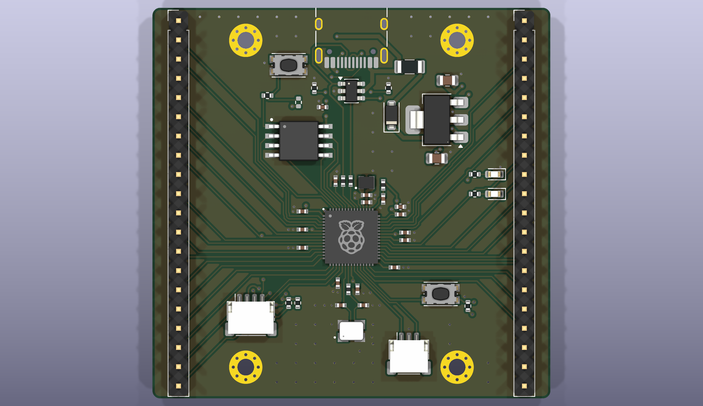
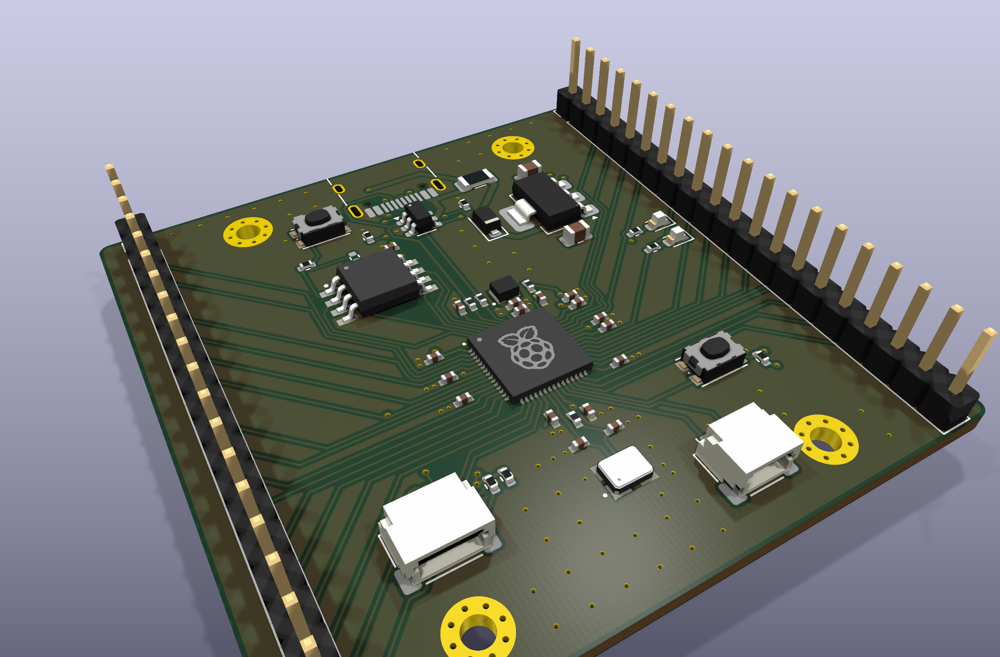
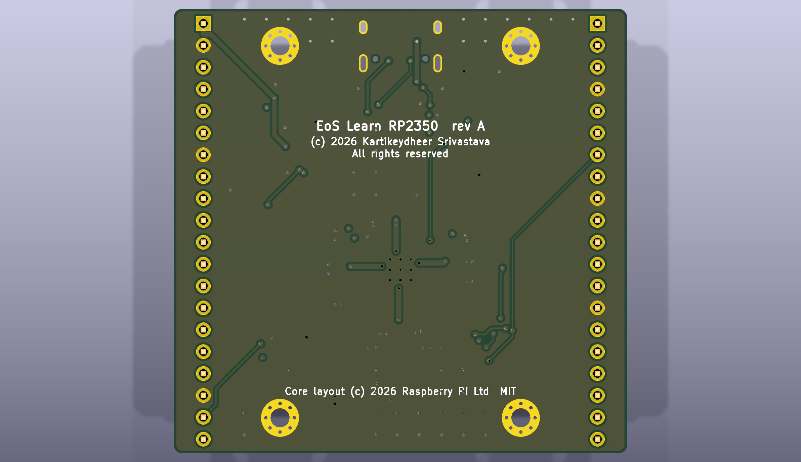

# EoS Learn RP2350

A four-layer RP2350A teaching board, 52.6 × 51.6 mm. Designed by Kartikeydheer Srivastava.
All rights reserved: not open source, and not under this repository's MIT licence.
Anyone may view it, clone this repository and run its tests; anything more needs
Kartikeydheer Srivastava's written permission (kartikeydheer@gmail.com). EmbeddedOS (EoS) Research Foundation has a limited, revocable
permission. See [LICENSE.txt](LICENSE.txt) and [the licence summary](../README.md#licence).



| | |
|---|---|
|  |  |

## What is on it

- **RP2350A**, 12 MHz crystal (ABM8-272-T3, 15 pF load capacitors, 1 kΩ series resistor) and
  128 Mbit QSPI flash (W25Q128JV).
- **Core regulator** (the RP2350's internal switcher): 3.3 µH polarity-marked AOTA-B201610S3R3-101-T
  inductor, 4.7 µF on VREG_VIN and on the output, 33 Ω + 4.7 µF filter on VREG_AVDD.
- **USB-C** (5 V sink, 5.1 kΩ on CC1 and CC2), USBLC6-2SC6 ESD protection and 27 Ω series
  resistors at the chip.
- **Power path:** a 500 mA polyfuse, then a Schottky diode, so 5 V fed into the header can
  power the board but never reach the USB host. Then an AP7361C 3.3 V regulator, which Diodes
  Inc. rates stable with ceramic capacitors of 2.2 µF or more, like those on this board.
- **BOOTSEL and RUN** buttons, a power LED and a user LED on GPIO25.
- **All 30 GPIOs** on two 1×20, 2.54 mm headers, in pin order, with ground pins spread along both.
- **Qwiic** (I2C0 on GPIO4/5, 4.7 kΩ pull-ups) and a Raspberry Pi Debug Probe **SWD** connector.

Every value comes from Raspberry Pi's *Hardware design with RP2350* and the RP2350 datasheet.

## The core layout is Raspberry Pi's, exactly

The RP2350 datasheet says the regulator's inductor "must be ... placed on the layout as indicated
in Figure 26". Raspberry Pi publishes that layout, the RP2350A Minimal Design R4, under the MIT
licence. So everything around the chip is theirs, unchanged:

- the footprints and positions of the chip, its regulator, the decoupling (all but C17, this
  board's own capacitor on ADC_AVDD), the crystal circuit, the USB resistors and the flash;
- the copper between them: 124 tracks, 25 vias and 7 zones.

One change: two of the 25 vias, ground vias beside the regulator capacitors, sat 0.05 mm from
the C6 and C7 ground pads, where solder wicks down the open barrel. They move 0.11 mm and
0.18 mm, still inside Raspberry Pi's ground pour, to clear both pads by at least 0.1 mm.

`tests/unit/test_eos_boards.py` checks where those parts sit, and the copper between them, down
to KiCad's 1 nm resolution, every time the test suite runs. It compares the board with the
reference file. The reference file records the SHA-256 of the Raspberry Pi design it was taken
from, and a test re-extracts it from that design when you supply the file (`RPI_MINIMAL_PCB`). The GPIO lines leave the chip along
Raspberry Pi's own escape paths; from there to the headers, the routing is this board's.

Raspberry Pi's licence requires its notice to travel with the design. It is on the back
silkscreen and in [hardware/footprints/EoS_RPi_Reference.LICENSE.txt](hardware/footprints/EoS_RPi_Reference.LICENSE.txt).

## Build results

| Check | Result |
|---|---|
| Schematic ERC | 0 violations |
| DRC errors | 0 |
| Unconnected items | 0 |
| Schematic ↔ board parity | 0 differences |
| DRC warnings | 4, explained below |

The four warnings:

- **Two short 3.3 V track ends.** These are Raspberry Pi's copper, kept unchanged. On their
  two-layer board those tracks ran into a 3.3 V pour; this four-layer board feeds 3.3 V from an
  inner plane instead.
- **Two USB-C silkscreen lines clipped at the board edge.** The connector is meant to sit on the
  edge.

## Fabrication

4 layers (signal / GND plane / 3.3 V plane / signal), 1.6 mm thick. Measured from the board file:

- **Tracks:** 0.15 mm, narrowing to 0.112 mm where the router necks down at a 0.4 mm-pitch pin.
- **Clearance:** 0.15 mm, and 0.125 mm at Raspberry Pi's regulator capacitor pads, as their
  footprints specify (the board's floor is 0.1 mm so that applies).
- **Vias:** 0.6 mm with a 0.3 mm drill; Raspberry Pi's own copper uses a 0.25 mm drill.
- **Holes:** at least 0.25 mm apart.

- Gerbers and drill files: [fab/gerbers](fab/gerbers)
- Bill of materials: [fab/eos-learn-rp2350-bom.csv](fab/eos-learn-rp2350-bom.csv)
- Pick-and-place: [fab/eos-learn-rp2350-placement.csv](fab/eos-learn-rp2350-placement.csv)
- STEP model: [fab/eos-learn-rp2350.step](fab/eos-learn-rp2350.step)
- Schematic: [eos-learn-rp2350-schematic.pdf](eos-learn-rp2350-schematic.pdf)
- KiCad project: [hardware](hardware)

## What has not been done

- **No board has been made or powered.** These are design files that pass KiCad's electrical and
  design rule checks; no hardware has been tested.
- **No signal-integrity simulation.** USB and QSPI were not simulated; the QSPI routing is
  Raspberry Pi's own.
- **USB D+ meets its ESD pad on a stub.** D+ from the connector and D+ from R3 join 0.7 mm from
  the USBLC6's D+ pad, which hangs on a 1.37 mm stub instead of lying on the line. D+ is
  32.05 mm and D− 25.85 mm, 6.19 mm apart. The link is Full Speed (12 Mbit/s).

## Rebuild

```
python3 tools/eos_boards/build.py eos_learn_rp2350
```

The design file is [tools/eos_boards/boards/eos_learn_rp2350.py](../../../tools/eos_boards/boards/eos_learn_rp2350.py).
