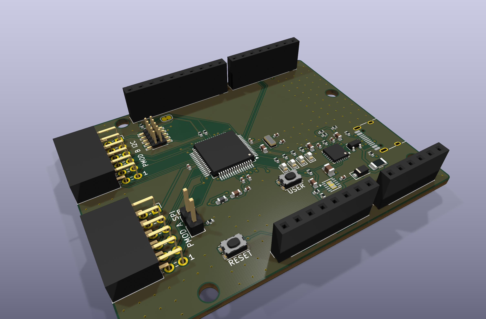
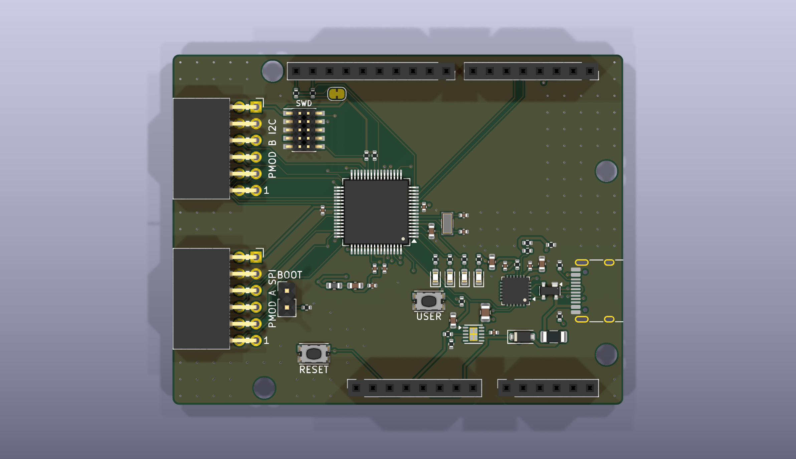
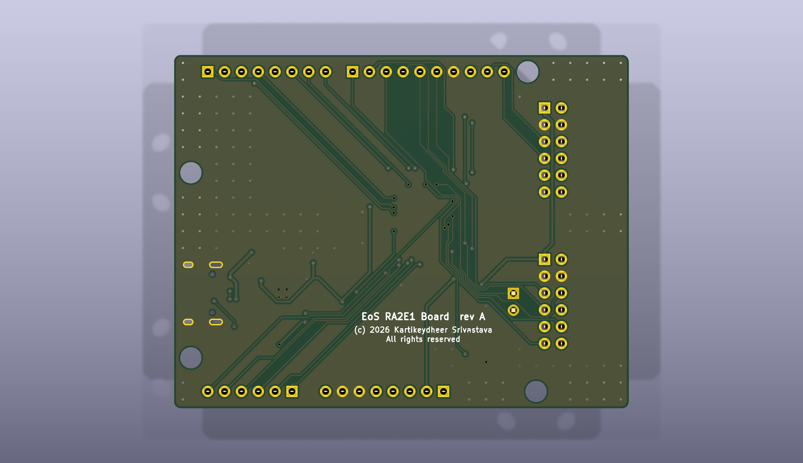

# EoS RA2E1 Board

A Renesas RA2E1 (R7FA2E1A92DFM, Cortex-M23, LQFP-64) development board that fits Arduino Uno R3 shields and Digilent Pmod modules, 68.58 × 53.34 mm, two layers.
Designed by Kartikeydheer Srivastava. All rights reserved: not open source, and not under this repository's MIT licence.
Anyone may view it, clone this repository and run its tests; anything more needs
Kartikeydheer Srivastava's written permission (kartikeydheer@gmail.com). EmbeddedOS (EoS) Research Foundation has a limited, revocable
permission. See [LICENSE.txt](LICENSE.txt) and [the licence summary](../README.md#licence).

A board for the same job as Renesas' EK-RA2E1; an original design, not a copy: no file of the vendor's was used.
No design file of the vendor's was used (no schematic, layout, CAD, Gerbers or BOM of Renesas' was opened);
the header positions come from Matthew Beckler's "Arduino Uno R3" dimension drawing v1.05, the Arduino UNO R3 product reference manual (A000066),
section 5.4, and Digilent's Pmod Interface Specification (revised 29 September 2020), section 4 and Figure 5.
The circuit comes from Renesas' RA2E1 data sheet, hardware manual and application notes, and the other
chip makers' data sheets.



| | |
|---|---|
|  |  |

The RA2E1 runs at 3.3 V from its 48 MHz on-chip oscillator. One USB-C port powers the board and
carries a CP2102N USB-UART bridge on SCI9, the RA2E1's serial-programming port, so the same port is
the console and, with the MD jumper fitted, the flash programmer. An Arm 10-pin SWD header takes
any SWD probe. The I/O runs at 3.3 V: IOREF is 3.3 V, and most RA2E1 pins take at most VCC + 0.3 V.

## What is on it

Sources: **DS** = Renesas RA2E1 Group Datasheet R01DS0386EJ0170 Rev.1.70; **UM** = RA2E1 Group
User's Manual: Hardware R01UH0852EJ0170 Rev.1.70; **QDG** = RA2 Quick Design Guide R01AN6060EU0104
Rev.1.04; **E2** = E2/E2 Lite Notes on Connection of RA Devices R20UT4686EJ0360 Rev.3.60; **CLK** =
Design Guide for Main Clock Circuits and Sub Clock Circuits R01AN7202EJ0102 Rev.1.02.

| Block | What it is, and where each value comes from |
|---|---|
| MCU | R7FA2E1A92DFM, 128 KB flash, 16 KB SRAM, −40 to 85 °C, LQFP-64 10 × 10 mm, 0.5 mm pitch (DS Table 1.12). KiCad's stock LQFP-64_10x10mm_P0.5mm footprint, checked against both package drawings the DS gives this part (Appendix 2, Figures A2.1 PLQP0064KB-C and A2.2 PLQP0064KL-A: body 10.0 mm, lead span 12.0 mm, leads 0.15–0.27 mm wide, foot 0.45–0.75 mm). |
| Supplies | 0.1 µF at each VCC/VSS pair (11/8, 39/40) (DS 2.1); 4.7 µF ceramic on VCL, the internal regulator's output (UM Table 38.1). AVCC0 must equal VCC and rise with or after it (DS Table 2.2): it comes from 3.3 V through a Bourns MH1608-221Y bead, with 0.1 µF at the pin and 10 µF + 10 nF at the supply (UM Figure 29.33, reference values). VREFH0 is tied to AVCC0 and VREFL0 to AVSS0, with 0.1 µF between them (DS 2.1, Table 1.14; UM Table 17.4). |
| 3.3 V LDO | TI TPS7A91 (SBVS282A), 1 A, from the 5 V rail: R1 = 3.57 kΩ, R2 = 1.15 kΩ (3.283 V, Table 7-1, Panasonic ERA-2AEB 0.1 %), 10 µF in (16 V 0805, so the 5 V bias costs less of it than the 50 % that section 7.1.3 allows for) and out, EN tied to IN. The RA2E1 needs its supply to rise at 0.02–2 ms/V (DS Table 2.14; 2 ms/V the limit in SCI boot mode). The TPS7A91's ramp has limits: tSS = 0.8 V × CNR/SS / INR/SS (Equation 6), INR/SS = 4.0–9.0 µA (section 5.5), so 10 nF ±10 % gives 0.80–2.2 ms, 0.24–0.67 ms/V. A plain LDO gives only a typical start-up time. That sum assumes the 5 V rail itself rises faster than about 0.5 V/ms: with EN tied to IN, a slower 5 V (a bench supply on the shield's 5V pin) is followed by the output and can break the 2 ms/V limit. Firmware that sets OFS1.LVDAS = 0 (voltage monitor 0 reset on at start-up) removes the upper limit outside SCI boot mode (Table 2.14, note 1); SCI boot is entered with JP1 and the reset button, not by a power-on ramp. |
| Power input | USB-C as a 5 V sink (5.1 kΩ Rd on CC1, CC2; TI SLVSFJ9 section 10.3.14.2), Littelfuse 1206L050YR polyfuse (0.50 A hold, 1.00 A trip), then a Nexperia PMEG6010CEH Schottky to the 5 V rail, so 5 V fed into the shield 5V pin cannot reach the host. The shield's 3V3 and IOREF pins are outputs: fed with 3.3 V while the 5 V rail is off, they would lift the TPS7A91's OUT above IN + 0.3 V, its absolute maximum (SBVS282A 5.1). |
| Current and heat | Budget: 300 mA from USB in all, the board's own load included (the CP2102N about 13.7 mA transmitting at 3 Mbaud, typical, CP2102N Table 3.2; the four LEDs 8.4 mA). D1 then drops at most about 0.48 V (Table 7, between the 100 mA and 500 mA maxima), 0.14 W, which at 330 K/W (standard footprint, Nexperia's thermal table) is 48 °C over ambient. The TPS7A91 then sees at most about 4.9 V in (5.25 V less D1's drop) and dissipates (4.9 − 3.283) V × 0.3 A = 0.49 W. TI's 62.5 °C/W θJA is its JEDEC board with plated vias in the thermal pad (SBVS282A 5.4, 7.1.4); this 1.2 × 2.0 mm pad has none (the generator adds exposed-pad vias only above 2 mm), so this board's θJA is higher and unknown. With ψJB = 30.7 °C/W (7.1.5) the junction runs 15 °C above the board next to the package at that load, so the board there must stay under 110 °C for the 125 °C limit (5.3). Not measured. |
| USB ESD | Littelfuse SP0503BAHTG on D+, D− and VBUS: diodes to ground only, no path from D+ to VBUS (CP2102N data sheet Figure 2.5; Littelfuse SP05xxBA pinout, page 1: pin 1 common, pins 2–4 one diode each). |
| USB-UART | Silicon Labs CP2102N-A02-GQFN24 (data sheet Rev. 1.5) on SCI9, P109 TXD9 and P110 RXD9: UM Table 35.18 makes these SCI boot mode's only pins. It runs from the board's 3.3 V (Figure 2.3: VREGIN tied to VDD, VIO to VDD), so it is never unpowered while the RA2E1 is. 4.7 µF + 0.1 µF at VREGIN/VDD and at VIO, 1 kΩ RSTb pull-up (section 2.1). VBUS sense through 22.1 kΩ / 47.5 kΩ (Figure 2.5) plus a 1.5 kΩ bleed, so its D+ pull-up comes on only with a host present: with the board fed from the 5V pin, the Schottky's reverse leakage would need 599 µA to lift the VBUS pin above VIL = 0.6 V (Table 3.7). PMEG6010CEH Table 7 gives 0.8 µA typical at 5 V and 25 °C, and its Fig. 2 about 100 µA typical at 85 °C; no maximum is given at 5 V, and at 60 V and 25 °C the maximum is 4.5 times the typical, which at 85 °C would still be about 450 µA. The bleed costs 3.4 mA from a host. |
| Clocks | No main crystal: the HOCO stays within ±1 % at 48 MHz over −40 to 105 °C and 1.6–5.5 V (DS Table 2.21, QDG 5.6), enough for the SCIs, SPI and IIC; the RA2E1 has no USB. EXTAL and XTAL serve as SCI1 for D0/D1 (UM Table 17.4). Sub-clock fitted, since the RTC counts the sub-clock or the LOCO (UM 22.1) and the LOCO is ±15 % (DS Table 2.21): Abracon ABS07-32.768KHZ-9-T (CL 9 pF, ESR ≤ 70 kΩ), 15 pF on XCIN and 18 pF on XCOUT, no damping resistor, Standard CL drive (SOMCR.SODRV = 00): CLK Table 4.2.7, the Renesas matching result for the RA2E1's group, which allows up to 120 kΩ ESR. Layout (CLK 6.1.1, 6.1.4): pin → crystal pad → load capacitor laid first on the top layer with no via, XCOUT 4.9 mm and XCIN 5.8 mm to the crystal, 0.35 mm apart, with VSS pin 8's track to C1 between D1 and XCOUT. D0 and D1 drop through vias just inside the chip outline and leave north-east on the bottom layer; TXD9 and RXD9 run south of the LEDs. None of the pre-laid copper of another net is in the crystal area on either layer; see the last section for the autorouter's nets. |
| Reset, mode, NMI | RES: 10 kΩ pull-up (E2 Figure 2.7: 4.7–10 kΩ), no capacitor (QDG 6.2), a reset button; RES also goes to the SWD header and the Uno RESET pin. MD: internal pull-up on during reset (UM Table A1.1), and JP1 (a 2-pin header with a shunt) with 1.5 kΩ to ground (E2 Figure 2.9): fitted at reset is SCI boot mode (UM Table 3.1). With it fitted MD is at most 0.43 V, under VIL = 0.66 V (DS Tables 2.5 and 2.10). P200/NMI: 10 kΩ pull-up (UM Table 17.4). |
| Debug | Arm Cortex 10-pin 1.27 mm SWD header in place of the vendor kit's J-Link OB probe, whose firmware is SEGGER's: SWDIO P108, SWCLK P300, nRESET, VTref 3.3 V (QDG Figure 1). Both SWD pins have internal pull-ups on by default (QDG 2), so none are fitted. The RA2E1 has no SWO (DS Table 1.14), so pins 6 and 8 are open. Renesas' E2 and E2 Lite use those two pins for TxD9 and RxD9, flash programming through the emulator (R20UT4686 Table 2.3); they stay open here because the CP2102N already drives RXD9, so program through the CP2102N (SCI boot) or over SWD. |
| Pmod ports | Two 2×6 right-angle female host ports on the left edge, 0.9 in apart, the 7–12 row 10.16 mm and the 1–6 row 12.70 mm from the edge, pin 1 as in the specification's Figure 5; 3.3 V only (its reduced subset). J7, Type 2A (expanded SPI) on the RA2E1's SPI; J8, Type 6A (expanded I²C) on IIC0. Pin map below. |
| I²C | IIC0 (P204 SCL, P407 SDA) on the Uno SDA/SCL pins and J8. 2.2 kΩ pull-ups to 3.3 V through solder jumper JP2, bridged as delivered: the Pmod specification suggests jumpered pull-ups on the host (section 2). 2.2 kΩ is above TI SLVA689A's RP(min) of 0.97 kΩ, and fast mode's 300 ns rise (DS Table 2.35) holds up to 161 pF. |
| User I/O | Three user LEDs at about 2 mA: red on P400 (Kingbright APTD1608LSURCK, 750 Ω), green on P401 (APTD1608LCGCK, 680 Ω), yellow on P403 (APTD1608LSYCK, 680 Ω); P400 and P401 are GPT9 outputs, so those two can be dimmed. User button on P402 (IRQ4) with a 10 kΩ pull-up. All ports are high-impedance after reset (UM Table A1.1), so the LEDs start off. |
| Power LED | Kingbright APTD1608LCGCK (VF 1.9 V at 2 mA, DSAO7432) through 680 Ω from 3.3 V: 2.1 mA. |
| Shield headers | Uno R3 positions (Beckler drawing v1.05; holes from A000066 section 5.4), pin order from A000066 section 5. 3.3 V logic. |

### Pin map

PWM on D3, D5 and D6 comes from the AGT compare outputs, on D9, D10 and D11 from the GPT. D2 and D3
are interrupt pins, as on the Uno. The RA2E1 has one SPI; D10–D13 and J7 share it, each with its own
chip select.

| Header pin | RA2E1 pin | Functions used |
|---|---|---|
| D0, D1 | P212, P213 | SCI1 RXD1, TXD1 (EXTAL and XTAL, free with no main crystal) |
| D2 | P409 | IRQ6 |
| D3 | P410 | IRQ5, AGTOB1 |
| D4 | P411 | GPIO |
| D5 | P914 | AGTOA1 |
| D6 | P208 | AGTOB0 |
| D7, D8 | P207, P206 | GPIO |
| D9 | P302 | GTIOC7A |
| D10 | P103 | SSLA0, GTIOC5A |
| D11 | P101 | MOSIA, GTIOC8A |
| D12 | P100 | MISOA |
| D13 | P102 | RSPCKA |
| SDA, SCL | P407, P204 | IIC0 SDA0, SCL0 |
| A0 | P012 | AN007 |
| A1–A5 | P004–P000 | AN004–AN000 |
| IOREF, 3V3 | — | 3.3 V |
| 5V | — | the 5 V rail (after the Schottky) |
| RESET | RES | |
| AREF, VIN | — | not connected |

| Pmod pin | J7 (Type 2A, SPI) | J8 (Type 6A, I²C) |
|---|---|---|
| 1 | CS: P104 (SSLA1) | INT: P205 (IRQ1) |
| 2 | MOSI: P101 | RESET: P112 |
| 3 | MISO: P100 | SCL: P204 |
| 4 | SCK: P102 | SDA: P407 |
| 5, 11 | GND | GND |
| 6, 12 | 3.3 V | 3.3 V |
| 7 | INT: P105 (IRQ0) | GPIO: P111 |
| 8 | RESET: P107 | GPIO: P113 |
| 9 | CS2: P106 (SSLA3) | GPIO: P303 |
| 10 | CS3: P500 | GPIO: P304 |

On-board: SWDIO P108, SWCLK P300, SCI9 P109/P110 (CP2102N), MD P201, NMI P200, sub-clock
P214/P215. Not connected: P301, P408, P501, P502, P913, P915 and P013–P015; firmware sets them as
outputs (UM Table 17.4). Each interrupt line has its own IRQ channel (DS Table 1.15): IRQ0 J7 INT,
IRQ1 J8 INT, IRQ4 the user button, IRQ5 D3, IRQ6 D2.

To program over USB: fit JP1, press reset, and use the RA2E1's SCI boot mode through the
CP2102N's serial port (UM section 35.10). Remove JP1 and reset to run the program.

## Not on this board

- **The J-Link OB debug probe.** It runs SEGGER's firmware. The SWD header takes any SWD probe,
  and the CP2102N gives the serial port and SCI boot programming.
- **The capacitive-touch button.** A CTSU electrode needs Renesas' electrode layout guidance and
  tuning, which were not followed here, so it is left out; its pins serve as GPIO and TSCAP (P112)
  has no capacitor.
- **A main crystal.** The HOCO's ±1 % covers everything on the board (see Clocks); EXTAL and XTAL
  are used as SCI1 instead.
- **AREF and VIN on the shield header.** A shield could put up to 5 V on AREF, above VREFH0's
  AVCC0 limit (DS Table 2.2), and 7–12 V on VIN, which would reach the 5 V rail. Neither is
  connected.
- **I²C on A4/A5.** The RA2E1's ADC pins cannot do IIC, so SDA/SCL are
  separate pins (the Uno R3 layout), and older shields that expect I²C on A4/A5 will not see it.
- **5 V shield logic.** Shields must use 3.3 V logic (IOREF tells them so).
- **The Uno's 2 × 3 ICSP header.** Shields that take SPI only from the ICSP header will not work;
  D11–D13 carry the SPI.
- **A boot switch reachable under a shield.** JP1 is a 2.54 mm header with a shunt, about 8.5 mm
  tall, inside the shield area: SCI boot mode is selected with the shield off, and a tall shunt may
  touch a shield's underside.
- **Series resistors and ESD diodes on the Pmod lines**, which the Pmod specification describes
  as usual on Digilent's own boards but does not require (section 2).

## Build results

The numbers below are from `build-report.json` and `drc.json` in this folder.

| Check | Result |
|---|---|
| Schematic ERC | 0 violations |
| DRC errors | 0 |
| Unconnected items | 0 |
| Schematic ↔ board parity | 0 differences |
| DRC warnings | 2: silkscreen within the board-edge clearance, the outline of J1 (USB-C), which sits at the board edge |

## Fabrication

2 layers, 1.6 mm thick, ground poured on both sides. Design rules (the generator's defaults plus
the board's net classes):

- **Tracks and clearance:** 0.15 mm clearance. The smallest track is 0.10 mm, the board's minimum:
  the autorouter lays 0.15 mm but necks down to enter fine-pitch pads, and the generator widens any
  neck below 0.10 mm to 0.10 mm (the previous build had 46 segments at 0.11 mm and 2 at 0.10 mm).
  Class widths: 0.4 mm on VBUS from the connector through the fuse and Schottky; 0.3 mm on the 5 V
  and 3.3 V rails, AVCC0 and VCL, because they enter 0.25–0.3 mm pads at 0.5 mm pitch (TPS7A91,
  LQFP-64, QFN-24), where the router may neck them to 0.225 mm; 0.25 mm on ground; 0.2 mm on USB
  D+/D−.
- **Laid before the autorouter** (`priority_routes`): the USB pair from the receptacle through the
  ESD part to the CP2102N and both second-contact joins, the 32.768 kHz lines, C1's VCC and VSS
  tracks, D0 and D1, the LED anode links, TXD9 and RXD9, the CP2102N's ground pin to its pad, and
  the LDO's FB and EN lines.
- **Vias:** 0.6 mm with a 0.3 mm drill. The CP2102N's exposed pad has a 2 × 2 array of them into the
  bottom pour; the TPS7A91's 1.2 × 2.0 mm thermal pad has none (see Current and heat).
- **Smallest drill:** 0.3 mm (vias). Headers have 1.0 mm holes; the four mounting holes are 3.2 mm,
  unplated.

## What has not been done

- **No board has been made or tested.** No firmware is included, and none has been run on this
  board.
- **The routed layout is checked by DRC and a second review only.** The layout changes after the
  independent review (USB pair and 32.768 kHz lines laid first, D0/D1/TXD9/RXD9 moved off the
  crystal, C1, C13, C15 and the crystal moved) are routed in this revision's full build (see Build
  results) and were measured by a second reviewer; none of it has been tried on a made board.
- **The autorouter's nets near the crystal.** Only the pre-laid copper is fixed. The other nets are
  Freerouting's, and this design file cannot close the bottom layer under the crystal to them: the
  generator's router keep-outs are top-layer only, and a copper keep-out would also remove the
  ground. Check the routed board for any foreign track or via in the crystal area on either layer
  (CLK 6.1.1 (1), 6.1.3.1); a bottom-layer router keep-out in the generator would make it certain.
  The bottom ground there is the board's bottom pour, joined to the rest of the ground, not the
  separate pattern tied only to the shield that CLK 6.1.3.1 (3) describes.
- **Ground stitching under the chip.** The design file cannot add stitching vias: the generator
  stitches the pours on a 2.54 mm grid where nothing else is near, and gives a pour fragment a via
  only where one fits inside it. A fragment that holds a pad but has no room for a via (VSS pin 40's,
  in the previous build) reaches the ground only through its tracks. Taking D0, D1, TXD9 and RXD9
  off the bottom layer under the chip leaves RXD9 as the only pre-laid net crossing under it.
- **One USB join changes layer.** B7 reaches A7 through two vias (3.7 mm), in the signal path only
  with the plug the other way up; no single-layer path exists for that join (see the design file).
- **Not verified:** the Pmod socket (Sullins PPPC062LJBN-RC) is drawn with KiCad's generic 2×6
  right-angle 2.54 mm socket footprint (8.51 mm body); Sullins' drawing could not be downloaded, so
  its pin-row offset and body depth are unchecked. The footprint's own pin-1 mark sits on its pad 1,
  which is Pmod pin 6; the silkscreen adds a "1" beside pad 11, Pmod pin 1 (Figure 5). The 32.768
  kHz load capacitors are Renesas' matching result for a 9 pF crystal; start-up margin on this board
  has not been measured. Heat at the 300 mA budget is not measured (see Current and heat).
- **BOM.** Manufacturer part numbers now cover the crystal's load capacitors, R8 and R9 (Panasonic
  ERA-2AEB3571X, ERA-2AEB1151X), C13 (Murata GRM21BR61C106KE15L), C14 (GRM188R61A106KE69D) and C3
  (GRM188Z71A475KE15D), taken from distributor listings; their data sheets' DC-bias curves were not
  read. The other resistors and capacitors are given by value, tolerance and size only; JP1 and its
  shunt by pitch; PMEG6010CEH's orderable packing code is not given.
- **No impedance simulation** of the USB full-speed lines was done.

## Rebuild

```
python3 tools/eos_boards/build.py eos_ra2e1_board
```

The design file is [tools/eos_boards/boards/eos_ra2e1_board.py](../../../tools/eos_boards/boards/eos_ra2e1_board.py).
