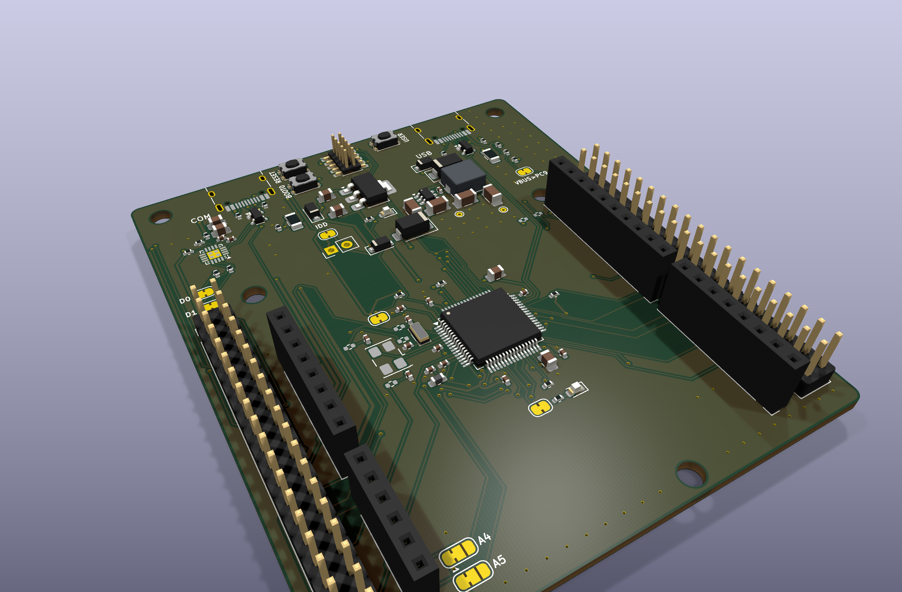
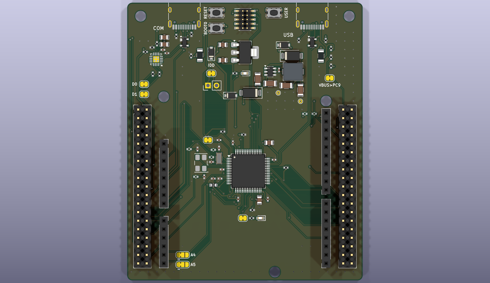
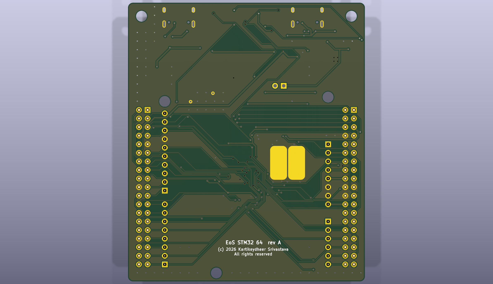

# EoS STM32 64

An STM32F411RE development board in the Nucleo-64 format, 70 × 82.5 mm, two layers.
Designed by Kartikeydheer Srivastava.
All rights reserved: not open source, and not under this repository's MIT licence.
Anyone may view it, clone this repository and run its tests; anything more needs
Kartikeydheer Srivastava's written permission (kartikeydheer@gmail.com). EmbeddedOS (EoS) Research Foundation has a limited, revocable
permission. See [LICENSE.txt](LICENSE.txt) and [the licence summary](../README.md#licence).

A board for the same job as ST's NUCLEO-F411RE (a Nucleo-64 board); an original design, not a
copy: no design file of the vendor's was used (no schematic, layout, CAD, Gerbers or BOM). Of
ST's board documentation, only the user manual UM1724 Rev 17 was used: the header positions come
from its Figure 5 (mechanical dimensions), and the header signals from its Table 16 (Arduino
connectors) and Table 29 (ST morpho connectors) for NUCLEO-F411RE. "STM32", "Nucleo",
"NUCLEO-F411RE" and "ST morpho" are STMicroelectronics' names, and "Arduino" is Arduino's; they
appear here, and in the board's name, only to say which chip the board carries (an STM32F411RE)
and which board format and headers it follows. EoS STM32 64 is not an ST or Arduino product, and
neither company made, endorsed or checked it.



| | |
|---|---|
|  |  |

The STM32F411RET6 (Cortex-M4F, 100 MHz, 512 KB flash, 128 KB SRAM) runs from 3.3 V with an
8 MHz crystal and a 32.768 kHz crystal. Arduino Uno V3 headers and both ST morpho 2×19 headers
are where a Nucleo-64 has them, with the same signals. A standard 10-pin Cortex Debug connector
replaces the NUCLEO's on-board ST-LINK, whose firmware is ST's. One USB-C port carries a CP2102N
serial bridge on USART2 (PA2/PA3, D1/D0, as on the NUCLEO); a second USB-C goes to the MCU's own
USB, so the board can be flashed by the ROM DFU bootloader with no probe: hold BOOT0 (B3) and
press RESET (B2).

**Why the STM32F411RE.** It is one of the boards UM1724's tables are written for, so every
header pin carries the signal those tables name with nothing reinterpreted. It is in production
and widely stocked, its USB OTG FS has a DFU bootloader in ROM, and BOOT0 is a dedicated pin, so
no header pin is shared with the boot strap.

## What is on it

| Block | What and why | Source |
|---|---|---|
| MCU supply | 100 nF at each of the four VDD pins, 4.7 µF on VDD; VCAP_1 4.7 µF X5R (ESR < 1 Ω) against pin 30; VDDA 100 nF at pins 12/13 + 1 µF, fed from VDD through a ferrite bead (TDK MMZ1608B601C, 600 Ω, 0.40 Ω: under 1 mV at the ADC's 1.8 mA); VBAT 100 nF and tied to VDD through solder jumper JP2 (cut it to run VBAT from a cell on CN7 pin 33). VREF+ is bonded to VDDA on the LQFP-64, so there is no separate VREF+ pin. | ST DS10314 Rev 8 Figure 11, Figure 17, Tables 16, 65; AN4488 Rev 7 section 2.2; TDK MMZ1608 catalogue |
| Reset and boot | NRST: 100 nF to GND at pin 7 (1.8 mm, top layer), the internal 30–50 kΩ pull-up, reset button B2, the debug connector's nRESET. BOOT0: 10 kΩ to GND and button B3 to VDD. BOOT1 (PB2): 10 kΩ to GND, so BOOT0 high selects system memory, not SRAM. PA10 (USART1_RX, D2): 47 kΩ to VDD, because ST asks for the RX pins of the bootloader interfaces not in use to be held at a known level while it picks one. | DS10314 Figure 32, Table 56; AN4488 section 3.1, Figure 12; RM0383 Rev 3 Table 2; AN2606 Rev 70 section 4.3, Table 83 |
| Crystal placement | The MCU sits with pin 1 at the top left, so the crystal pins 3–6 face open board. The LSE crystal is against pins 3–4 and the HSE crystal just beyond it against pins 5–6; every crystal line, load-capacitor line and link line is laid on the top layer, with no vias, before the autorouter runs (the design file's priority routes). Pin to crystal pad: PC14 3.3 mm, PC15 2.8 mm, PH1 6.9 mm, PH0 10.5 mm (PH0 runs between Y1's own pad rows); each load capacitor is 1.3–2.0 mm from its pad. On the top layer only the VBAT and PC13 escapes run between a crystal (Y2) and the MCU, which pins 1–2 force; they are a supply and a button input. The bottom layer under the oscillators is solid ground: two 5 × 10 mm ground pads on the bottom side (TP1, TP2, nothing fitted) cover both crystals, their load capacitors and links and the oscillator lines to within 1.5 mm of the pins, so no other net can run under them. On the routed board no other net's copper is inside Y1's courtyard, and Y2's is clipped only by 0.12 mm of PH0 (the HSE line) on the top layer; the header side of the PC15 link passes between R18's pads; see "What has not been done". The LSE stays nearest the MCU and the HSE beyond it: the LSE has the smaller margin (gmcrit 0.59 µA/V against 1.50 µA/V in high drive, 2.5 times; the HSE's 0.23 against 1 mA/V is 4.4 times) and the higher impedance, and 10 mm of 8 MHz line adds about 1 pF, inside the 4 pF stray allowance. | AN2867 Rev 24 section 7.1; DS10314 Tables 37, 38 |
| HSE crystal | 8 MHz ECS-80-10-30B-CWN-TR (CL 10 pF, ESR 100 Ω max, C0 5 pF max). 8 MHz, not 24 MHz, because the DFU bootloader measures the HSE against the HSI and ST says a low frequency is detected better. gmcrit = 4 × ESR × (2πF)² × (C0 + CL)² = 0.23 mA/V with worst-case figures, under the F411's Gm_crit_max of 1 mA/V. Load capacitors 12 pF C0G: CL1 = CL2 = 2 × (CL − Cs) with Cs = 4 pF (two 5 pF oscillator pins in series, 2.5 pF, plus about 1.5 pF of board). Drive level at a full 3.3 V swing is 67 µW, under the crystal's 100 µW, so no series resistor. | ECS ECX-53B datasheet; AN2867 sections 3.3–3.5; DS10314 Tables 37, 53; AN2606 section 38.1 |
| LSE crystal | 32.768 kHz Abracon ABS07-120-32.768kHz-T (CL 6 pF, ESR 60 kΩ max, C0 1.6 pF max), which AN2867 Table 7 lists for the STM32F4. With the worst-case C0, gmcrit is 0.59 µA/V: above the low-power mode's 0.56 µA/V, well under the high-drive mode's 1.50 µA/V, so firmware should set LSEMOD = 1. Load capacitors 3.9 pF C0G (2 × (6 − 4) pF; AN4488 asks for CL ≤ 7 pF). | Abracon ABS07-120 datasheet; AN2867 Table 7; DS10314 Table 38; AN4488 section 6.2; RM0383 (RCC_BDCR) |
| Crystal pins on CN7 | PH0, PH1, PC14 and PC15 reach CN7 (pins 29, 31, 25, 27) only through 0 Ω links R18–R21, not fitted, each beside its crystal's load capacitor, so the stub on the oscillator net is one pad. Remove a crystal and its capacitors and fit the links to use those pins on the header. | AN2867 section 7.1 |
| User I/O | User LED LD2 on PA5 (green APTD1608LCGCK, 680 Ω: 2.1 mA), through solder jumper JP3 so D13 / SPI1_SCK can be freed. User button B1 on PC13 with 10 kΩ to VDD (pressed reads 0; PC13 never sources current here). | UM1724 (names LD2, B1); Kingbright DSAO7432; DS10314 Table 8 note 2, Table 53 |
| Debug | Arm 10-pin Cortex Debug connector, 1.27 mm (J3): VTref = VDD, SWDIO PA13, SWCLK PA14, SWO PB3, TDI PA15 (so JTAG works too), nRESET. Any CMSIS-DAP, J-Link or ST-LINK probe connects here. **Setting the RDP option byte to Level 2 is irreversible: it permanently disables the debug port and the ROM bootloader (DFU included)**, so such a board can then be reflashed only by its own firmware. | AN4488 Table 8; RM0383 Rev 3 section 3.6.3 |
| USB-UART | CP2102N-A02-GQFN20 on the board's own 3.3 V, its regulator unused (VREGIN tied to VDD), so it is powered whenever the MCU is and the MCU's TX can never back-power it. 4.7 µF + 0.1 µF on VREGIN and on VDD: the two 0.1 µF against pins 6 and 7 and the two 4.7 µF beside them, joined on the top layer with no vias. 1 kΩ RSTb pull-up. Its VBUS pin reads J1's VBUS ahead of the fuse, as the data sheet draws it, through the 22.1 kΩ / 47.5 kΩ divider (5 V reads 3.41 V and 4.40 V reads 3.00 V, above its VIH of 2.7 V), so its D+ pull-up comes on only while a host supplies J1. TXD and RXD meet PA3 and PA2 through 1 kΩ and solder jumpers JP8/JP9, bridged as delivered: cut them to free D0/D1 for a shield. A shield driving D0 fights the bridge through 1 kΩ, at most 3.6 mA, as does the bridge driving PA3 while JP1 is cut and the MCU is off (PA3 is 5 V tolerant). 1 kΩ × about 17 pF is 17 ns, against 333 ns per bit at the bridge's 3 Mbaud maximum. | Silicon Labs CP2102N data sheet Rev. 1.5, Figures 2.3 and 2.5, sections 2.1, 2.3, Table 3.7; DS10314 Table 11 |
| USB ESD | Littelfuse SP0503BAHTG on both ports: three diodes to ground on D+, D− and VBUS, none between them. A USBLC6-style array, whose data-line diodes run to its VBUS pin, could let a live D+ pull-up hold VBUS near 2 V after a host unplugs, so a VBUS-sensing chip (the CP2102N, or the STM32 watching PC9) never sees the unplug. | Littelfuse SP05xxBA datasheet; CP2102N data sheet Figure 2.5 |
| USB routing | Each pair runs connector contact, then ESD pad, then chip pin, on the top layer and through the ESD pads with no stub, laid before the autorouter. The receptacle's duplicate contacts are tied at the connector: on J1, B6 in front of A7 and B7 through a via pair; on J2, A6 behind A7 and A7 in front of A6. J1's pair is 13–16 mm from the receptacle to the CP2102N. J2's pair runs down a channel east of the buck to PA11/PA12, 47–50 mm, on the top layer with no via; CN10 pins 12 and 14 (PA12/PA11) reach it only through 0 Ω links R24/R25, not fitted, so nothing on the header hangs on the live lines. | — |
| VBUS bleeds | Each port's VBUS has 4.7 kΩ to ground (R3 on J1, R23 on J2); with its 69.6 kΩ divider that is 4.4 kΩ. The OR diode's reverse leakage at 5 V is 1.2 µA typical at 25 °C (its 50 µA maximum is specified at 30 V) and, from the data sheet's typical curve, about 100 µA at 85 °C, which holds an unplugged port at 0.44 V: under USB Type-C's vSafe0V of 0.8 V, and on J1 it puts 0.30 V on the CP2102N's VBUS pin, under its VIL of 0.6 V. A host attached costs 1.1 mA per port. | Nexperia PMEG3010CEH data sheet Rev. 02, Table 8 and Fig. 2; CP2102N Table 3.7; USB Type-C specification (vSafe0V) |
| Native USB | USB-C J2 on PA11/PA12 (OTG FS, device mode; no external pull-up needed). The OTG FS's own VBUS input, PA9, is Arduino D8, so its hardware sensing stays off (NOVBUSSENS) and J2's VBUS reaches PC9 instead, a 5 V-tolerant pin on CN10 only, through 22.1 kΩ / 47.5 kΩ (3.41 V; under the VDD + 4 V limit even with the MCU off) and solder jumper JP7, bridged as delivered. **Firmware must watch PC9 and keep the D+ pull-up off (OTG_FS_DCTL SDIS) while it reads low**, so the pull-up never drives an unpowered host; cut JP7 to use PC9 for something else. The ROM DFU bootloader uses only PA11/PA12. | RM0383 section 22.5, OTG_FS_GCCFG and OTG_FS_DCTL; AN2606 Table 83; DS10314 Tables 8, 11 |
| USB-C ports | Both are 5 V sinks (5.1 kΩ Rd on CC1 and CC2), each with a Littelfuse 1206L050 polyfuse (0.5 A hold, 1.0 A trip). | USB Type-C specification (Rd); Littelfuse 1206L datasheet |
| 5 V rail | J1, J2 and E5V (CN7 pin 6, 4.75–5.5 V) are ORed through Nexperia PMEG3010CEH Schottky diodes (0.44 V max at 0.5 A; low-leakage parts, for the bleeds above), and the VIN buck through a B240A. | Nexperia PMEG3010CEH Rev. 02; Diodes DS13004 Rev 22-2 |
| VIN | 7–12 V on CN6 pin 8 / CN7 pin 24 (the Arduino VIN range), through a B240A against reverse polarity, into an AP63205 buck (2 A, current limit 2.5–3.1 A) with the parts in its Table 3: 10 µF in (fitted twice, because section 11 asks for "a ceramic capacitor greater than 10 µF" and a 50 V X5R 10 µF loses part of its value at 12 V), 2 × 22 µF out, 100 nF bootstrap, EN tied to VIN, and 4.7 µH as a Bourns SRP5030T-4R7M (Isat 6.0 A, Irms 4.6 A), which stays out of saturation up to the buck's current limit. Laid out as the datasheet's Figure 25: the input capacitor straddles the VIN and GND pins (layout item 4), the bootstrap capacitor and the inductor's SW pad sit beside pins 5–6, an output capacitor shares the input capacitor's ground, all joined on the top layer with no vias before the autorouter runs; the feedback line goes round the buck on the top layer, kept 0.5 mm or more from the bootstrap copper. No part sits under the buck, but item 3 asks for the bottom layer under the device to be ground, and the generator cannot keep tracks off the bottom layer: on the routed board none runs under the AP63205, the input capacitor C5 or the output capacitors, while PA15 (TDI) runs on the bottom layer under the inductor L1 (3.0 mm under its body) and the OR diode D5 (3.8 mm). For item 2, plated GND pads (0.5 mm holes, TP3 and TP4) sit beside the input and output capacitors' grounds. Item 2 is there for heat at 2 A; the 5 V taken from VIN is budgeted at 0.5 A, where Figure 4 shows about 94 % efficiency from 12 V, so the buck dissipates under 0.3 W (25 °C at the TSOT26's 89 °C/W) and the B240A OR diode drops at most 0.45 V and dissipates about 0.2 W. | Diodes DS41326 Rev 3-2 Table 3, sections 10–12, PCB Layout, Figure 4, Figure 25, thermal table; Diodes DS13004 Rev 22-2; Bourns SRP5030T datasheet |
| 3.3 V | AP7361C-33 LDO (1 A, 2.2–6.0 V in, 140 mV max dropout at 300 mA), 4.7 µF in and out as its typical application shows. From a 4.6 V rail it drops 1.3 V: at 400 mA that is 0.52 W, a 57 °C rise at the 110 °C/W the datasheet gives for SOT-223 on its minimum pad, so the 3.3 V rail is budgeted at 400 mA continuous (450 mA would be 64 °C). Power LED LD3 (red APTD1608LSURCK, 750 Ω: 2.1 mA). | Diodes DS37274 Rev 5-2; Kingbright DSAO7433 |
| IDD | JP1 is a solder jumper, bridged as delivered, from the 3.3 V rail to the MCU's VDD, with the 2-pin header J4 (not fitted) across it: cut JP1 and connect an ammeter to J4 to measure the MCU's current. | — |
| Headers | Arduino CN5, CN6, CN8, CN9 (female) and ST morpho CN7, CN10 (2×19 male) at the UM1724 Figure 5 positions, wired as UM1724 Tables 16 and 29 give for NUCLEO-F411RE. A4/A5 are PC1/PC0 as delivered; solder jumpers JP4/JP6 move them to PB9/PB8, the tables' alternative. "VDD" (CN7 5) is the MCU supply after JP1; "+3.3V" and IOREF are the 3.3 V rail; AVDD (CN10 7) and AREF (CN5 8) are VDDA, an output here as on the NUCLEO: **do not drive AREF**, which would push current into VDDA through the ferrite bead. U5V (CN10 8) is J1's VBUS after its fuse: **do not feed it**, since anything fed in back-powers the host on J1. CN10 pins 12/14 (PA12/PA11) are open until R24/R25 are fitted, and CN10 pin 1 (PC9) carries J2's VBUS sense until JP7 is cut. AGND is GND. Pins the tables mark "-" are unconnected, including CN10 pin 18, which is PB11 on other parts: the F411 has no PB11 (its LQFP-64 pin 30 is VCAP_1). | UM1724 Rev 17 Figure 5, Tables 16, 29 |

### Mechanical

Positions from UM1724 Figure 5 (origin top left, y down, mm):

| Item | Position | From the drawing |
|---|---|---|
| Outline | 70.00 × 82.50 | overall dimensions |
| Morpho CN7 pin 1 / CN10 pin 1 | (3.25, 31.74) / (64.21, 31.74) | outer columns 63.50 apart, 7.62 outside the Arduino columns; bottom row 77.46 from the top (3.80 + 2.54 + 71.12) |
| Arduino CN6 / CN8 pin 1 | (10.87, 41.90) / (10.87, 64.76) | 10.87 from the left edge; CN6 pin 8 is 5.08 above A0 |
| Arduino CN5 pin 1 (D8) / CN9 pin 1 (D0) | (59.13, 55.62) / (59.13, 77.46) | 48.26 right of CN8; D7 to D8 is 4.06 |
| Holes | (10.87, 27.93), (59.13, 29.20), (43.89, 80.00) | 13.97 above CN6 pin 1; 3.56 above D15; 2.54 below the bottom row and 33.02 right of CN8 |

UM1724 does not dimension the holes; they are 3.2 mm, unplated, as on the Uno R3 whose layout
these positions match. The two holes at the top (4, 4) and (66, 4) are this board's own. The
drawing's bottom edge has a 33.00 mm tab reaching 82.50 and is 80.50 elsewhere; the generator
draws a rectangle, so this board fills the two bottom corners down to 82.50.

## Not on this board

- **ST-LINK/V2-1.** Its firmware is ST's. The Cortex Debug connector takes any SWD probe; the
  serial port is the CP2102N; flashing without a probe is the ROM DFU bootloader on J2. The
  ST-LINK's own USB functions go with it; this board clocks the MCU from its own 8 MHz crystal.
- **Flashing over the serial port.** The F411's ROM bootloader uses USART2 on PD5/PD6, which
  the LQFP-64 does not have (AN2606 Table 83), so the COM port cannot flash the chip. USART1
  (PA9/PA10, D8/D2) does reach the ROM bootloader, but the bridge is not wired there, to keep the
  NUCLEO's D0/D1 serial port.
- **USB host mode.** There is no switch to supply VBUS on J2, so OTG host and dual-role are not
  supported.
- **The NUCLEO's other solder-bridge options.** Only those that UM1724's pin tables imply are
  here (A4/A5, the crystal-pin links, D0/D1); the rest are described only in its user manual's
  solder-bridge table and design files, which were not used.

## Build results

The numbers below are from `build-report.json` and `drc.json` in this folder.

| Check | Result |
|---|---|
| Schematic ERC | 0 violations |
| DRC errors | 0 |
| Unconnected items | 0 |
| Schematic ↔ board parity | 0 differences |
| DRC warnings | 4: silkscreen within the board-edge clearance, the outline of J1 (USB-C) and J2 (USB-C), which sit at the board edge |

## Fabrication

2 layers, 1.6 mm thick, ground poured on both sides. Design rules (from the design file and the
generator's defaults):

- **Tracks:** 0.15 mm signals, 0.2 mm USB D+/D−, 0.3 mm on 3.3 V and VDD, 0.4 mm on VBUS, the
  5 V rail, E5V, VIN and the buck switch node.
- **Clearance:** 0.15 mm.
- **Vias:** 0.6 mm with a 0.3 mm drill.
- **Smallest drill:** 0.3 mm (vias). Plated test pads TP3/TP4 0.5 mm; header pins 1.0 mm; mounting
  holes 3.2 mm, unplated.
- **Bottom side:** nothing is assembled there. It carries two exposed 5 × 10 mm ground pads (TP1,
  TP2) under the crystals; they are on the bottom copper and mask layers only, with no paste, so
  the bottom paste layer is empty and no bottom stencil is needed. If the through-hole headers are
  wave-soldered, these two pads will be tinned too; selective or hand soldering avoids that.

## What has not been done

- **No board has been made or tested.** Only KiCad's checks have been run on the design.
- **No firmware is included or tested.** Firmware must run the HSE as an 8 MHz crystal (HSE
  on, not bypass) and the LSE in high drive (LSEMOD = 1); code written for another board's clock
  set-up needs checking. DFU on J2 has not been tried on this board.
- **The crystal loads are estimates.** Cs = 4 pF is assumed from DS10314's 5 pF pin capacitance
  and an estimate of the board's share; measure the HSE and LSE frequencies on a built board and
  adjust C21–C24 if needed.
- **Bottom-layer ground under the buck is not enforced.** No part sits under the buck, but the
  design file sets no bottom-layer keep-out there, so the autorouter may run a track there. On
  the routed board nothing runs on the bottom layer under the AP63205 (U4), the input capacitor
  C5 or the output capacitors, but PA15 (TDI) runs there under the inductor L1 (3.0 mm under its
  body) and the OR diode D5 (3.8 mm). A re-route can move it, so check again after a rebuild.
  Under the crystals the ground pads TP1/TP2 keep it solid.
- **Ground vias at chosen pads.** The design file asks for a via beside each ground pad of the
  MCU, its decoupling and analog capacitors and the crystals' parts (`ground_vias`); where none fits
  beside a pad (the MCU's fine-pitched pins, C20, C24 and Y1's case pads), that pad keeps its track
  to a nearby via; the MCU's pins run to their capacitors' vias. Elsewhere the generator
  places vias only where its router, its stitching grid (which keeps clear of every part's
  courtyard) and its island check put them;
  the plated pads TP3/TP4 stand in for vias at the buck capacitors. The LDO's tab has none: its
  400 mA budget already uses the datasheet's minimum-pad thermal resistance (110 °C/W).
- **Lines beside the crystals.** The autorouter routes the header side of the crystal-pin links,
  and on the routed board PC15_HDR (CN7 pin 27, the header side of the unfitted link R21) runs on
  the top layer between R18's pads (0.5 mm under R18's body), beside the 8 MHz crystal; it no
  longer enters Y1's courtyard. It floats while R21 is not fitted, but a shield driving CN7 pin 27
  would couple into the HSE, against AN2867 section 7.1 ("Any path conveying high-frequency
  signals must be routed away from the oscillator paths and components"). No other net's copper
  is inside the courtyards of Y1, C21, C22, C23 or C24 on either layer; PH0 clips Y2's by 0.12 mm.
  A re-route can move these lines, so check again after a rebuild.
- **The crystals' grounds reach the bottom ground beside them.** AN2867 section 7.1 asks for the
  ground under the oscillator to be "connected to the nearest MCU/MPU ground". Each load capacitor
  and the VBAT capacitor has its own ground via into the bottom pour: C19, C21, C22 and C23 reach
  one through 0.8–1.1 mm of track, C24 through 7.1 mm, and Y1's case pads through 4.9 and 5.2 mm.
  No via sits in TP1 or TP2 (the board keeps vias out of pads); the bottom pour joins them.
- **Each VSS pin runs to the ground end of the capacitor beside it,** which has its own ground via:
  VSS 18, 31 and 63 reach a via through 3.2, 6.2 and 4.6 mm of track. VSS 47's capacitor (C13)
  has its 3.3 V pad between pin and ground pad, so its ground line goes round: 6.4 mm.
- **Other bootloader inputs.** AN2606 section 4.3 also names the MOSI pins of the SPI
  bootloaders (PA7 / D11, PB15, PC12). They are left to whatever a shield puts on them: a shield
  that floats them while the board is held in the bootloader could, rarely, start the wrong
  interface.
- **Plug-in charge.** Plugging into a USB port charges about 4.7 µF on the 5 V rail, 21 µF on
  3.3 V and 4.7 µF on VCAP_1 (1.2 V), about 97 µC, with no soft start: more than the 10 µF that
  USB 2.0 assumes at plug-in. The USB 2.0 text was not re-read for this board, and the inrush
  was not measured.
- **H2 and CN5 pin 10.** Hole H2 is 3.56 mm from CN5 pin 10 (D15), where UM1724 Figure 5 puts
  them. A 5.5 mm M3 screw head on the back clears that pin's drill but reaches its pad ring: use
  a snap-in nylon PCB support there, or M2.5 nylon hardware.
- **Schottky leakage at temperature.** The 0.44 V bound on an unplugged port's VBUS uses the
  PMEG3010CEH's typical leakage at 85 °C (about 100 µA at 5 V, Fig. 2); the data sheet gives no
  maximum at 5 V, and at 125 °C the typical 250 µA would lift VBUS to 1.1 V. Not measured.
- **VBUS sensing on PC9 needs firmware.** The board feeds J2's VBUS to PC9; nothing turns the D+
  pull-up off unless the firmware does. Not tried.
- **3D models.** KiCad 10's library has no model for the USB-C receptacles, the CP2102N's QFN-20
  or the 5032 crystal, so the STEP file and the renders lack them; no enclosure or plug-mating
  check is possible from the STEP.
- **J3's keying shroud.** The FTSH-105-01-L-DV-K's "-K" shroud is not in the generic 1.27 mm
  header footprint, so its clearance to the parts around J3 has not been checked.
- **Part numbers.** Every MPN was found in a distributor listing on 2026-10-13; none was ordered.
  The 3.9 pF capacitors' lifecycle status was not found.
- **Shield current on 5 V.** The 5 V pin carries USB VBUS less a polyfuse and a Schottky
  (about 4.2–4.6 V at 0.5 A), not a regulated 5 V, unless the board runs from VIN.

## Rebuild

```
python3 tools/eos_boards/build.py eos_stm32_64
```

The design file is [tools/eos_boards/boards/eos_stm32_64.py](../../../tools/eos_boards/boards/eos_stm32_64.py).
