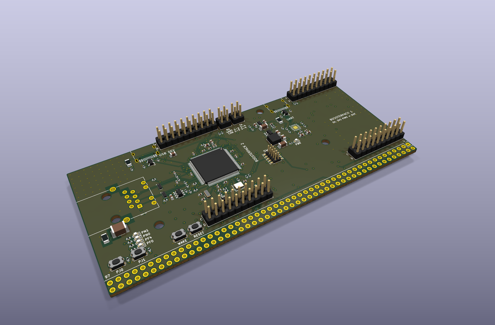
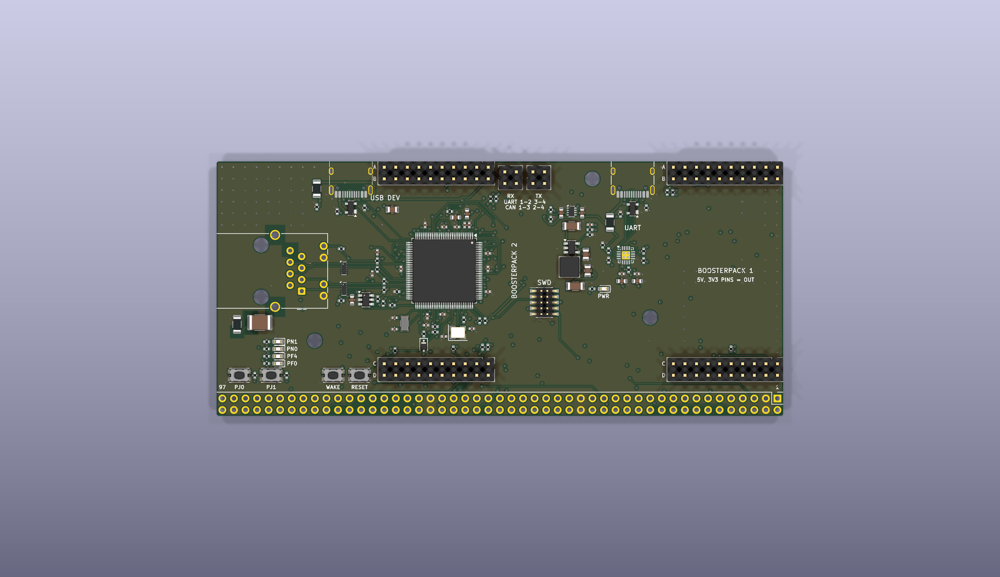
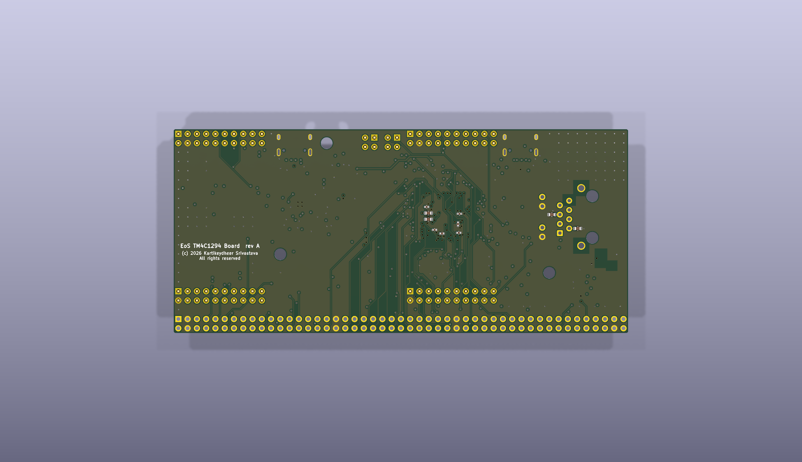

# EoS TM4C1294 Board

A development board for the TI TM4C1294NCPDT (Arm Cortex-M4F at 120 MHz, 1 MB flash, integrated
10/100 Ethernet MAC and PHY, USB 2.0, TQFP-128) with two BoosterPack-compatible (40-pin) sites, a
98-hole breakout row and an RJ45 Ethernet jack, 124.46 × 55.88 mm, six layers.
Designed by Kartikeydheer Srivastava. All rights reserved: not open source, and not under this repository's MIT licence.
Anyone may view it, clone this repository and run its tests; anything more needs
Kartikeydheer Srivastava's written permission (kartikeydheer@gmail.com). EmbeddedOS (EoS) Research Foundation has a limited, revocable
permission. See [LICENSE.txt](LICENSE.txt) and [the licence summary](../README.md#licence).

A board for the same job as TI's EK-TM4C1294XL; an original design, not a copy: no file of the
vendor's was used. "BoosterPack", "LaunchPad" and "EK-TM4C1294XL" name TI's products only to say
which modules fit and which form factor this follows (nominative use); this board is not a TI
product. No design file of the vendor's was used (no schematic, layout, CAD, Gerber or BOM, and
none of the user's guide's schematic appendix pages); the outline, header and breakout positions,
mounting holes and the signal on each header pin come from TI's EK-TM4C1294XL User's Guide,
SPMU365C: Table 1-1 (p. 6), Tables 2-1 to 2-4 (pp. 9–19) and the dimension drawing, Figure 4-1
(p. 26). Every circuit value comes from the chip makers' data sheets listed below.



| | |
|---|---|
|  |  |

## What is on it

| Block | What and why | Source |
|---|---|---|
| TM4C1294NCPDT (U1) | Turned 270° so its Ethernet pins (53–57) face the jack on the left edge; its oscillator and USB pins face down, JTAG at the bottom of its right side. | TI SPMS433B (data sheet) Tables 26-3, 26-5, Figure 25-1 |
| Supply decoupling | 0.1 µF at every VDD pin (pins 26/28 and 51/52 share one), each joined to its pin before routing; 10 µF bulk; VDDA 1 µF + 0.1 µF. Four of them sit on the bottom side under the chip, as the guide's 128-pin example places most of its capacitors: C4 (pin 39), C6 (pins 51/52, whose ground pad also takes ground pins 55 and 58 between the Ethernet pins), C46 (pin 90) and C27 (RST's 10 nF), each reached through a via inside the pad ring, so the pins' outer ends stay free for their neighbours. All 3.3 V pins sit on the inner 3.3 V plane, all grounds on the inner ground plane. | SPMA056 3.4.1, 3.4.3, 3.4.4, Table 7 |
| VDDC (core LDO) | 2.2 µF + 1 µF + 0.1 µF at pin 115 in the guide's order: the 2.2 µF (C19) nearest, then the 1 µF (C20) and the 0.1 µF (C21), all three on the bottom side under the chip beside pin 115's via, each ground pad with a via of its own to the ground plane (distances in Layout); 0.1 µF at pin 87 (C22, on the bottom side, through pin 87's via); 3.4 µF in all (3.06–3.74 µF at ±10 %, inside CLDO 2.5–4.0 µF); pins 87 and 115 joined through the bottom layer; nothing else on VDDC. | SPMS433B Table 27-15; SPMA056 3.4.2, Table 6 |
| ADC reference | VREFA+ from 3.3 V through a 0 Ω link (R43) with 1 µF + 10 nF to GNDA at the pin; also on breakout hole 34, where an external reference can come in once R43 is removed. | SPMA056 3.4.5; SPMS433B Table 26-7 |
| 25 MHz crystal (Y1) | NDK NX3225GA-25.000M-STD-CRG-2 (±20 ppm, ±30 ppm over −40…+85 °C, ESR ≤ 50 Ω, CL 8 pF, ≤ 200 µW), one of the crystals TI simulated: C1 = C2 = 12 pF, Rs = 2 kΩ, worst-case drive 181 µW. CL = 12 ∥ 12 + C0 1.1 + 0.5 + 0.5 = 8.1 pF. The PHY needs 25 MHz ±50 ppm; this crystal's tolerance and stability add to exactly ±50 ppm (see "What has not been done"). | SPMS433B Tables 27-23, 27-24, 27-50; SPMA056 3.6, 4.1.5; NDK NX3225GA |
| 32.768 kHz crystal (Y2) | Abracon ABS07-32.768KHZ-T (CL 12.5 pF, ESR ≤ 70 kΩ, C0 ≤ 2.0 pF, ≤ 0.5 µW). ESR above 50 kΩ needs OSCDRV = 1, which needs C1, C2 > 18 pF: 20 pF each. With the errata's corrected equation, CL = 10 + C0 + 0.5 + 0.5 = 12.2–13.0 pF. | SPMS433B Table 27-22; SPMZ850G ELEC#04; SPMA056 3.6.1.2; Abracon ABS07 |
| Hibernation | VBAT from 3.3 V through a BAT54J Schottky, then 51 Ω + 0.1 µF (rise under 0.7 V/µs; the diode also keeps VBAT under its 3.6 V maximum when VDD is at its 3.63 V maximum, as Table 27-29 note a asks). No coin cell, so hibernation is VDD3ON mode: VDD stays on. WAKE: 200 kΩ to VBAT's supply (Figure 7-2's value for a crystal; the guide's 4.15 suggests 1 MΩ) and a button through 470 Ω; also on breakout hole 95. | SPMS433B Figure 7-2, 7.3.3, Table 27-29; SPMZ850G ELEC#02; SPMA056 3.4.6, 4.15; Nexperia BAT54J |
| Ethernet supply in hibernation (U9) | The data sheet requires the supply of the four Ethernet termination resistors to be switched off before hibernating in VDD3ON mode. HIB (pin 65), which the chip asserts low in hibernation, drives the ON pin of a TI TPS22917 load switch; its output, ETH_VTERM, feeds the four 49.9 Ω resistors and the transformer's centre taps. The centre taps share the switched rail because their windings tie them to the same lines in DC (an inference: the data sheet names only the resistors). 100 Ω from the output to QOD discharges the rail (2.2 µF) through 250 Ω in all: 90 % to 10 % in about 1.2 ms, under 0.1 V in about 1.9 ms; 1 µF at the switch's input. | SPMS433B 7.3.9, the note under Figure 20-13, HIBCTL VDD3ON bit; TI SLVSDW8B Table 6-1, 9.3.3, section 11 |
| Reset | 10 kΩ pull-up, 10 nF at the pin (on the bottom side under the chip), button through 470 Ω. RST also reaches both sites' D.5, breakout hole 94 and the debug header. | SPMS433B Figure 5-3; SPMA056 3.5.1 |
| Ethernet | The MCU's PHY: each of EN0TXOP/TXON/RXIP/RXIN pulled to ETH_VTERM (the switched 3.3 V, see U9) by 49.9 Ω 1 % near the chip (see Layout), one end on the line, with 0.1 µF at each pair's resistors; RBIAS 4.87 kΩ 1 % beside pin 59 with its own ground via. Würth Elektronik 7499010121A (WE-RJ45LAN): RJ45 with 1:1 magnetics (common-mode chokes, centre taps, Bob Smith termination 4 × 75 Ω + 1000 pF/2 kV), shielded, tab up, two LEDs. Centre taps on ETH_VTERM, each with its own 1 µF on the bottom side beside its pin (1 µF because they are fed by a track, not a plane); shield and termination to chassis, chassis to ground through 1 MΩ ∥ 4.7 nF 2 kV. ESD: a TPD4EUSB30 per pair (5.5 V standoff, 0.8 pF) on the device side, the lines passing straight through its flow-through pads. The tab-up jack's pins run in the chip's order (RD−, RD+, TD−, TD+ against EN0RXIN, EN0RXIP, EN0TXON, EN0TXOP), so the pairs are MDI-wired with no crossing and no via. Jack LEDs from PF0 (EN0LED0) and PF4 (EN0LED1), sourcing current through 470 Ω (EMACCC.POL = 0, the reset value: active high). | SPMS433B 20.4.3, Figure 20-13, Table 27-49, EMACCC; SPMZ850G ETH#01, ETH#03; SPMA056 4.1, 4.1.2; Würth 7499010121A data sheet (version 003.001); TI SLVSAC2G |
| USB device (J7, USB-C) | USB0DP/USB0DM (PL6/PL7) through an SP0503BAHTG just below the connector, on the top layer with no via between the ESD part and the chip: the receptacle stands on the top edge above the jack, and the pair enters the chip's pad ring at its corner between pins 32 and 33 and runs under the chip's body to pins 93/94, so none of the chip's escapes has to cross it on the top layer; 5.1 kΩ Rd on CC1/CC2; 0.75 A polyfuse. VBUS to PB1 (USB0VBUS, the one 5 V-tolerant pin) through 100 Ω; a 10 kΩ bleed, so PB1 sees the host leave. Firmware forces device mode; host/OTG is not offered (see "Not on this board"). | SPMS433B 21.2 note, 27.14; SPMA056 4.3, 4.3.1; SPMZ850G GPIO#09; Littelfuse SP05xxBA; TI SLVSFJ9 10.3.14.2 |
| Debug (J9) | Arm Cortex Debug 10-pin, 1.27 mm, keyed (Samtec FTSH-105-01-L-DV-K): SWD/JTAG on PC0–PC3 and RST, VTref on 3.3 V. In place of TI's on-board in-circuit debug interface (ICDI), whose firmware is TI's: any CMSIS-DAP, J-Link or similar probe plugs in here. | SPMA056 3.7.1, Table 9 |
| USB-UART (J6, USB-C) | CP2102N-A02-GQFN20 on the board's 3.3 V with its own regulator unused, so it is powered whenever the MCU is and neither drives an unpowered chip; 4.7 µF + 0.1 µF on VREGIN and on VDD; 1 kΩ RSTb pull-up. VBUS sense: the 22.1 kΩ / 47.5 kΩ divider of the self-powered figure (5 V reads 3.41 V, above VIH 2.7 V) plus a 5.1 kΩ bleed, so with no host the pin stays under VIL = 0.6 V unless over 185 µA is pushed into the debug port's VBUS: its D+ pull-up comes on only with a host present. TXD/RXD reach UART0 (PA0/PA1) through 1 kΩ each and jumpers JP1/JP2. ESD: SP0503BAHTG. | Silicon Labs CP2102N Rev. 1.5, Figures 2.3, 2.5, 2.6, section 2.3, Tables 3.7, 3.10; SPMA056 4.6 |
| UART/CAN jumpers (JP1, JP2) | Two 2 × 2 headers, two shunts each. 1-2 + 3-4 (UART, the default): the bridge on UART0 (PA0/PA1), PD4/PD5 (UART2) on BoosterPack 2 A.5/A.6. 1-3 + 2-4 (CAN): PA0/PA1 (CAN0Rx/CAN0Tx) on BoosterPack 2 A.5/A.6 and the bridge on UART2. | SPMU365C 2.1.6.2, Table 2-2; SPMS433B Table 26-5 |
| Power | Each USB-C port has a Littelfuse 1206L075THYR polyfuse (0.75 A hold, 0.65 A at 40 °C). A TI TPS2116 power mux in priority mode takes the device port (VIN1) first and the debug port (VIN2) otherwise (27 kΩ / 10 kΩ on PR1: switch-over at 3.40–4.00 V); it blocks reverse current, so neither host feeds the other and no BoosterPack feeds a host. 3.3 V: TI TLV62569 buck (2 A, 1.5 MHz) with TI's standard filter, Coilcraft XAL4020-222ME and 10 µF out; 453 kΩ / 100 kΩ feedback for 3.318 V (3.25–3.38 V over VFB's range). Green power LED at 2.1 mA. | TI SLVSFG1A 7.3.4, 7.6.1; TI SLVSDG1C Tables 3, 4, Equation 2; Littelfuse 1206L; Coilcraft document 806-1; Kingbright DSAO7432 |
| User I/O | LEDs on PN1, PN0, PF4 and PF0 (2.1 mA each; PF0/PF4 are EN0LED0/EN0LED1, so they can also show the PHY's link and activity). Buttons on PJ0 and PJ1 to ground through 1 kΩ (they also reach the breakout); the internal pull-ups make a pressed button read under 0.28 V. | SPMS433B Tables 27-7, 27-34, 27-35 |
| Pull-ups | 2.2 kΩ on I2C0 (PB2/PB3, BoosterPack 1 A.9/A.10) and I2C2 (PN5/PN4, BoosterPack 2 A.9/A.10). 10 kΩ on the chip-select positions PH2 (BP1 D.3), PP5 (BP2 D.3) and PQ1 (BP2 D.9, SSI3Fss). | SPMA056 4.5, 4.7 |
| BoosterPack headers | Samtec SSW-110-23-F-D, female with long male leads (stackable). PQ2/PA3 and PQ3/PA2 share BoosterPack 2 D.6/D.7 through 0 Ω links R40/R41, so a site gets SPI MOSI/MISO and I2C SDA/SCL on the same pins; firmware keeps the unused one of each an input. | TI BoosterPack Pinout Standard (Sept 1, 2013) p. 2; SPMU365C 2.1.6.2 |
| Breakout (J5) | 98 holes, 2 × 49 on 2.54 mm, pads only (fit right-angle rows to plug the board into a breadboard). | SPMU365C 2.1.6.3, Tables 2-3, 2-4 |

### Header pin map

Each row lists pin 1 to pin 10 (SPMU365C Tables 2-1 and 2-2; rows A and D are the outer standard
rows, B and C the inner XL rows). On the board, part J1 holds BoosterPack 1's rows A and B, J2 its
rows C and D, J3 and J4 the same for BoosterPack 2, and J5 is the breakout, hole n = pin n.

| Row | Pins 1 to 10 |
|---|---|
| BP1 A | 3V3, PE4, PC4, PC5, PC6, PE5, PD3, PC7, PB2, PB3 |
| BP1 B | 5V, GND, PE0, PE1, PE2, PE3, PD7, PA6, PM4, PM5 |
| BP1 C | PF1, PF2, PF3, PG0, PL4, PL5, PL0, PL1, PL2, PL3 |
| BP1 D | GND, PM3, PH2, PH3, RST, PD1, PD0, PN2, PN3, PP2 |
| BP2 A | 3V3, PD2, PP0, PP1, PD4 (or PA0, see JP1), PD5 (or PA1, see JP2), PQ0, PP4, PN5, PN4 |
| BP2 B | 5V, GND, PB4, PB5, PK0, PK1, PK2, PK3, PA4, PA5 |
| BP2 C | PG1, PK4, PK5, PM0, PM1, PM2, PH0, PH1, PK6, PK7 |
| BP2 D | GND, PM7, PP5, PA7, RST, PQ2 + PA3, PQ3 + PA2, PP3, PQ1, PM6 |

The breakout follows SPMU365C Tables 2-3 and 2-4 hole for hole, with two exceptions: hole 58
carries PB0 through 1 kΩ, and hole 60 (PB1) is not connected, since PB1 senses the device port's
VBUS here. Errata GPIO#09 says PB0 and PB1 can draw a high current after an edge faster than 2 ns;
its workaround for an unused PB0 is 1 kΩ to ground. Here PB0 stays usable on hole 58, and the
1 kΩ in series slows any edge driven into the hole; by how much depends on the pin's capacitance,
which the data sheet does not give. This is the board's own measure, not one the errata lists.
When hole 58 is unused, keep PB0 an input with its pull-down on.

### Notes for firmware

- **Clocks:** the PHY needs MOSC at 25 MHz; set OSCDRV in HIBCTL for the 32.768 kHz crystal (20 pF
  load capacitors).
- **Hibernation:** use VDD3ON mode (set VDD3ON and RETCLR in HIBCTL); VDD stays on. HIB then turns
  the Ethernet termination supply off by itself, as SPMS433B 7.3.9 requires. Before hibernating,
  turn on the pull-ups of PK4–PK7 (GPIOPUR) unless they are wake sources: SPMS433B 7.3.9 says they
  "should not be left floating" in VDD3ON mode, and here they reach only BoosterPack 2 and the
  breakout, so they float with nothing plugged in.
- **PF0 and PF4** each light a jack LED (3.2 mA) and a user LED (2.1 mA): give them the 8 mA drive
  (GPIODR8R).
- **USB:** force device mode (USBGPCS DEVMOD) and watch VBUS on PB1 (USB0VBUS); the board can be
  powered from the debug port while the device port is unplugged, so it is a self-powered device
  and must drop its D+ pull-up when VBUS goes.
- **Ethernet:** Auto-MDIX is on at reset and is not needed for the jack's wiring (MDI). Keep
  EMACCC.POL at 0 (LEDs active high). Errata ETH#02: turn the flash prefetch off around Ethernet
  initialization.
- **PD7** is NMI-capable and locked at reset: unlock it (GPIOLOCK, GPIOCR) before use.
- **PA0/PA1 with JP1/JP2 on CAN, PD4/PD5 with them on UART:** check the jumpers before driving these
  pins. On BoosterPack 2 D.6/D.7, keep the unused one of PQ2/PA3 and PQ3/PA2 an input.
- **Power pins are outputs.** The 3.3 V pins (BP A.1, breakout 1 and 98) carry the board's 3.3 V;
  the 5 V pins (BP B.1, breakout 2 and 97) carry the selected USB port's 5 V less a fuse and the
  mux. Do not feed either while a USB port is connected.
- **Shared current budget:** the BoosterPacks and the breakout together may take
  I(5 V pins) + 0.75 × I(3.3 V pins) ≤ 300 mA, so that one 500 mA USB port supplies the whole board.
  The board itself takes about 217 mA of 3.3 V: the MCU 133.4 mA (SPMS433B Table 27-63, Run mode at
  120 MHz with every peripheral, the MAC and the PHY on, 85 °C maximum) plus 3.0 mA IDDA, the PHY's
  line drivers about 50 mA (an estimate), the CP2102N 13.7 mA and the LEDs 16.9 mA; about 0.17 A from
  a 4.75 V host through the buck (90 %, an estimate), so about 0.47 A in all.

## Not on this board

- **TI's in-circuit debug interface (ICDI).** Its firmware is TI's, so it is replaced by the
  standard Cortex 10-pin SWD/JTAG header (J9) and a separate USB-UART bridge (CP2102N, J6).
- **USB host / OTG.** The device port is a USB-C sink only (Rd on both CC pins). Host or dual-role
  operation on USB-C needs configuration-channel logic (for example TI TUSB320), a switched VBUS
  (for example TI TPS2553) and switching of the bulk capacitance between roles; that block was left
  out to keep the port simple and standard. PB0 (USB0ID) becomes a free GPIO on the breakout.
- **Micro-USB connectors:** both ports are USB-C.
- **A backup battery.** VBAT comes from 3.3 V through a diode, so the RTC and battery-backed memory
  last only while USB power is present (VDD3ON mode).
- **A current limiter on the BoosterPack 5 V pins.** The 5 V pins are protected by the input fuses
  only, and share the 300 mA budget above.
- **ESD parts on the BoosterPack and breakout lines:** they are board-to-board connections.
- Nothing else of TI's board was looked at beyond the SPMU365C pages named above, so this list
  covers only what those pages show.

## Layout

Numbers measured on the routed board (`hardware/eos-tm4c1294-board.kicad_pcb`), centre-line copper:

- **Ethernet pairs.** Both pairs run on the top layer, over the inner 1 ground plane, with no via,
  from the chip through the termination resistors and the ESD parts' flow-through pads to the jack.
  Each net's track in all: EN0RXIN 28.17 mm and EN0RXIP 28.25 mm (0.08 mm apart in length), EN0TXON
  24.30 mm and EN0TXOP 24.28 mm (0.02 mm), against SPMA056 4.1.8's 1.27 mm. These totals count every
  piece of a net's track, up to the centres of the jack's pads; measured from track end to track end
  instead, the transmit lines differ by a few tenths of a millimetre (the independent review's method
  gave 0.41 mm on an earlier routing), still under 1.27 mm. The lines of a pair are 0.20–0.25 mm apart
  (edge to edge) where they run together, within 0.6 mm of each other for 17.6 of 28.2 mm (receive) and
  10.0 of 24.3 mm (transmit); they part round the termination resistors, the ESD parts' pads and the
  jack's pins.
- **Between the pairs.** EN0RXIP and EN0TXON leave pins 54 and 56, 0.8 mm apart, and stay 0.65 mm apart
  (edge to edge) for their first 4–5 mm, until the receive pair turns up towards U6; from there to the
  jack they are at least 1.8 mm apart, and 1.2 mm at the jack's pins. EN0RXIP lies within SPMA056's
  1.27 mm of a transmit line for 5.6 mm in all.
- **Other copper near the pairs.** PF4 (EN0LED1 and a user LED) runs 0.36 mm (edge to edge) from EN0RXIN
  for 6.4 mm on the top layer; the jack's own green-LED pad (pin 10) sits 0.20 mm from both transmit
  lines where they pass between its pins; the nearest other-net vias are PN2's, 0.16 mm from EN0TXOP,
  and two of ETH_VTERM's, 0.20 mm. PF0, the jack's LED lines and PJ0 stay 1.2 mm or more from the pairs.
- **Termination and RBIAS.** Each pair's two 49.9 Ω resistors sit side by side: EN0RXIN → R7 8.48 mm and
  EN0RXIP → R8 8.29 mm of track (0.19 mm apart), EN0TXON → R9 5.40 mm and EN0TXOP → R10 5.67 mm (0.27 mm
  apart); 7.8, 7.7, 5.5 and 5.5 mm pad centre to pin centre. RBIAS's R11 is 2.26 mm from pin 59 (2.44 mm
  of track; the guide asks for under 6 mm), and its ground end has a via of its own.
- **Centre taps.** Each tap reaches its own 1 µF on the bottom layer with no via: J8.2 → C29 1.55 mm,
  J8.5 → C30 1.45 mm of track; their ground pads are 0.97 and 1.58 mm (centre to centre) from a ground via.
- **Crystals.** All four oscillator lines are on the top layer with no via: OSC0 8.74 mm of copper (pin,
  crystal pad and load capacitor), OSC1 3.05 mm to Rs and 3.01 mm on from Rs, XOSC0 6.25 mm, XOSC1
  8.30 mm (SPMA056 3.6.2: ideally under 6 mm, never over 18 mm). No other net's via is inside a
  crystal's or load capacitor's courtyard, and no other net's track is on the bottom layer there (the
  router keep-outs); on the top layer the only other-net copper there is PL3's track, which clips a
  corner of C23's courtyard by 0.04 mm. Inner layers 2 and 3 carry 7 nets under Y1 and 7 under Y2, all
  below the inner 1 ground plane (99.9–100 % ground under each crystal). The nearest other-net copper
  to a crystal line on the top layer is VBAT, 0.17 mm from XOSC1 beside their neighbouring pins (67, 68),
  and PL5, 0.39 mm from OSC0 where it leaves pin 86 beside pin 88; the nearest other-net vias are PL5's
  and PB2's (merged with PB3's), 0.16–0.17 mm from the 25 MHz lines, so 0.2–0.3 mm of those lines has no ground plane
  directly below (the vias' clearance holes in inner 1).
- **HIB and the termination supply.** HIB runs 12.79 mm on the top layer, with no via, from pin 65 to
  U9's ON pin. ETH_VTERM, 0.3 mm wide, is 47.1 mm of copper on the top, bottom and inner 2/3 layers with
  3 vias, from U9 to the four resistors and the transformer's centre taps.
- **USB pairs.** Device port: D− 42.21 mm and D+ 40.78 mm (1.42 mm apart, against 3.81 mm in SPMA056 4.3);
  the ESD part's pads are 2.36 mm of track from the receptacle's contacts; between the ESD part and the
  chip both lines are on the top layer with no via; D− takes two vias and 1.3 mm of bottom-layer track
  only where the receptacle's B7 contact joins A7. The lines run under the chip's body to pins 93/94.
  Debug port: D− 18.99 mm and D+ 19.22 mm, its ESD part 2.51 mm from the receptacle, with the same
  B7-to-A7 join.
- **Debug lines.** SWCLK 23.9 mm, SWDIO 22.6 mm, TDI 19.7 mm, SWO 20.3 mm, each with two vias; SWCLK
  runs mostly on the top layer (16.4 mm), the others mostly on inner layer 3 (SPMA056 3.7.1:
  external pull-ups needed only beyond 2 in, 51 mm).
- **Reset.** RST is 152.9 mm of track with 4 vias, from pin 70 to both sites' D.5, breakout hole 94 and
  J9; its 10 nF (C27) is 3.71 mm of track from the pin.
- **VDDC.** Pin 115 drops through a via inside the pad ring to the bottom side: 2.20 mm of track to the
  2.2 µF (C19), 3.91 mm to the 1 µF (C20) and 3.71 mm to the 0.1 µF (C21) (2.19, 2.77 and 2.61 mm pad
  centre to pin centre). C19's ground pad has its own via 0.98 mm from the pad's centre (0.50 mm from its
  edge), C21's 0.81 mm, C20's 1.58 mm. Pin 87 reaches its 0.1 µF (C22) in 4.51 mm and C20 in 8.15 mm. In
  all VDDC is 16.5 mm of 0.15 mm copper (13.4 mm bottom, 3.1 mm top) with three vias. SPMA056's Table 6
  example uses 0.254 mm; this net enters 0.4 mm-pitch pads, so it stays at 0.15 mm.
- **Back-side capacitors.** C4 (pin 39), C6 (pins 51/52), C22 (pin 87), C27 (pin 70) and C46 (pin 90)
  are 3.4–5.3 mm (pad centre to pin centre) from their pins, each through one via inside the pad ring;
  C6's ground pad is 4.3 mm from GND pin 55, which pin 58 joins.
- **5 V paths.** All 0.3 mm (the mux's and the CP2102N's supply class). The device port's VTGT runs
  67.8 mm from F2 to the mux's VIN1 (31.7 mm on inner 3, 22.1 mm on the bottom, 4 vias); the debug
  port's VDBG 9.1 mm on the top layer. +5V runs from the mux to BoosterPack 1's B.1 in 70.3 mm (mostly
  inner 2 and 3), to BoosterPack 2's B.1 in 26.1 mm, to breakout hole 2 in 96.5 mm and to the buck in
  14.5 mm. At 1 oz (35 µm) a 0.3 mm track is about 1.6 mΩ/mm: VTGT 0.11 Ω, +5V to the farthest 5 V pin
  0.16 Ω. With the whole 0.47 A budget drawn from a 4.75 V host and 0.3 A of it at the farthest 5 V pin,
  the fuse and mux (0.16 V) and these tracks (about 0.1 V) leave about 4.5 V there; at 0.5 oz inner
  copper the track drop doubles, which is why the Fabrication section asks for 1 oz.
- **Vias.** 476 in all, 0.6 mm with a 0.3 mm drill. The only vias in a surface pad are the four in the
  CP2102N's exposed (ground) pad, which the generator puts there on purpose and the repository's
  ViaInPadTest allows.

## Build results

The numbers below are from `build-report.json` and `drc.json` in this folder.

| Check | Result |
|---|---|
| Schematic ERC | 0 violations |
| DRC errors | 0 |
| Unconnected items | 0 |
| Schematic ↔ board parity | 0 differences |
| DRC warnings | 19: silkscreen within the board-edge clearance, the outline of J1 (BoosterPack 1 A/B), J2 (BoosterPack 1 C/D), J3 (BoosterPack 2 A/B), J5 (Breakout 2x49), J6 (USB-C), J7 (USB-C) and J8 (7499010121A), which sit at the board edge |

## Fabrication

6 layers, 1.6 mm thick: top signal, inner 1 ground, inner 2 and inner 3 signal, inner 4 3.3 V,
bottom signal; ground also poured on both outer layers. This is the six-layer stack of TI's guide
(SPMA056 3.2.2.1, Figure 6), which allows more than four layers "for high density designs". The
guide recommends four layers for most designs, for "a solid ground plane reference for USB and
Ethernet signals that have a specific impedance target" and low-impedance supply planes (3.2.1);
six keep both planes and add two routing layers. Here 90 GPIOs leave a 0.4 mm-pitch TQFP-128 for
two BoosterPack sites and a 98-hole breakout, most of them to two places: with only the two outer
layers for signals, the generator's autorouter still left 54-69 connections open after 12-24 passes,
and one four-layer build ran out of the build's one-hour routing limit. Six layers cost more to make
than four. On two layers a 100 Ω pair needs
30 mil lines 7 mil apart (the guide's Table 4), and a TQFP-128 at 0.4 mm pitch has no room for that.

**Stack-up and impedance: the board files do not carry the stack-up to build.** The generator sets
only the copper layer count and the board thickness (`pcb_build.py`, `rules()`); it writes no
stack-up, so the `.kicad_pcb` and the job file (`fab/gerbers/eos-tm4c1294-board-job.gbrjob`) declare
KiCad's default six-layer stack-up: five FR4 dielectrics of 0.274 mm and 35 µm copper. With 0.274 mm
under the top layer the pairs would come out about 50 % high. Order this stack-up instead, 1.6 mm in
all, with controlled impedance:

| Layer | Use | Copper | Dielectric below it |
|---|---|---|---|
| F.Cu | signals, Ethernet and USB pairs, ground pour | 35 µm (1 oz) finished | prepreg about 0.10 mm, εr about 4.1 (e.g. one 3313 ply) |
| In1.Cu | ground plane | 35 µm | core, thickness to suit |
| In2.Cu | signals, 5 V tracks | 35 µm | prepreg, to suit |
| In3.Cu | signals, 5 V tracks | 35 µm | core, thickness to suit |
| In4.Cu | 3.3 V plane | 35 µm | prepreg about 0.10 mm, εr about 4.1 |
| B.Cu | signals, ground pour, ten back-side capacitors | 35 µm finished | — |

Ask the fab to hold the Ethernet pairs (ETH_RXN/RXP, ETH_TXN/TXP: 0.15 mm lines, 0.25 mm apart) at
100 Ω ± 10 % differential and the USB pairs (0.15 mm and 0.13 mm lines, 0.20 mm apart) at 90 Ω,
adjusting the top prepreg (or the gap) to suit their process. Inner copper must be 1 oz (35 µm), not
the 0.5 oz many six-layer stacks use: the 5 V tracks are 0.3 mm wide (see Layout). The pairs are 0.15 mm lines, the widest that enters the
TQFP-128's 0.25 mm pads at 0.4 mm pitch, except the device USB pair: 0.13 mm, so that both its
lines pass the chip's corner between pins 32 and 33 (0.89 mm between the two pads' corners). On the
routed board a pair's lines are 0.25 mm apart (Ethernet) and 0.20 mm apart (USB) where they run
together. A 2D field solve (0.035 mm copper,
0.09–0.11 mm prepreg, εr 4.1) gives 92–104 Ω differential for the 0.15 mm pairs uncoated and
84–96 Ω under 15 µm of solder mask (εr 3.8); for the 0.13 mm device pair, 99–111 Ω uncoated and
89–101 Ω under the mask. The same solver reads TI's own Table 4 examples about 5 % high. Under the
mask the Ethernet pairs can come out below 100 Ω − 10 %, so the fab must set the prepreg (or the
gap) for 100 Ω. The USB pairs are full speed (12 Mb/s): their few centimetres of line are short
against its 4–20 ns edges, and the computed range lies in or near the USB 2.0 specification's
90 Ω ± 15 %.

Design rules: 0.15 mm clearance; 0.15 mm tracks (every net that enters the TQFP-128), 0.13 mm on
the device USB pair, 0.3 mm on the TPS2116's and CP2102N's supply nets and on ETH_VTERM, 0.4 mm on
VBUS and the buck's switch node; vias 0.6 mm with a 0.3 mm drill, which is the smallest drill.

**Assembly is two-sided.** Ten capacitors sit on the bottom side: eight under the TQFP-128 (0402: C4,
C6, C21, C22, C27, C46; 0603: C19, C20) and the two centre-tap capacitors beside the jack's pins (0603:
C29, C30); every other part is on the top side. C29's and C30's pads are 0.19–0.33 mm (edge to edge)
from the jack's through-hole pads J8.2 and J8.5 on the bottom side, so the jack is soldered by hand or
selectively, not by wave. Corners are
rounded to 0.5 mm: BoosterPack 1's pin 1 sits 0.05 in from both edges of its corner.

Both USB-C receptacles (HRO TYPE-C-31-M-12) sit where HRO's recommended layout puts them: their
origin 3.19 mm from the top edge, so the shell stands about 0.46 mm proud of the edge. The jack's
face stands 1.0 mm proud of the left edge.

## What has not been done

- **No board has been made or tested,** and no firmware is included.
- **The TM4C1294NCPDT symbol is new.** KiCad 10 has no TM4C129x symbol, so U1 uses
  EoS_MCU:TM4C1294NCPDT, drawn from SPMS433B Table 26-5 (the 90 GPIOs) and Table 26-3 (the fixed
  pins) and checked against Figure 25-1; its check confirms pins 1–128 appear once each. The 98-hole
  breakout uses a new generic footprint (EoS_Packages:PinHeader_2x49_P2.54mm_Vertical), drawn as
  KiCad's own generated 2 × 40 header.
- **Crystal tolerance.** NX3225GA-25.000M-STD-CRG-2's ±20 ppm tolerance and ±30 ppm stability add
  to the PHY's ±50 ppm limit with nothing left for ageing; TI simulated and lists this crystal for
  the PHY, but a tighter crystal would add margin. The crystals' real load (board strays) is not
  measured.
- **Not verified:** the pairs' real impedance (fab-dependent, see the stack-up note); the
  22 µF capacitors' effective value at 5 V (DC bias); the LED currents (forward voltages are given
  only at 20 mA); the buck's efficiency and the 3.3 V current, which are estimates; a 3D check of a
  plug in each receptacle and of a BoosterPack stack over the parts; distributor stock of every part.
- **J9's land pattern.** J9 uses KiCad's generic `PinHeader_2x05_P1.27mm_Vertical_SMD` (2.40 × 0.74 mm
  pads, 3.90 mm between the rows' centres), smaller than the land pattern on Samtec's FTSH-1xx-xx-xxx-DV
  footprint drawing (2.79 × 0.74 mm, 4.07 mm, as the independent review read it). KiCad ships no FTSH
  footprint; drawing one is a change to the generic footprint library, not to this board, and was
  left for approval. EoS RA4M2 Board uses the same footprint for the same part.
- **Part lifecycle.** Every Murata capacitor was checked on Murata's own product database on
  21 October 2026 and is "In Production"; six earlier choices marked "To be discontinued" and one
  "NRND" were replaced. The CP2102N-A02-GQFN20R's status was not confirmed from Silicon Labs
  (distributors disagree); KEMET C1812C472KGRACTU, HRO TYPE-C-31-M-12 and the Samtec headers were
  not checked.
- **HIB's high level.** SPMS433B gives no output levels for HIB; the TPS22917 needs only 1 V on ON
  (SLVSDW8B section 7.3), so any logic high from the hibernation domain (about 3.1 V on this board)
  turns it on. Not measured.
- **The pairs near the chip.** The receive and transmit pairs run 0.65 mm apart for their first 4–5 mm
  (the pins are 0.8 mm apart), and the termination resistors sit 5.4–8.5 mm of track from the pins; both
  are measured, neither is tested on a board (see Layout).
- **Copper the layout could not keep away.** The generator lets the router choose each net's layer and
  holds pours off only on the outer layers, so these stay as measured (see Layout): PF4, a LED line that
  switches with link activity, runs 0.36 mm from EN0RXIN for 6.4 mm on the top layer; PL5 runs 0.39 mm
  from OSC0 beside pins 86-88, and a PL5 via sits 0.16 mm from it (a top-layer keep-out strip that held PL5
  0.6 mm away narrowed the one way out of the PL pins and left PL2 unrouted in two of five builds, so it was
  taken out); the outer pours are held off the chassis copper, but the inner ground planes run under the
  whole jack, so chassis copper is 0.25 mm from ground on inner 1, and on the outer layers its pads are
  0.66–1.14 mm from ground copper, its track 0.52 mm and a chassis via beside C31 0.29 mm: a strike on
  the shield can arc across those gaps to ground, around the 1 MΩ ∥ 4.7 nF of SPMS433B Figure 20-13;
  and the buck's input capacitor (C40) and the CP2102N's
  100 nF on VREGIN (C33) close their ground return through the inner plane, as the TLV62569's pins
  (VIN and GND on opposite sides of the SOT-23-5) and the CP2102N's (VREGIN between VDD and VBUS)
  allow. A trial top-layer join from C40 to the buck's GND pin came out 5.4 mm of 0.15 mm track, worse
  than the plane path, and was not kept.
- **RST is shared with the headers.** As the BoosterPack standard asks, RST reaches both sites' D.5,
  the breakout and the debug header, 152.9 mm in all, with no buffer: SPMA056 3.5.1 recommends one when
  the reset comes from another board, but a buffer would stop a BoosterPack from resetting the MCU.
- **Jumper shunts are not BOM lines.** The four shunts JP1 and JP2 need (Samtec SNT-100-BK-G) are named
  in the two headers' BOM descriptions; the generator makes a BOM line only from a part placed on the
  board.
- **Two-sided assembly** (ten capacitors on the bottom) is not costed with a fab.
- **USB attach, enumeration and suspend current are not qualified.** The CP2102N's factory
  maximum-power descriptor is 100 mA; the board's budget assumes a 500 mA port.

## Sources

Only chip and part documentation and published form-factor facts were used.

| Source | Used for |
|---|---|
| [TI SPMS433B](https://www.ti.com/lit/ds/symlink/tm4c1294ncpdt.pdf) | MCU pins, supplies, oscillators, hibernation, reset, Ethernet PHY, USB, GPIO characteristics |
| [TI SPMA056](https://www.ti.com/lit/an/spma056/spma056.pdf) | TM4C129x board design guidance: stack-up, decoupling, VDDC, crystals, JTAG, Ethernet, USB |
| [TI SPMZ850G](https://www.ti.com/lit/er/spmz850g/spmz850g.pdf) | Silicon errata (ELEC#02, ELEC#04, ETH#01, ETH#02, ETH#03, GPIO#09) |
| [TI SPMU365C](https://www.ti.com/lit/ug/spmu365c/spmu365c.pdf), pp. 6, 9–19 and 26 only | Outline, header and breakout positions, mounting holes, header signal tables; no schematic, layout or BOM page used |
| [Silicon Labs CP2102N Rev. 1.5](https://www.silabs.com/documents/public/data-sheets/cp2102n-datasheet.pdf) | USB-UART bridge |
| [TI SLVSFG1A (TPS2116)](https://www.ti.com/lit/ds/symlink/tps2116.pdf) | 5 V power mux |
| [TI SLVSDG1C (TLV62569)](https://www.ti.com/lit/ds/symlink/tlv62569.pdf) | 3.3 V buck and its filter |
| [Coilcraft XAL4000 (document 806-1)](https://www.coilcraft.com/getmedia/6adcb47d-8b55-416c-976e-1e22e0d2848c/xal4000.pdf) | Inductor ratings |
| [Würth Elektronik 7499010121A](https://www.we-online.com/components/products/datasheet/7499010121A.pdf) (read from the Web Archive copy of 2025-11-08; the live site refused the download) | RJ45 with magnetics: pinout, schematic, LEDs, hole pattern |
| [TI SLVSAC2G (TPD4EUSB30)](https://www.ti.com/lit/ds/symlink/tpd4eusb30.pdf) | Ethernet ESD |
| [TI SLVSDW8B (TPS22917)](https://www.ti.com/lit/ds/symlink/tps22917.pdf) | Load switch for the Ethernet termination supply |
| [Littelfuse SP05xxBA](https://www.littelfuse.com/~/media/electronics/datasheets/tvs_diode_arrays/littelfuse_tvs_diode_array_sp05_datasheet.pdf.pdf) | USB ESD |
| [Littelfuse 1206L](https://www.littelfuse.com/~/media/electronics/datasheets/resettable_ptcs/littelfuse_ptc_1206l_datasheet.pdf.pdf) | Polyfuses |
| [NDK NX3225GA](https://www.ndk.com/images/products/catalog/c_NX3225GA_e.pdf) | 25 MHz crystal |
| [Abracon ABS07](https://abracon.com/Resonators/ABS07.pdf) | 32.768 kHz crystal |
| [TI SLVSFJ9 (TPS25854-Q1/TPS25855-Q1)](https://www.ti.com/lit/ds/symlink/tps25855-q1.pdf) | 10.3.14.2: a sink exposes Rd (5.1 kΩ) on CC1 and CC2 |
| [Kingbright APTD1608LCGCK](https://www.kingbrightusa.com/images/catalog/SPEC/APTD1608LCGCK.pdf) | LED forward voltage |
| [Nexperia BAT54J](https://assets.nexperia.com/documents/data-sheet/BAT54J.pdf) | VBAT diode |

## Rebuild

```
python3 tools/eos_boards/build.py eos_tm4c1294_board
```

The design file is [tools/eos_boards/boards/eos_tm4c1294_board.py](../../../tools/eos_boards/boards/eos_tm4c1294_board.py).
